# Browser extension

Klav's extension fills logins, cards and addresses, offers to save what you
type, generates passwords and lets an agent fill the tab you are looking
at. It keeps no key and no value: it asks `klavd` for everything at the
moment it needs it. The decision is in
[ADR 0017](decisiones/0017-extension-de-navegador.md).

## 1. Architecture

```
 web page ───┐
             │  content script (isolated world): detects forms and writes
             │  only what the person chose, in the frame that asked for it
             ▼
 background (service worker in Chromium, event page in Firefox) + klav-wasm
             │  native messaging port (4-byte length + JSON)
             ▼
 klav-native-host ── checks who is calling and which operation it asks for
             │  Unix socket ($KLAV_HOME/klavd.sock, same UID)
             ▼
 klavd ── unlocked account, Touch ID, sync, site rule
```

- **`klavd`** holds the account, decides whether a login matches the page and
  computes the TOTP codes.
- **`klav-native-host`** is a small bridge: the browser starts it when it
  opens the port and kills it when it closes it. If `klavd` isn't running, it starts it.
- **The *background*** is the only part that talks to the *host*. It keeps the
  state (locked or not) in memory and nothing else.
- **The *content script*** receives nothing from the vault until the person
  picks what to fill, and then only that item's values.

## 2. Installing the *host*

> The steps for people who use Klav are on the public page [`install.mdx`](../apps/docs/src/content/docs/get-started/install.mdx) (in `apps/docs/src/content/docs/get-started/`); a change to those steps goes there first.

```sh
klav extension install-host --dev                      # navegadores instalados, con la extensión de desarrollo
klav extension install-host --browser dia --dev        # solo Dia
klav extension install-host --user-data-dir DIR --dev  # un perfil desechable de Chromium
klav extension install-host --extension-id ID          # la de la tienda (cuando exista), sin --dev
```

`--dev` allows Chromium's development ID (below). Its public key
is in the repository (`apps/extension/static/dev-key.txt`), so
any extension loaded unpacked can take that ID: it is allowed only
when asked for (layer 09). Without `--dev` or a Chromium `--extension-id`,
the Chromium browsers it finds are skipped with a warning, and the
ones named (`--browser chrome`, `--user-data-dir`) are an error.
Firefox doesn't need it: addons.mozilla.org guarantees its ID.

It writes:

- `$KLAV_HOME/native-host/klav-native-host` (0700): a *wrapper* that calls
  the binary with `--home $KLAV_HOME` and the allowed extensions. The
  browser passes no environment variables, so without it the host wouldn't know which
  `KLAV_HOME` to use.
- `dev.klav.host.json` in each browser's *hosts* directory:

| Browser | macOS (`~/Library/Application Support/…`) | Linux |
|---|---|---|
| Chrome | `Google/Chrome/NativeMessagingHosts` | `~/.config/google-chrome/NativeMessagingHosts` |
| Chromium | `Chromium/NativeMessagingHosts` | `~/.config/chromium/NativeMessagingHosts` |
| Brave | `BraveSoftware/Brave-Browser/NativeMessagingHosts` | `~/.config/BraveSoftware/Brave-Browser/NativeMessagingHosts` |
| Arc | `Arc/User Data/NativeMessagingHosts` | — |
| Edge | `Microsoft Edge/NativeMessagingHosts` | `~/.config/microsoft-edge/NativeMessagingHosts` |
| Dia | `Mozilla/NativeMessagingHosts` (Firefox format) and `Dia/User Data/NativeMessagingHosts` | — |
| Firefox | `Mozilla/NativeMessagingHosts` | `~/.mozilla/native-messaging-hosts` |

Dia is Chromium with its data directory in `Dia/User Data`, but it takes the *host*
from the **Mozilla** directory, in Firefox's format (`allowed_extensions`), and ignores
the one in `Dia/User Data`. We checked this in November 2026 with a test *host* in each
directory: only the Mozilla one ran. That is why `--browser dia` writes both. The Mozilla
one is the same file Firefox reads, so `uninstall-host --browser dia` leaves
it, unless you also remove `firefox`. Dia doesn't check the manifest's list of
extensions; `klav-native-host` does check who calls it (§3, "Who can call").

If the extension in Dia shows another account, check which `klav-native-host --home …`
Dia started (`ps`) and the Mozilla manifest: a stale manifest there wins.

If the manifest lets the extension through but the *wrapper* doesn't allow it,
the *host* rejects it (§3, "Who can call"). That happens, for example, to
a *wrapper* written before the development extension needed `--dev`.
`klav extension host-status` compares each manifest with the *host* it
runs: if the *host* would reject an extension the manifest allows,
that manifest comes out with `current: false`, the list in `refused` and the
command in `reason` ([cli.md](cli.md) §8). In Dia, the row that shows it
is the `Dia/User Data` one: the Mozilla one only names the Firefox
add-on.
With `--user-data-dir`, Chromium looks for the *hosts* inside that profile: the
tests use throwaway profiles and never touch the user's.

### Allowed IDs

| Browser | ID | Origin |
|---|---|---|
| Chromium (development) | `niiplppgdljgimbnmokojdkofdcjkgao` | set by the manifest's public key (`key`); the private one was thrown away. Only with `install-host --dev` |
| Firefox | `klav@klav.dev` | `browser_specific_settings.gecko.id` |
| Chromium (Chrome Web Store) | `aoabckikmlcaffgipfcaoeccgclbpbph` | assigned by the Chrome Web Store; it is in `STORE_CHROMIUM_IDS` (`crates/klav-daemon/src/native.rs`) and enters the manifest and the *host* without further options ([publicar-extension.md](publicar-extension.md) §6) |
| Chromium (Edge Add-ons) | pending | the one Edge Add-ons assigns; it goes in `STORE_CHROMIUM_IDS` too. Meanwhile, `--extension-id` |

## 3. Extension ↔ *host* protocol, version 1

Native messaging: each message is a 32-bit integer in the machine's byte
order with the length, followed by UTF-8 JSON.

- **Extension → *host*:** the same envelope as the `klavd` socket
  ([`klavd.md`](klavd.md) §3): `{"v":1,"id":N,"request":{"op":…}}`. At
  most 1 MiB.
- ***Host* → extension:** `klavd`'s response, as is: `{"v":1,"id":N,"ok":…}`
  or `{"v":1,"id":N,"error":{"code","message"}}`. At most 1 MiB (Chromium's
  limit); a larger response is replaced by an `invalid` error with the
  same `id`.
- Responses arrive in the order of the requests. An `id` is a number
  the extension picks (`0` only in errors for an unreadable line).
- Of the envelope's extra fields ([`klavd.md`](klavd.md) §3), the *host*
  passes `shown` (a password unlock's window, §8, "The presence gate") and
  drops `notify`: a notice line has no `ok` or `error`, and the extension,
  which has no terminal name to print, would take it for an answer. It
  never adds `hold` (the *host* refuses it) or `untyped`: the person
  types the password into Klav's own page.

### Who can call

1. The browser only lets the manifest's extensions connect
   (`allowed_origins` in Chromium, `allowed_extensions` in Firefox).
2. The *host* checks again the origin the browser passes it:
   `chrome-extension://<id>/` in `argv[1]` (Chromium) or the ID in `argv[2]`
   (Firefox), against the `--allow`s of its *wrapper* and Firefox. If it isn't an
   allowed ID, it writes that to stderr, reads a single message (with the
   1 MiB limit) and answers it with the `extension_not_allowed` error, whose message
   only says what to run: `klav extension install-host --dev` for the
   development extension and `--extension-id <id>` for another. Then it exits. It doesn't start
   `klavd`, doesn't connect to it and reads only the `id` from the request. Without that
   response, the browser would only see that the port closed. The extension
   treats it as a missing *host* (`host_missing`): the *popup* and the
   import page say which command to run.
3. `klavd` checks the peer's UID on its socket (T32).

### Allowed operations

The *host* only lets these `klavd` operations through; the others answer
`denied` without reaching the daemon:

| `op` | What for |
|---|---|
| `status`, `unlock`, `lock`, `sync` | State and unlocking (Touch ID, or `password`) |
| `vaults`, `projects`, `list`, `view` | *Popup*: search and view items |
| `suggest` | What to offer on a page (metadata only): `logins` in `relation` order and, separately, `parent` with its `site` (§4), and `codes`, the codes on their own that name the page's domain (§7, "Codes") |
| `autofill` | An item's values for a page; `klavd` checks the site. A `parent` login only with `chosen: true` (§4) |
| `totp` | Copy the code from the *popup* |
| `create`, `edit` | Save or update a login from the save bar, and create an item by hand from the *popup* ("New item", §7); never with `allow_duplicate` |
| `generator_record`, `generator_history`, `generated_value`, `generator_delete` | The generator: save each password before filling it, and its history (ADR 0022 §2) |
| `password_history`, `previous_password` | An item's "Previous passwords" (ADR 0022 §3) |
| `resolve_pending` | "Pending change": the person decides on the password an assisted change generated (ADR 0022 §5) |
| `passkey_uv` | The *popup*'s settings: the passkey verification window (ADR 0020 §8). Loosening it asks for Touch ID in `klavd` or the password in the *popup*, and opens nothing: the next use still asks once (ADR 0041 §3) |
| `vault_health`, `health_settings` | The *popup*'s "Health" view (ADR 0022 §4): items, hosts and reasons, without values, and the switch for the breach lookup |
| `reused_offer`, `offer_task`, `task_progress` | "Fix my reused passwords" (ADR 0022 §6): the list for the person, the offered task (with presence) and the progress per site. `reused_offer` names the agents only with `{id, name}`; `agents` stays out |
| `approvals`, `decide_approval` | Agent approvals from the *popup* |
| `tasks`, `decide_task`, `add_to_task`, `end_task` | Task requests from the *popup* (ADR 0021); not `task_log`, which belongs to the audit log |
| `extension_attach`, `extension_reply`, `extension_presence` | Receive and answer the agents' fills (§8), and the master password for the presence gate's question on this connection (§8, "The presence gate") |
| `import_add`, `import_preview`, `import_apply`, `import_cancel` | The import wizard (§12, ADR 0024) |
| `environments`, `environment`, `environment_save`, `environment_trash` | Environments in the *popup* (§7, ADR 0032 §6): names, counts and origins, never a value. Saving goes through the same grants-first order as the CLI; lowering the protection and trashing a protected environment ask for Touch ID in `klavd` (or the master password the *popup* sends) |
| `resolve` with `variables_only: true` and one reference | «Show» and «Copy» of one environment variable (§7). `klavd` refuses a reference that isn't an environment's variable, and asks for Touch ID every time in a protected environment |

Never: `resolve` for `run` (without `variables_only`, or with more than one reference), `environment_import_review` (importing a `.env` stays the CLI's), `attach`, `create_vault`, `create_project`,
the agents, revocation, the audit log, `shutdown`, nor `browser_tab`,
`browser_fill` or `agent_rotate_*` (those belong to agents).

### Operations per page

The *host* doesn't know which extension page is asking; the *background* does
(`sender.url`, which the browser gives), and lets each one through only with what
it needs (`background/surfaces.ts`). It is defense in depth: the pages
Klav draws inside sites don't reach `view` with `reveal`,
`totp`, approvals, tasks or edits even if a bug of theirs
tried to.

| Page | Operations |
|---|---|
| *Popup* (`popup.html`) | All of those in the table above |
| Import (`import.html`, in its own tab) | `status`, `unlock`, `projects`, `import_*` |
| Field menu (`menu.html`) | `unlock` and the generator (`generator_record`, `generator_history`, `generated_value`, `generator_delete`); the history's "Copy" and "Delete all", only with the menu in view (§5, "Against *clickjacking*") |
| Search (`find.html`) | `unlock`, `list` |
| Save bar (`save.html`) | `unlock` |
| Passkey frame (`passkey.html`) | `unlock` (signing and saving go through `passkey_sign_in` and `passkey_save`, §13; the presence gate's password through `presence_answer`, §8) |
| Sign-in card and agent notice | None |

`unlock` stays on the pages inside sites: it is how Klav is unlocked
from the menu, the bar or the search (Touch ID or the password, which
is typed on the extension's page, not the site's). Filling,
saving and the rest go through their own messages that the *background*
checks (`menu_fill`, `save_do`…), not through `daemon`.

## 4. Site matching (anti-*phishing*)

The rule lives in `klav-core::site`, and the SDK, `klavd` and the extension
(through `klav-wasm`) use it:

- the page has to be `https`, or `http` on the machine itself (`localhost`,
  a name under `.localhost` such as `idmsa.localhost`, `127.0.0.1`, `::1`).
  RFC 6761 reserves `.localhost` for the machine itself and Chromium
  resolves it without DNS (in Firefox it hasn't been checked); it is useful for testing sites
  with subdomains. The
  connections the SDK opens (CDP) still accept only `localhost` and the
  *loopback* IPs;
- its host has to be that of one of the item's URLs or a subdomain of it
  (the item's `www.` is ignored); an IP only matches itself;
- no *Public Suffix List* (ADR 0006): `github.com` doesn't match
  `github.com.evil.example`, `evilgithub.com` or `github.co`, and
  `accounts.example.com` doesn't match `mail.example.com`;
- international domains are compared in *punycode*: `gіthub.com` (with
  a Cyrillic `і`) isn't `github.com`.

### The order and the "Saved for a subdomain" group (ADR 0025)

`klav-core::site::host_relation` says how the page relates to a
login, with the best of the item's hosts:

1. **Exact:** the page's host is one of the item's.
2. **Subdomain:** the page is a subdomain of one of the item's (a
   `1password.com` login on `my.1password.com`).
3. **Parent:** the page is the parent domain of one of the item's (a
   `my.1password.com` login on `1password.com`). The page must have at least
   two labels (`com` is never a page), siblings don't match
   (`mail.example.com` doesn't get the one for `accounts.example.com`), an IP
   is never a parent and the page's `www.` isn't removed: `www.1password.com`
   is a sibling of `my.1password.com`. No PSL.

`suggest` returns the exact ones in `logins` and then the subdomain ones, and by
title within each. That order wins over any other: on
`my.1password.com`, the `my.1password.com` login comes before the
`1password.com` one even if its title sorts later. The **parent** ones come
separately, in `parent`, each with `relation` and the saved host (`site`).

- **The menu, the search and the *popup*** show them in their own group,
  "Saved for a subdomain", with "Saved for my.1password.com"
  under the username. The menu doesn't say "No Klav login is for…" if there is one there.
  Only in the top frame: in an `iframe` the group doesn't show.
- **Only with the person's click.** The sign-in card and everything that is
  filled without choosing use only `logins`, so the first thing offered
  is never a parent one. When one is chosen, the *background* checks that `klavd`
  offered it as `parent` for that page and that `klav-wasm`
  (`hostRelation`) says the same about the item's URLs. Then it asks for
  `autofill` with `chosen: true`: `klavd` fills a parent login only with
  that mark and refuses it without it. An `autofill` without `chosen`, that of an
  older extension for example, keeps the strict rule. It doesn't press
  buttons or follow the steps, doesn't type the code on its own and doesn't remember the
  login for the code's page.
- **"Add this site".** After filling it, the save bar asks
  "Add 1password.com to this item?". "Add this site" is a
  normal edit (`edit` with `add_urls`, the page's origin), and from
  then on the login matches exactly. "Not now" closes it.
- **Agents:** `fill_login`, the SDK, `klav mcp` and the assisted change still
  use `host_matches` and `page_matches`, which never accept **parent** (T21,
  T61).

| The group in the menu | "Add this site" |
|---|---|
| 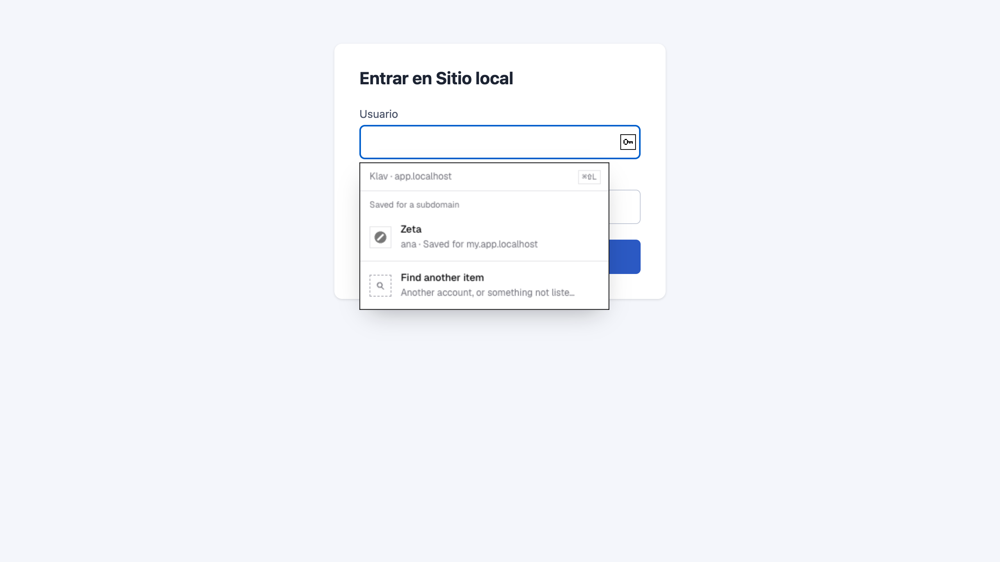 | 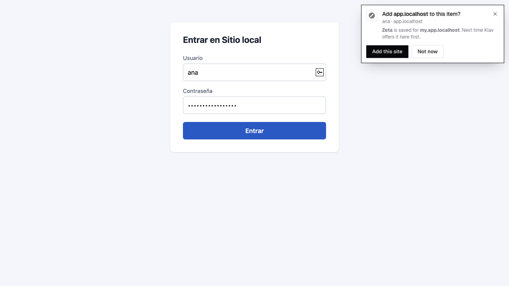 |

Cards and identities have no URL: they are offered on any page
that can be filled and are only written when the person picks them.

`klavd` started by the *host* is a child of the browser. On startup it drops the
Mach exception handlers it inherits (`klav_touchid::detach_crash_handlers`):
that way its crashes don't go to the browser's *crash reporter*, and the browser can close
even if `klavd` keeps running.

## 5. Autofill

> The steps for people who use Klav are on the public page [`browser-extension.mdx`](../apps/docs/src/content/docs/apps/browser-extension.mdx) (in `apps/docs/src/content/docs/apps/`); a change to those steps goes there first.

Klav never fills when a page loads. It fills when the person picks an
item in its menu, on the sign-in card or in Klav's search:

1. When a field it recognizes gets the focus, the *content script* draws Klav's
   glyph (the key in a white square with an ink border) at the end of the
   field. The shortcut `⌘⇧L` (`Ctrl+Shift+L` outside macOS) opens the menu in the
   focused field without touching the mouse, or the search if no field has
   the focus.
2. A click on the glyph (only a real click: `isTrusted`) asks the
   *background* for a menu. The *background* binds it to the frame that asked with what
   the browser says (`sender.tab`, `sender.frameId`, `sender.documentId` and
   `sender.url`), never with what the page says.
3. The menu is an extension page (`menu.html`) in an `iframe`
   inside a closed *shadow root*: the page can't read it. It asks
   `klavd` for the suggestions for the frame's URL (`suggest`, only names
   and usernames). If Klav is locked, it is unlocked from there (Touch ID
   or the master password). At the end, "Find another item" opens the search
   for that same field.
4. When an item is picked, the *background* asks `klavd` for its values
   (`autofill`, which checks the site again) and sends them **only** to that
   frame and document. Each surface carries a *token* (the menu's, that of the
   form that told the card, the search's) and the *content script*
   only accepts values for a *token* of its own. It writes them into that form and
   lets go of them. Each *token* is good for one fill. The card's stays
   bound to the form that told it: if a single-page application
   swaps it for another, the card fills nothing.

   Firefox has no `documentId`. There, fills with a *token* are already
   bound to the document by the *token*, which belongs to that document. Those from the
   *popup* and those from agents carry no *token*: they carry the identifier
   of the document that answered `where`, and the *content script* rejects them
   if it isn't its own (layer 09). That way, a new page in the tab doesn't
   receive what was checked for the previous one.

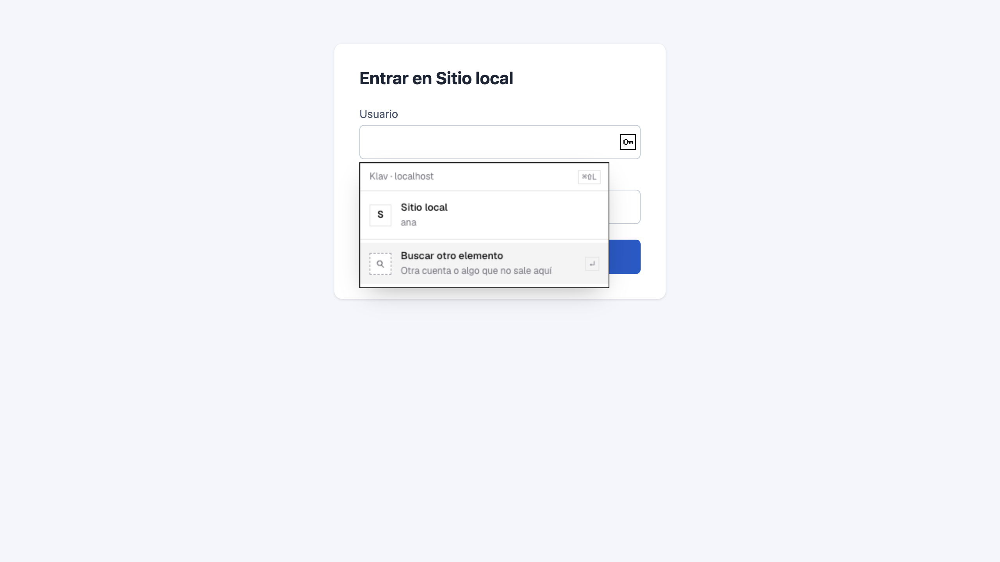

### The sign-in card and Klav's search

- **Card:** if a document has a visible sign-in form
  (a password, or a form that asks only for the account), it
  tells the *background* once. If Klav is unlocked and there are logins for the
  site, it shows at the top right (`card.html`, centered in windows
  narrower than 560 px): "Sign in as **ana** · github.com", "Sign
  in", "Another account" if there are more, and close. It never fills without a click.
  It goes away if the person types in a field or closes it, and doesn't come back for that
  site in that tab. One per tab, and none while Klav is following a
  sign-in in several steps.
- **Search** (`find.html`): centered over a veil, with a search box. First
  what matches the frame about to be filled ("On host"), then
  "Other logins" (from `list`, metadata only), cards and addresses. A
  login for another site **isn't filled with one click**: it leads to "Fill X
  on host?", with the two hosts side by side and "They don’t match", and only "Fill
  on host" writes it. That fill uses `view` with `reveal` (only username and
  password, never the TOTP seed), so `klavd`'s audit log records
  a reveal and not the host (threat model T69 and residual risk 20).

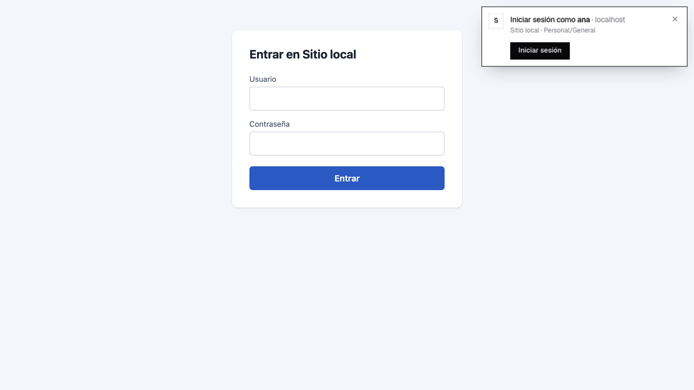

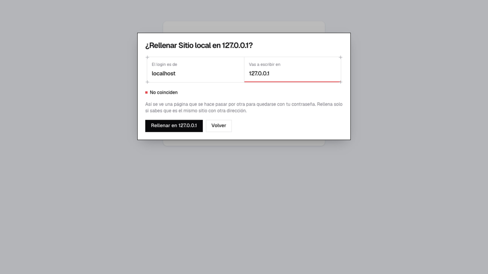

### Sign-ins in several steps

When the person picks a login on a form that asks only for the account
(first the email and "Continue", like Apple, Google or Microsoft), Klav follows
the steps:

1. it types the username and presses the button that follows;
2. it waits for the password (up to 10 s): on the same page, after a
   navigation within the same site or in a frame of another subdomain. Each frame
   of the tab looks for it and tells the *background*, which fills it like
   any other fill (`suggest` with the address of the frame and of the
   top page, and `autofill`) and presses "Sign in";
3. if a code field shows up afterwards and the login has TOTP, it fills it
   (also in one-digit boxes) and presses "Verify".

The state lives in the *background*'s memory (`background/flow.ts`), per
tab and item, for 60 s at most. It is canceled if the person types in a
field, closes the tab, or a new page in the tab is no longer on the
item's site. Klav stops without retrying, and says so with the menu
open on the field, if it sees a captcha, if the password doesn't show up or if it
shows up in a frame of another site (which receives nothing).

It only presses the form's submit button or one whose text says
"Continue", "Next", "Sign in", "Log in" or "Verify"; never
"Continue with Google", "Forgot your password?" or "Create account". A
single-page form is filled without being sent, as always, and the
code only goes in on its own if Klav was already pressing. The *popup*'s "Only fill, don’t
press" setting (`storage.local`, `onlyFill`) leaves the buttons to the
person. Threat model T68.

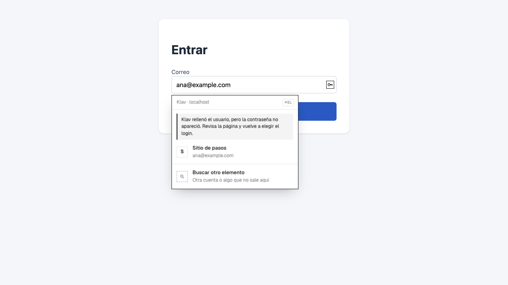

### What it recognizes

`detect.ts` classifies each field by `autocomplete`, the type, the name, the
id, the *placeholder*, `aria-label` and its `<label>`, in English and in Spanish:
username, current password, new password, one-time code,
card (holder, number, expiry together or as month and year, security
code) and address (first name, last name, email, phone, address,
city, state, postal code, country). Context corrects what a field doesn't
say on its own: an email right before a password is the username; a
form with only an email is the first step of a sign-in if
something says so (`identifier`, `login`, `iniciar`…).

- **Frames:** the *content script* runs in every frame; each one
  fills its own. In a frame, a login is offered and filled only if it
  matches the frame **and** the top page (the address
  bar): a sign-in from another subdomain of the same site
  (`idmsa.apple.com` inside `appleid.apple.com`, for an item for
  `apple.com`) does; the login of the framed site inside another site's
  page doesn't. Cards do, because of payment frames.
- **Codes in boxes:** 4 to 8 consecutive one-character boxes are a
  single code; each digit goes into its box.
- **Shadow DOM:** fields are looked for in open *shadow roots*, and a
  field's form is looked for across its hosts. Closed ones can't
  be seen.
- **Hidden fields:** when filling, when capturing what is sent and when looking for
  the form of the card or of a step, only the fields the
  person can see count (`isVisible`, layer 09). A hidden field is the
  classic trick to take a password or a CVV away. A field counts if:
  - it is at least 6×6 px;
  - it is inside the page: neither to the left of it nor above it (you
    can't scroll there), nor beyond its right or bottom
    edge. A field further down in a long form does count, because the
    person reaches it by scrolling (address forms are usually
    taller than the window);
  - no container with `overflow: hidden` or `clip` leaves it entirely outside;
  - neither it nor its ancestors (across *shadow roots* too) have
    `display: none`, `visibility: hidden`, opacity or `opacity()` in
    `filter` below 0.1, an old-style `clip`, or a `clip-path` that leaves
    nothing (`inset()` of half or more, `circle(0)`, `ellipse(0)`).
- **Passwords only in password boxes:** the password is only written
  in an `input type=password`, and on submit it is only captured from a visible one.
  A field the page marks `autocomplete="current-password"` but that is
  a text or search field never gets it.
- **Codes and CVV:** next to a card number, an ambiguous "security code"
  is the CVV. A box that claims to be for a one-time code
  (`autocomplete="one-time-code"`, "verification code", one box per
  digit) stays one, and the CVV never goes into it.
- **Change-password forms:** the login's password only goes
  to the current-password field. A sign-up form (only new passwords)
  doesn't get it from the person's menu. When an agent fills
  (`fill_login`), it does get it in the password and in its confirmation: that way it
  signs up with the login it just created with `create_item` and `generate`
  (ADR 0022 §7).

### Against *clickjacking*

A page can try to cover the menu, make it transparent or move it
under the cursor so that the person clicks without seeing it. There are two
checks, and a choice only counts if it passes both.

**Inside the frame** (`ui/guard.ts`), in the menu, the card, the search,
the save bar and the generator history:

- it ignores clicks in its first 400 ms;
- in Chromium it uses *IntersectionObserver v2* (`trackVisibility`): a
  choice only counts if the frame has been whole and visible for 300 ms (no
  opacity, filters, transforms or anything on top). If not, it says so and does
  nothing;
- it only accepts real clicks, within its own origin (the page can't
  generate events there).

The check observes a fixed element the exact size of the frame, not its
content: a long list scrolls inside the menu and still
counts as visible.

**From the page** (`content/cover.ts`, layer 09), in every browser,
Firefox included, which has no *IntersectionObserver v2*. Before acting
on a choice (`menu_fill`, `menu_generated`, `menu_find`,
`card_fill`, `card_find`, `find_fill`, `save_do`, `menu_passkey`,
`passkey_sign_in`, `passkey_save`, and the history's "Copy" and "Delete all" in the menu), the *background* asks the *content
script* of the document where the frame is drawn whether the page leaves it
alone, and if not, it answers `covered` ("The page is covering part of this box").

The `<klav-ui>` host is the last child of `<html>`, `position: fixed`
with the highest `z-index` and `all: initial !important` in its `style`.
Only a later element in `<html>` (or
`html::after`), the top layer (a modal `<dialog>`, a *popover*, full
screen) or `<html>` itself with opacity, filters, transforms
or clipping can paint above it. A layer with `pointer-events: none` lets the click through to the frame
and `elementFromPoint` doesn't see it; that is why the rule is about structure, not about
what is under the pointer. The frame counts as seen if:

- it has been open for 400 ms;
- the host is still the last visible child of `<html>`, with no
  changed styles, and nothing is in the top layer;
- `<html>` has no opacity, filters, transforms, clipping, masks
  or `zoom`;
- the frame is entirely within the window and exactly where Klav put it (its
  rectangle matches its `left`, `top`, `width` and `height`);
- `elementsFromPoint` at its center returns the host;
- and none of that failed in the last 300 ms: it is checked every 100 ms
  while a frame is open and every time `<html>` or the
  host changes. A page that removes the layer right when it notices the click (its
  window's `blur`) is too late.

If the page changes the host's `style` or class, Klav puts them back
at once (a `MutationObserver`) and the frame doesn't count for 300 ms.
If it takes the host out of `<html>` or moves it inside its own markup, Klav
throws it away with its frames.

The click on the glyph goes through the same structural rules (without the wait:
it only opens the menu, which has its own).

Limits: the menu of a field inside a frame from another origin is checked
in that frame's document, not in the top page, which could cover it
entirely (what the top page covers is seen by *IntersectionObserver v2* in
Chromium, not in Firefox); a *popover* inside a closed *shadow root* can't
be enumerated; and an extension that adds visible elements at the end of
`<html>` or puts a `filter` on `<html>` (some dark modes) makes Klav
say the page is covering it: it doesn't fill, and the shortcut or the *popup* still
work.

Even so, on a page that matches the login, whoever controls the page
(XSS) can read what is typed into it: Klav doesn't protect against that, and
neither does any password manager that fills forms.

## 6. Saving, generating and one-time codes

> The steps for people who use Klav are on the public page [`browser-extension.mdx`](../apps/docs/src/content/docs/apps/browser-extension.mdx) (in `apps/docs/src/content/docs/apps/`); a change to those steps goes there first.

### Saving or updating on submit

When a form with a password is sent, the *content script* sends the
*background* the username and password it sees (if there is a new
password, that one). These count as the person sending it (layer 09):

- a real click (`isTrusted`) on the button that sends the form: one of
  type `submit` or one whose text says so ("Log in", "Create account",
  "Save"…); not the eye of "Show password" or "Generate";
- a real `Enter` in a password box;
- a real `submit` event **right after a gesture by the person** (a
  press or a key in the last second), one per gesture. `isTrusted`
  isn't enough here: the `submit` that `requestSubmit()` triggers from the
  page's JavaScript also arrives as trusted.

Only what is typed in a visible `type=password` box is captured, never a
text field the page marks as a password, nor a hidden one. The
*content script* keeps nothing of what was sent: the same login sent twice
(the click and then the `submit`) is thrown away by the *background*, which already
has it. The *background*:

- keeps them **only in memory**, per tab and for 60 seconds; never
  in `chrome.storage` or on disk, and deletes them when saving, when discarding, when they
  expire or when the tab closes;
- takes the site from `sender.url` (what the browser says), not from the page;
- only offers it in the top document of **that site**: the same host,
  one below or above, or a sibling under the same parent of two or more
  labels (`accounts.example.com` → `www.example.com`, after signing
  in). If the tab went to another site, it throws it away.

The next page (or the same one, if it doesn't navigate) asks whether anything is
pending and, if so, opens the save bar (`save.html`, an extension `iframe`
at the top right). The bar **never receives the
password**: it sees the site and the username and returns a decision. Its buttons
go through both checks against *clickjacking* (§5), like the
menu.

- If Klav already has a login for that site with that username and the **same**
  password, it offers nothing.
- If the password **changed**, it offers "Update" (it edits the login's password
  with `edit`), with the login's vault and project. If there are **several**
  logins for the site with that username, the person picks which one; the *background*
  only accepts one of those.
- If there is no login, it offers "Save" with a title (by default, the site)
  and, if the person has more than one project, where to save it. The new login
  takes the page's exact origin as its URL. The rule for repeated
  titles is the usual one: `klavd` rejects a title that already exists in the
  project, and the bar explains it so the person can pick another.
- With Klav locked, the bar unlocks first (Touch ID or the
  master password).

A malicious page could fake a submit with made-up data, once
per gesture by the person: the worst it gets is that the bar offers to
save something the person throws away. It can't read anything from Klav or save
without the person's click on a bar in view.

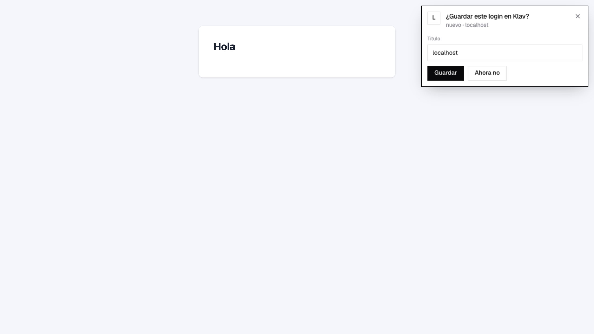

### Password generator

In a new-password field (`autocomplete="new-password"`, or a
sign-up or change form), the menu starts with the generator (ADR
[0022](decisiones/0022-generador-historial-y-cambio-asistido.md) §1). The
password is made by `klav-core` (WASM, `generate`, with the browser's
randomness).

- **Kinds:** "Smart" (default), "Random", "Memorable" and "PIN",
  with their options (length, digits and symbols; words; PIN digits).
- **Smart** follows the field's rules: when the menu opens, the *content script* sends
  its `passwordrules`, `minlength` and `maxlength`, and the
  *background* only lets those three keys through, with a text of 2000
  characters at most and lengths from 1 to 4096. If the field gives no rules,
  it uses those of `apple/password-manager-resources` for the domain, which are
  bundled in the WASM, and with none at all it gives 20 characters. Below, it says which
  rules it followed, whether the site doesn't allow a stronger one, or whether its rules can't be
  understood or have no solution (then a "Random" one comes out).
- **Strength:** four segments and "Very strong · 124 bits" (weak < 40,
  fair < 64, strong < 100).
- **Buttons:** "Copy", "Another" and "Use this password". Before
  typing or copying it, Klav saves it in the **generator history**
  (`generator_record`). If it can't, it doesn't type it and says so; when copying, it
  copies it anyway with the warning. When it is used, the *content script* writes it
  in the visible new-password boxes of the field's form (the
  password and its confirmation), and when the form is sent Klav offers
  to save it like any other. Without a `<form>`, only in the field and in those
  of the nearest container that has another one (up to four levels), never
  in every one on the page (layer 09).
- **"Use as default for suggestions"** saves the kind in
  `storage.local` (`generatorDefaultKind`).
- **"History"** lists what was generated, newest to oldest, without
  values: site, date, whether it hasn't synced yet and which login it was
  saved in. The value is asked of `klavd` (`generated_value`) only when copying.
  "Delete history" asks for confirmation ("Delete the whole generator history? Passwords you did not save in any item are lost.")
  and then empties it, also from the versions saved on the server.
- **Clickjacking:** "Copy", "Use", and the history's "Copy" and "Delete history"
  have the same defenses as the rest of the menu (§5), and are
  checked before saving or deleting anything.
- **Height:** the menu with the generator can grow up to 600 px, but never
  beyond the window on the side of the field where it opens: a frame
  cut off by the window counts as covered and wouldn't accept clicks.

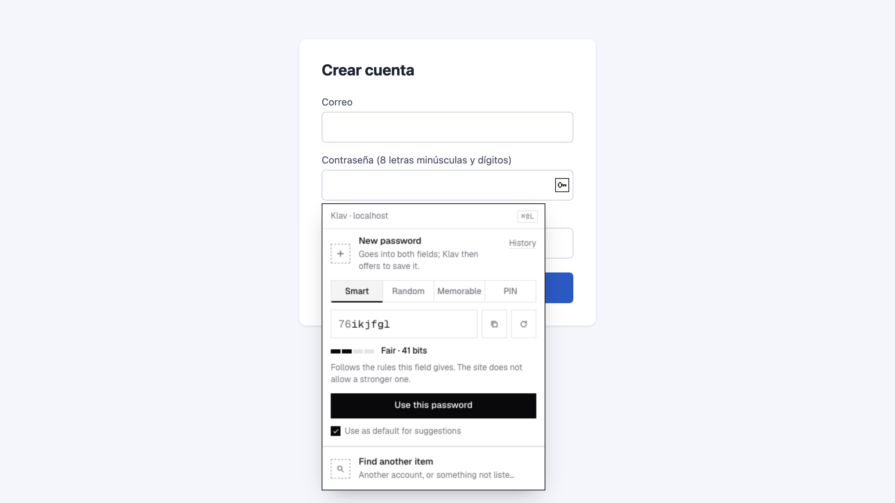

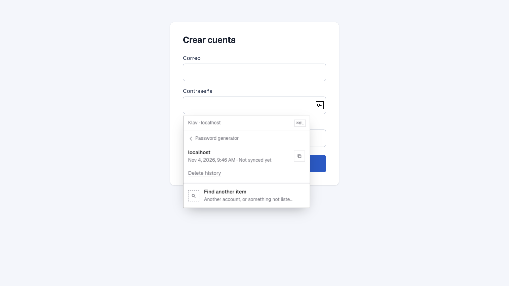

### One-time codes (TOTP)

- **After the login:** when a login that has TOTP is filled, the
  *background* remembers that login in that tab for two minutes (only
  its ID and its title, in memory). If the next page has a code
  field and it gets the focus, Klav opens its menu on its own, with that login first.
  **It writes nothing until the person picks it**: `klavd` computes the
  code at that moment (`autofill` with `part: "totp"`), with the same
  site check as the password.
- **In a sign-in in several steps** that Klav was following (§5),
  the code goes in on its own, because the person already picked the login.
- **In any code field:** the menu first shows the site's logins
  that have TOTP.

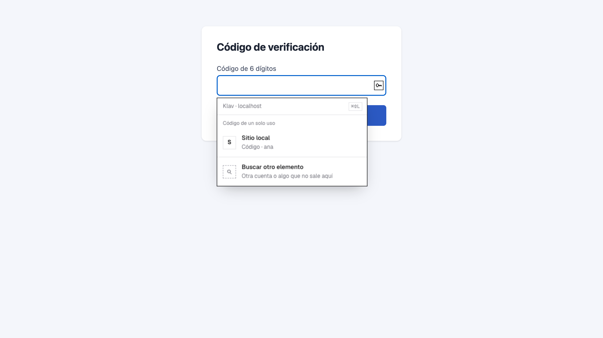

## 7. The *popup*

> The steps for people who use Klav are on the public page [`browser-extension.mdx`](../apps/docs/src/content/docs/apps/browser-extension.mdx) (in `apps/docs/src/content/docs/apps/`); a change to those steps goes there first.

Klav's button in the browser's toolbar opens the *popup*:

- **Unlock and lock** (Touch ID or the master password, through
  `klavd`).
- Pending **agent approvals**, at the top (§8). They are asked for after
  drawing the vault and never while typing in the search (ADR 0026).
- **On opening** (ADR 0026): `status` and right after it `list`, which `klavd`
  answers with its local copy without waiting for the server; the active tab
  with `suggest` goes at the same time. The rows that fit are drawn first and the
  rest when the browser is free (100 at most). While the
  *popup* is open it asks for `status` (every 250 ms if `klavd` is syncing,
  otherwise every 3 s) and asks for the list again only if `revision` changed.
- **On this page:** the logins for the active tab's site, with
  "Fill". The *background* asks the browser for the address (the same
  `where`/`here` exchange agents use, with `sender.url`), so
  neither the `tabs` permission nor `activeTab` is needed. When filling,
  `klavd` checks the site again and the values go only to the top
  document of that tab: to the form of the field with the focus or, if there is
  none, to the one that best fits the login.
- **Codes in view:** the row of the site's login shows its live code
  (Departure Mono, with 30 blocks that go out one per second) and it is copied
  with a click or with **⌘C** (`Ctrl+C`) if no text is selected. In the
  list, items with TOTP also show their code. Codes are
  asked of `klavd` (`totp`) only while their row is visible.
- **Tabs by kind**, on a discreet line under the search:
  "All", "Logins", "Codes", "Cards", "Notes", "SSH keys", "API
  keys", "Addresses" and "Files", each one with its kind's icon
  (`kindIcon` in `kit.ts`, the same strokes as the iPhone and the Mac,
  [diseno-visual](diseno-visual/README.md) §7) and its count in gray. Only
  the ones that have something show, and the whole row hides if the vault is of
  a single kind and has no codes. The chosen one is in ink with the
  2 px line that says "chosen" elsewhere. ← and → move from one to the other, and if they don't
  fit they scroll sideways and fade at the edge. The counts come
  from the same `list` that draws the vault, so a search counts them
  again. A tab that the search leaves empty stays while it is
  chosen and says so: "Nothing in Cards matches …". Outside "All" and
  "Codes", "On this site" isn't shown. The chosen tab is kept
  when opening an item and coming back, but not from one opening of the *popup* to
  the next.
- **"Codes"**, in the style of Google Authenticator: only the items with
  a one-time code, whatever their kind (a login with its
  `totp`, a `totp` on its own or a note with a code field). Each row
  carries the title and the username at the top, the large code in Departure Mono,
  its 30 blocks and a copy box. **A click anywhere on the
  row copies the code**, and the box turns into ✓ for a moment. `klavd` says which items
  have a code with `list` and `codes: true` (§3 of
  [klavd.md](klavd.md)), which is asked for right after drawing the vault,
  never before, and again only if `revision` changes. Each code is still
  asked of `klavd` (`totp`) only while its row is visible. A `totp` on its own
  has no tab of its own: that is what "Codes" is for.
- **"On host" above "Codes":** if the active tab's page
  has codes, "Codes" starts with them, with the same rows, and
  continues with the rest under "Codes". They are the codes of the page's logins
  (those in `logins` in `suggest`) and the codes on their own that
  name it (`codes`): their title or their `otpauth` link's issuer names the
  page's domain, or one of their confirmed URLs matches it,
  with the logins' rule. The page picks the host, so only
  its last two labels count (`site::issuer_names_page`, T186): a
  host name counts if its last two labels are those ("anydesk.com"
  and "my.anydesk.com" on `my.anydesk.com`), and any other text, if its
  letters and digits are the label before the suffix ("AnyDesk",
  "Google" on `accounts.google.com`). No other label counts:
  "PayPal" doesn't show on `paypal.attacker.example`. Without the *Public Suffix List*
  (ADR 0020 §6 keeps it for the rpId), a two-label suffix
  hides the name: "Amazon" doesn't show on `www.amazon.co.uk`. It fails toward
  not showing. It is different from the iPhone's rule
  (`site::issuer_names_site`, ADR 0035 §3), which compares with the sites the
  person saved and accepts any label. It is a hint for copying
  the code, never a fill.
  What shows at the top isn't repeated below, as in "All"; if everything is
  at the top, the list below isn't drawn. Logins saved for a
  subdomain (`parent`, ADR 0025) don't move up: as in "All", their code
  stays in the list. With no codes for the page, the tab stays as
  before. An older `klavd` doesn't send `codes`, and only the
  logins' codes show at the top.
- **Search** the whole vault (`/` goes to the search) and **view an
  item**. Secret fields arrive hidden (`view` without `reveal`),
  covered by noise instead of dots, and are asked of `klavd` only when
  "Show" or "Copy" is pressed; they are forgotten on going back to the list or closing the
  *popup*.
- **Sites added by an agent** (ADR 0030 §7, layer 09): if an agent
  added URLs to a login and the person hasn't confirmed them, the item's page shows them
  separately, "Not confirmed: Klav does not suggest or fill this login there", with
  **Confirm** and **Remove**. Both act on all of them at once, like
  `klav item sites`: any edit by the person is a version of theirs and
  confirms the sites it keeps, so removing just one would confirm the
  others without asking. Confirming asks for a second click that names the sites.
  `klavd` doesn't give the agent's name to the extension (`agents` isn't on its
  list), so it says "an agent".
- **Previous passwords** (ADR 0022 §3): under an item's fields, the
  values its password and its hidden fields had, with
  their dates. The list arrives without values (`password_history`); each one is
  asked for (`previous_password`) when "Show" or "Copy" is pressed. Those an
  assisted change generated and nobody confirmed say "Generated, not confirmed".
- **Pending change** (ADR 0022 §5): while an assisted change is waiting for an
  answer, the card **"Pending change: did the new password work?"**
  shows above the previous passwords, with the same shape as
  approvals and their blue dither band, since when it has been waiting and two buttons:
  **"Use the new one"** (the pending one becomes current and the previous one goes to the
  history) and **"Keep the current one"** (the pending one goes to the history as
  unconfirmed). Both send `resolve_pending`.
- **Generator** (asterisk, at the top): the same as the menu's, for the active
  tab's site and without "Use", with its history.
- **New item** ("+", at the top): create by hand a **login**, a **secure
  note**, a **card** or a one-time **code**, with a kind
  selector like the generator's.
  - **Login:** title, username, password and website. If the active tab
    is a page where Klav fills (`fillableHost` from `klav-wasm`), the
    site comes filled in with its origin and the title with its *host*, until the
    person types another one. The password goes in a `type=password` field with
    "Show", and the asterisk opens the generator right there: its "Use this
    password" saves it first in the generator history (ADR 0022 §2) and
    then puts it in the field; when the login is created, `klavd` links that
    history entry to it.
  - **Secure note:** title and text (they go in the `NewItem`'s `notes`).
  - **Card:** holder, number, expiry (`MM/YY`, saved as
    `YYYY-MM`) and security code. The number and the code go as
    secrets.
  - **Code:** paste the setup key or the `otpauth://` link.
    `totpCheck` from `klav-wasm` reads it with `klav-core`'s `Totp::from_field_value`,
    the same as `klavd` when creating, and only returns what the key
    says about itself (digits, period, issuer and account), never the secret or
    a code. The issuer suggests the title. If `klavd` rejects the key
    anyway, the error shows on the field.
  - **Where:** with more than one project, the same list as the save
    bar (`projects`).

  Pressing "Save" sends the usual `create` operation, without
  `allow_duplicate`; a repeated title in the project shows on the title
  field. The values live only in the form's fields (as a
  property, never as an attribute, so they aren't in the page's HTML)
  and are cleared on creating, on changing kind and on leaving with "Esc" or "Your
  vault". The *background* empties the values of a `create` or an `edit`
  (and the password of `generator_record`) as soon as `klavd` answers, as
  `rotateFill` does with its own. After creating, the item opens, covered
  like any other. The view's code (`newitem.ts`) is only evaluated
  when "+" is pressed: the *popup*'s startup doesn't change.
- **Health** (pulse, at the top; ADR 0022 §4 and §6): the `vault_health` report
  in four sections, each item with its site and without values:
  - **Reused**, one block per group of items that share a
    password, with the **"Fix my reused passwords"** button;
  - **Weak** (the strength from `zxcvbn`, or the bits if it came from the generator);
  - **Old** (since when);
  - **Breached**, with the "Look for breached passwords" switch and the
    text of what it sends (`health_settings`; the text is translated in the
    extension, because `klavd`'s `notice` is in English). Off by
    default.

  **"Fix my reused passwords"** opens a card with the shape of
  approvals and their blue band (`reused_offer`):
  - the agent (if there are several, choosing another asks for the list again with
    its grant and its policy);
  - one row per login, by site and not by group, with its username, its group
    (only for the person), its change page and, if it has a code, "one-time
    code · Added by Klav" with its notice;
  - unchecked, and impossible to check, the ones that can't go: without a website,
    outside the agent's projects or with the reused password in a
    field that isn't the main one;
  - the duration (2 h by default, up to 24 h).

  A single approval (Touch ID or the master password) signs the offered task
  (`offer_task`) with the title "Change passwords", neutral on
  purpose: the agent reads it and mustn't know which ones were reused. While
  the task runs, "Health" shows its card at the top with each site
  **changed**, **in progress**, **pending** or **failed** (`task_progress`,
  every 5 s while the view is open).
- **Settings** (gear): "Only fill, don’t press", "Ask each site for its icon"
  (below), "Passkeys" and the list of shortcuts.
  - "Passkeys" chooses when a passkey asks again for Touch ID or the
    master password: "Every time", "Every 5 minutes" or "While Klav is
    unlocked" (ADR 0020 §8, [klavd.md](klavd.md) §4). It is a setting of
    `klavd` on this computer, not of `storage`. To make it ask less, `klavd`
    asks for Touch ID or the *popup* asks for the password, and until then nothing
    changes. To make it ask more, nothing is needed.
  - With "Every time", unlocking Klav in a passkey's frame counts for
    that sign-in: the frame doesn't ask for the password again. The
    *background* marks only the unlocks from
    `passkey.html` that way (`passkey_flow`), even if another page puts it in its request.

- **Environments** (ADR 0032 §6): an "Environments" tab, shown once there
  is one, lists each environment with its project, its number of variables
  (`environments`, asked once) and a padlock when it is protected. A row
  opens the environment's page (`environment`):
  - each variable with its value as noise until "Show", and "Copy". Both ask
    `klavd` every time (`resolve` with `variables_only`), so a protected
    environment, or a reference to a protected item, asks for Touch ID on
    every "Show" and every "Copy". The value lives only in the field that
    shows it, and goes when it hides or the page closes. A copied value is
    cleared like a password;
  - where each value comes from: "Its own value", or "From Stripe ›
    api_key" (and "· protected" when that item is);
  - the notice of a protected environment, and which variables an agent
    changed since the person last saved it;
  - "Add variable" (a value, typed in a password field, or a `klav://`
    reference), "Change" and "Remove" on each variable, the "Protect this
    environment" box and "Move to trash" with a confirmation. Turning the
    protection off and trashing a protected environment ask for Touch ID in
    `klavd`; without it, the *popup* asks for the master password first and
    sends it with the request.

  "New environment" (in "New item", and above the "Environments" list)
  picks the project, the name (`[a-z0-9][a-z0-9_-]{0,63}`) and the
  protected box, ticked by itself for `production` and `prod` until the
  person touches it. The page of an item a protected environment points to
  says "Protected by “production”: showing or copying a value asks for
  Touch ID every time". Importing a `.env` stays the CLI's (`klav env
  import`). An older `klavd` or native *host* answers these operations
  with `denied` or `bad_request`, and the *popup* says "Update Klav".

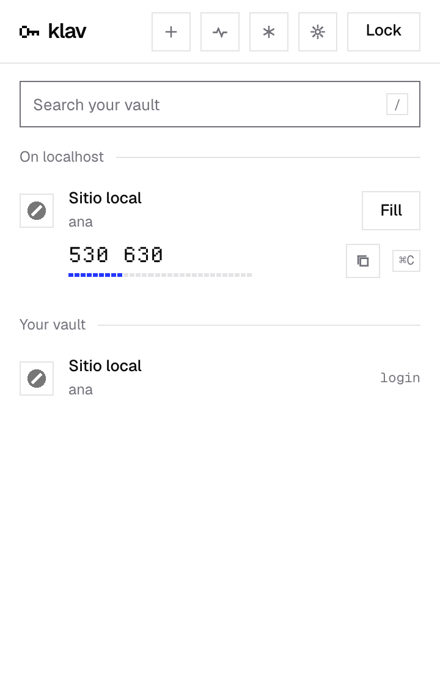

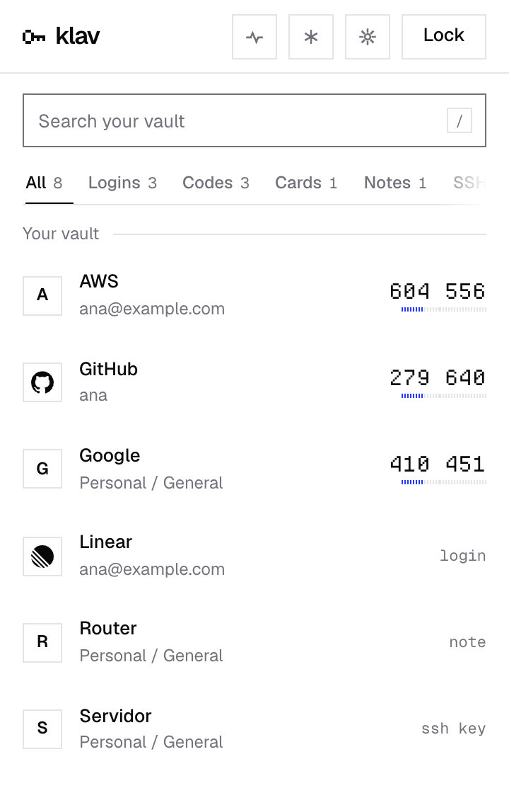

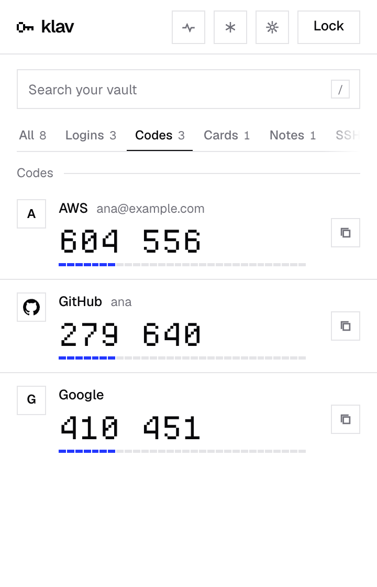

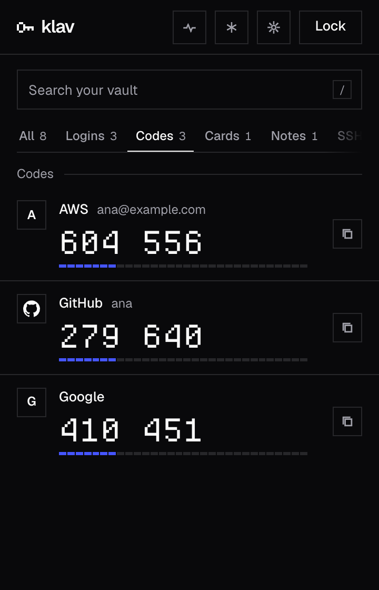

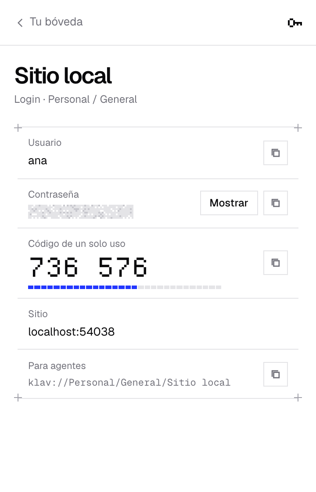

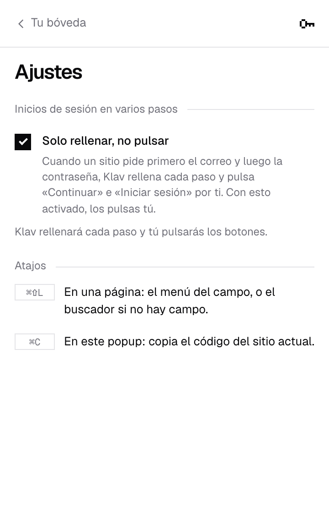

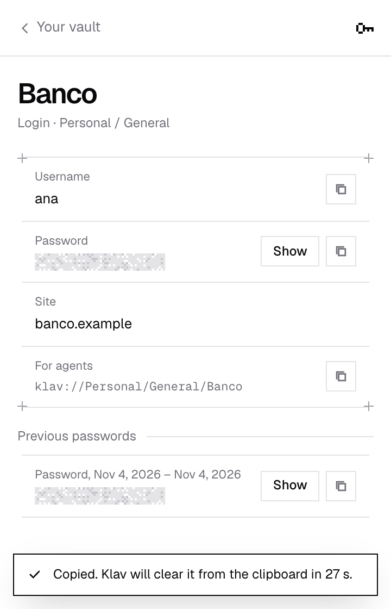

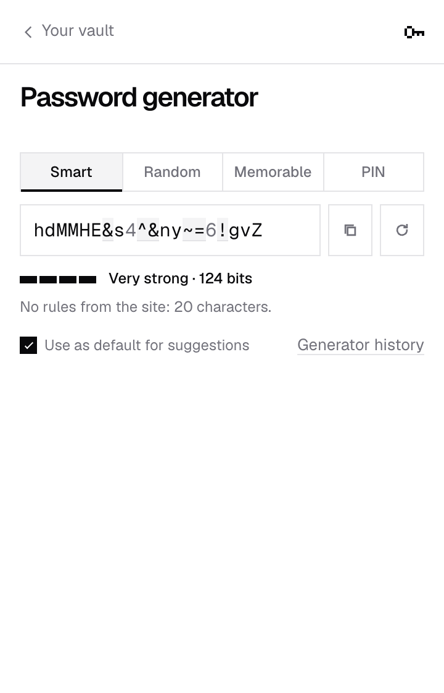

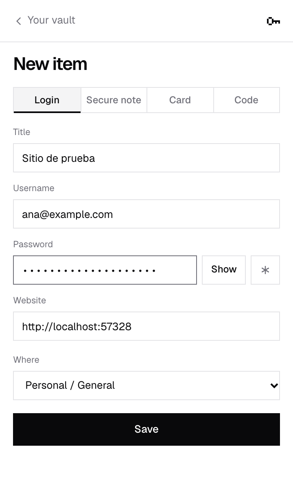

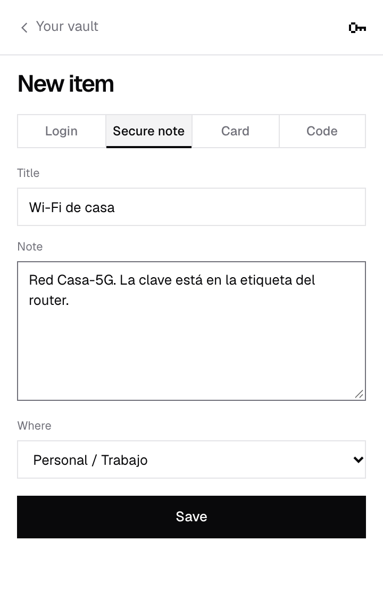

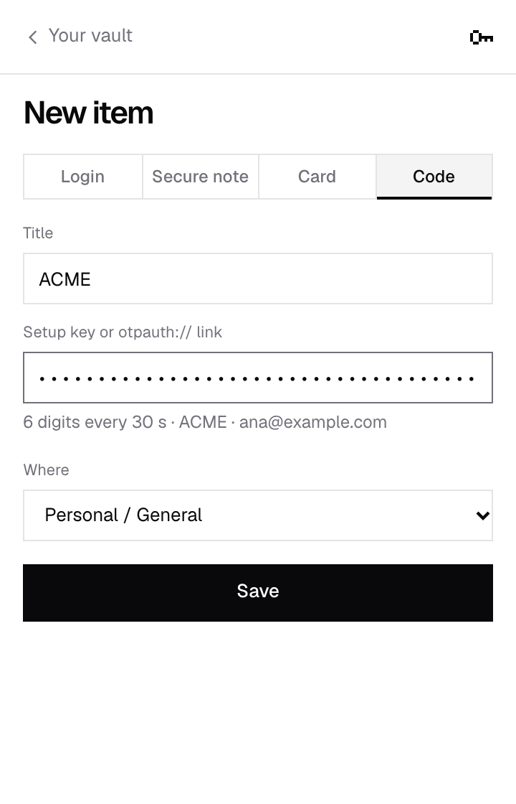

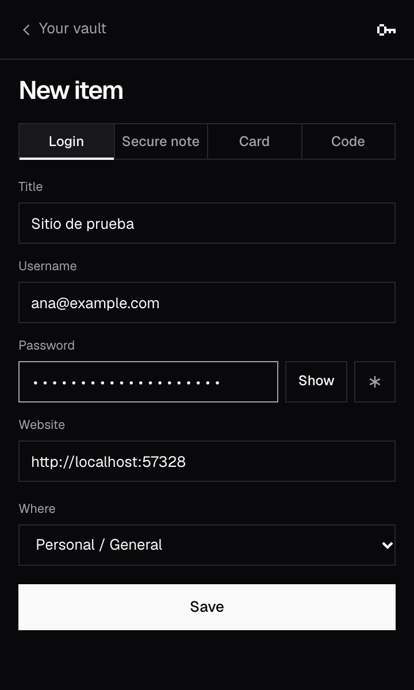

### Site icons

Next to each login, in the *popup*, the field menu, the sign-in card,
Klav's search and the save bar, there is a box with the site's
icon. The vault's URLs are private, so **no third-party icon
service** ever learns which sites someone saves. The box is
filled in three layers (`src/ui/siteicon.ts`):

1. **The logo, if Klav ships it.** About 300 common sites, from
   [Simple Icons](https://simpleicons.org), bundled in the extension
   (`site-icons.json`). They are drawn in a single color, the theme's ink
   (light or dark), never in the brand's color. A subdomain takes its
   domain's logo (`gist.github.com` → GitHub), unless it has one of its
   own (`mail.google.com` → Gmail).
2. **The favicon the browser already has**, only in Chromium (the
   `favicon` permission, `chrome-extension://<id>/_favicon/?pageUrl=…`): it is a
   lookup in the browser's own cache, not a network request.
   Chromium only finds it for exact addresses of pages it has already
   shown, so the menu and the card look up the open page's address
   first. If it returns its generic globe, it counts as "none".
   It is drawn in grayscale so that it doesn't break the palette.
   Firefox skips to the third layer.
3. **The initial** of the title, in its box.

A setting, **off out of the box**, "Ask each site for its icon"
(`storage.local`, key `askSites`), adds a layer between 2 and 3: it asks
the item's own site for `/favicon.ico` (the origin of its first URL),
without `Referer`. That site sees the request; nobody else does. The browser keeps it
in its HTTP cache like any image; Klav keeps nothing.

Cards and addresses always show their initial. The logo or the
favicon is only looked up when the box comes on screen: in a long
list, the rows further down ask for nothing until they are visible.

| *Popup*: logos and initials | Menu: the cached favicon | Setting to ask the site |
|---|---|---|
| 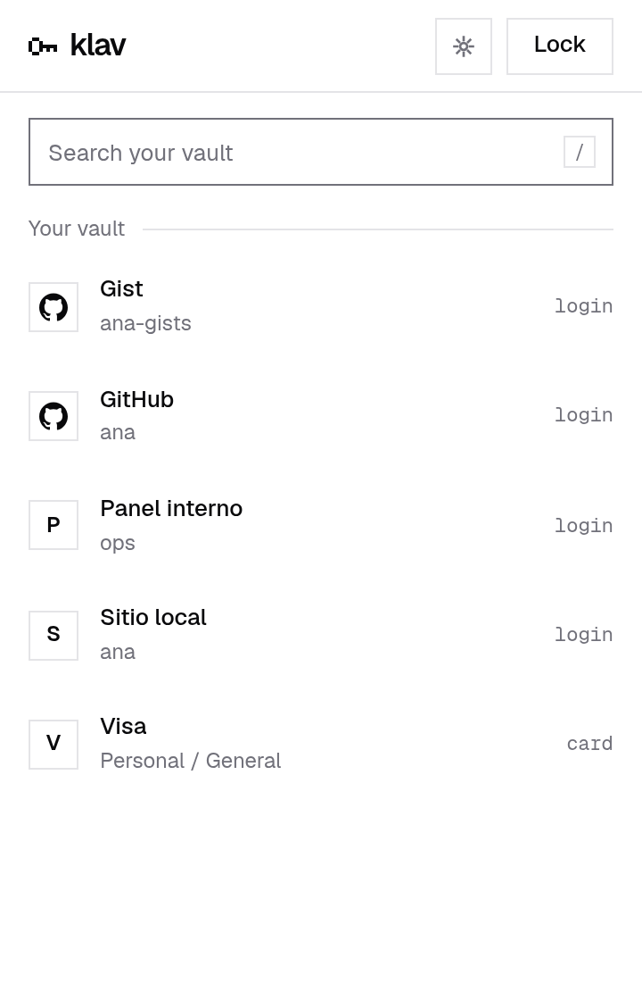 | 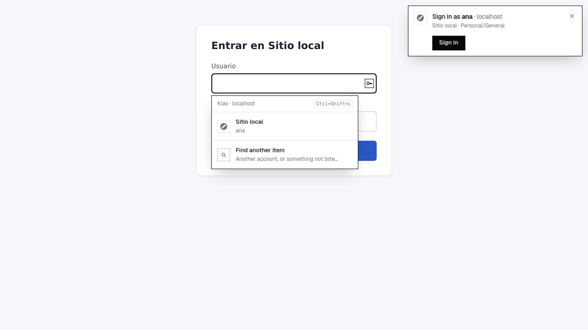 | 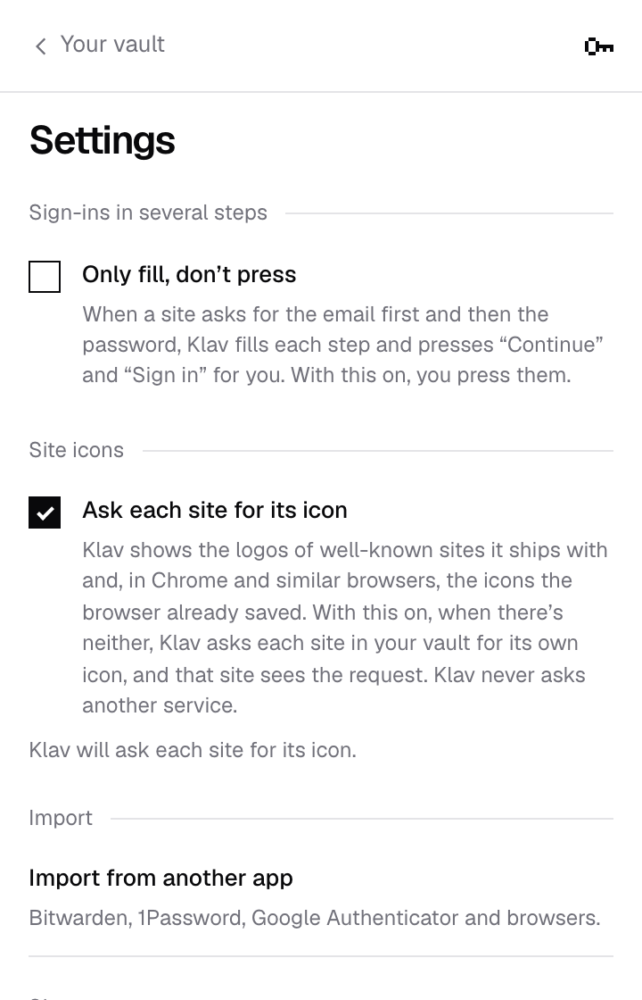 |

**Where the logos come from.** `assets/site-icons/sites.txt` lists each
logo (its Simple Icons *slug* and the domains it stands for) and
`node scripts/site-icons.mjs` generates `assets/site-icons/site-icons.json`:
it downloads the pinned version of the `simple-icons` package from the npm registry,
checks its `integrity`, refuses any logo that Simple Icons licenses
other than CC0 1.0, and rewrites each path with absolute `M`, `L`, `C`, `Q`
and `Z` only (arcs become curves), so that the iOS app doesn't
need a full SVG interpreter. The same file serves the
extension and the iOS app. Running the *script* twice gives the same
file, byte for byte.

**License and trademarks.** Simple Icons is CC0 1.0 (public
domain), but some of its logos (212 of 3,467 in 16.36.0) carry another
license (the `license` field of its data). The script ships none of those, so Vivaldi, Let's
Encrypt and GnuPG fall to layers 2 and 3. The logos are trademarks of their owners: Klav uses them only so that the
person recognizes their own items, and that implies no relationship
with those brands and no endorsement by them. Simple Icons doesn't include some big
brands (Amazon, Microsoft, LinkedIn, Slack…), which fall to layers 2 and 3.

### Clipboard

When copying, the *popup* writes the value with `navigator.clipboard` (the page's
menu, whose frame doesn't have the clipboard API, with
`execCommand("copy")` right after the click) and the
*background* schedules an alarm (`chrome.alarms`) to **clear the
clipboard 30 s later**, even if the *popup* has already closed or the
*service worker* has gone to sleep. In Chromium, a *service worker* has no
clipboard: an *offscreen* document (`offscreen.html`, reason
`CLIPBOARD`) clears it and closes. In Firefox the background page clears it.

Without the `clipboardRead` permission, Klav can't know whether the clipboard
still holds its value: at 30 s it clears it even if the person copied
something else outside Klav. Each copy from Klav restarts the count. It is a
trade-off in favor of asking for fewer permissions.

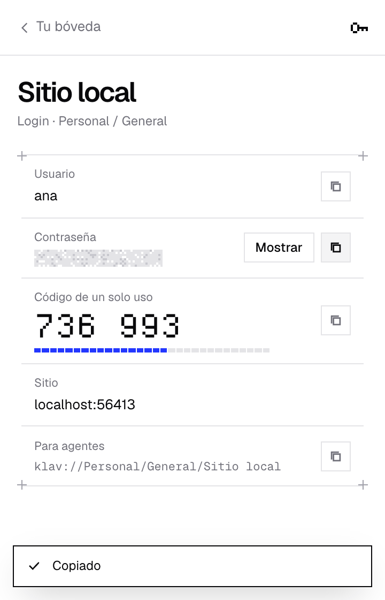

## 8. Agents

An agent (MCP `fill_login`, `fill_card` or `get_totp` with
`target: "extension"`, or `klav agent fill --extension`) fills the tab
the person has open, without seeing the values:

1. The *background* attaches to `klavd` on startup (`extension_attach`) and
   does it again if the port closes.
2. The agent asks `klavd` for the active tab (`browser_tab`). The
   extension answers with the active tab of the window with the focus and its
   address, which it gets from the browser (`sender.url` of a message from the
   top frame), not from the page. With several browsers attached,
   the one with the focus wins (with the presence gate on, exactly one must
   report it: below).
3. The agent checks that the host is that of one of the item's URLs (the same
   rule as the SDK, T21) and asks the server for the values with the `fill`
   permission and that host as `domain`: the grant's policy, the `ask`
   approvals and the audit log are those of any SDK `fill`.
4. With `browser_fill`, `klavd` passes the values to that extension. It
   reads the tab's address again and, if its host is no longer the one the
   agent checked, answers `denied` without writing anything.
5. The top frame's *content script* picks the form with the most
   fields of the item (or the fields in `selectors`; a password only goes
   into an `input[type=password]` and a TOTP code into a password or
   code one), writes, lets go of the values and shows at the bottom, across the width of the page, **"Klav filled this
   page for *name*"** in blue, with the reason, for 12 s. The notice is
   an extension page (`notice.html`) that asks the *background* for the
   name and the reason by a one-time ID: the *content script* doesn't see
   them.
6. The field names and the origins (scheme and
   host, without path or query) go back to the agent; with `submit`, whether another page loaded and its
   origin. It only submits if it wrote a password and if the form's action
   is of the same origin as the page.

`ask` approvals show at the top of the *popup* ("*agent* is waiting for your
permission", with a blue dither band) and are approved with Touch ID or with the master password, the same as
with `klav approval`.

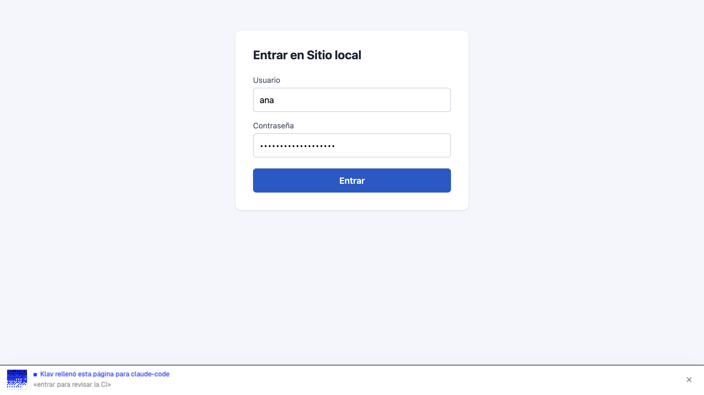
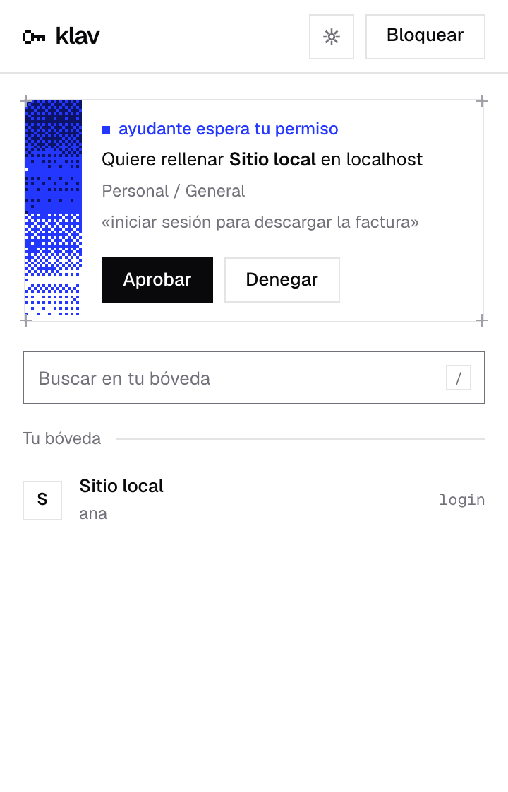

### The presence gate (ADR 0041)

Since layer 6, values need the person's presence ([`klavd.md`](klavd.md)
§3, the gate). An older `klavd`, or one of layers 2–5 (built with the gate
off behind a hidden `--presence-gate` flag, now gone), sends none of this,
and the extension behaves as above.

- **Agents' values.** Before the first value an agent sends this browser
  connection (a fill, the fill step of an assisted change, a passkey
  sign-in), `klavd` asks: with Touch ID, in its own dialog; without it,
  with a `presence` event. The *background* opens Klav's passkey frame
  (`passkey.html`, top right, never a field of the page) in the event's
  tab, with the words of `klavd`'s dialog in the browser's language:
  "Klav wants to let agents fill through this browser connection until
  Klav locks, starting with “claude-code”'s fill of “GitHub”." The event
  names the cause (a fill, a password change, or a passkey sign-in with
  the site from the vault), and adds how many browser connections are
  attached when there is more than one. The password goes back with
  `extension_presence` on the same connection; a wrong one asks again in
  the same frame. Closing the frame, or 110 s without an answer, declines:
  the *background* answers the event with an `error`, and the agent hears
  that the person declined. Under `5m` or "While unlocked", one answer
  covers this connection until Klav locks; under "Always", each value
  asks: "Klav wants to let a browser connection receive “claude-code”'s
  values for “GitHub”."
- **The extension's own fills.** An `autofill` that gets
  `presence_required` opens the same frame in the tab it fills, words the
  question from `presence` ("Klav wants to fill “GitHub” in this
  browser", or what the window would open), and sends the same request
  again with `password`. `klavd` checks a password only against the last
  question it sent on a connection (own choice 32), and the extension has
  one, so the *background* asks one question at a time.
- **In the *popup* and the field menu**, `view` with `reveal`, `totp`,
  `previous_password` and `generated_value` ask over their own page, the
  same way, and send the request again with `password`.
- **Unlocking with the password.** With the gate on, `status` carries
  `presence`. The unlock form then says what the password also opens
  ("Unlocking also lets this browser use your vault for 5 minutes.") and
  sends that as `shown` (own choice 34); without `lasts` it says nothing
  more and sends `always`. Without `presence` (the gate off, or an older
  `klavd`) it sends no `shown`, as before. An unlock that finds Klav
  already unlocked by another key says so in the *popup*.
- **One browser in front** (P25). With more than one browser attached,
  exactly one must report focus when the agent asks for the tab, and again
  right before each value; otherwise the agent gets `browser_ambiguous`
  and nothing is filled. The *popup* says "More than one browser is
  connected to Klav…" if it ever gets it, and "Klav is already asking you
  to confirm something…" for `presence_busy`.

### Assisted password change

With a task that gives it `rotate` on a login, an agent can change its
password in the person's tab without seeing either the current one or the new one
(ADR [0022](decisiones/0022-generador-historial-y-cambio-asistido.md) §5;
`klavd`'s side is in [`klavd.md`](klavd.md) §3):

1. `klavd` sends `rotate_probe`. The *background* forwards it to every
   *frame* of the tab. The main one answers, and so do those with the focus
   on an `<input type=password>`, each one with a one-time *token* and
   the field's rules (`passwordrules`, `minlength`, `maxlength`). The
   *background* waits up to 700 ms (less if one with the focus has already answered).
2. It picks the *frame* with the focus whose address, the one the browser gives
   (`sender.url`), is on the item's host and matches its addresses
   (§4, also inside *iframes*, T61). If there is none, the main one.
   It returns to `klavd` the *frame*, its address and the rules.
3. `klavd` saves the new password as pending in the item and sends
   `rotate_fill` only to that *frame* (and to that document). The *content
   script* spends the *token* and writes:
   - the new one in the `<input type=password>` that has the focus (the one the
     agent picked) and in its form's confirmation; with no focus, in
     the `new-password` fields of the change form (the detection of
     `detect.ts`, §5);
   - the current one in "current password", only if it wrote the new one.

   **It never writes in a field that isn't `type=password`**, even if it has
   the focus or says `autocomplete="new-password"`: the password would be in
   plain view. It checks each field again right before writing.
4. The notice at the bottom says **"Klav typed a new password into this page for
   *name*"**. Only the roles go back to the agent (`current_password`,
   `new_password`, `confirm_password`); with `submit`, whether another page loaded.

While one is pending, the in-page menu offers the login's two
passwords: the current one and **"New password, not confirmed"**
(`autofill` with `part: "pending"`), in case the site asks for one or the other. The
person decides in the *popup* ("Pending change", §7) if the agent neither
confirms nor cancels.

What Klav can't prevent: an agent with JavaScript or CDP in the tab
can read `input.value` after the fill ([threat
model](modelo-de-amenazas.md) T102). Klav only keeps the values
out of its API's responses.

### Task requests

A task ([ADR 0021](decisiones/0021-solicitudes-de-tarea.md)) shows at the top
of the *popup* as **a single card** ("*agent* asks for a task"):

- The task's name and the agent's reason, marked "According to the agent".
- Each item with its title, username and site, taken from the vault (not from the
  agent's text), and its permissions with a checkbox each. The item's
  checkbox checks or unchecks them all.
- What Klav added (the `totp` of a login with 2FA) says "Added by Klav".
  What the policy denies shows crossed out and without a checkbox. A site that doesn't
  match the item says so in the row and is left unchecked.
- Warnings on `totp`, `passkey` and `rotate`.
- "Duration": the requested time or a shorter one (5 min at least), with the
  time it would end.
- "Approve" asks for Touch ID or the master password; "Deny" asks for nothing.

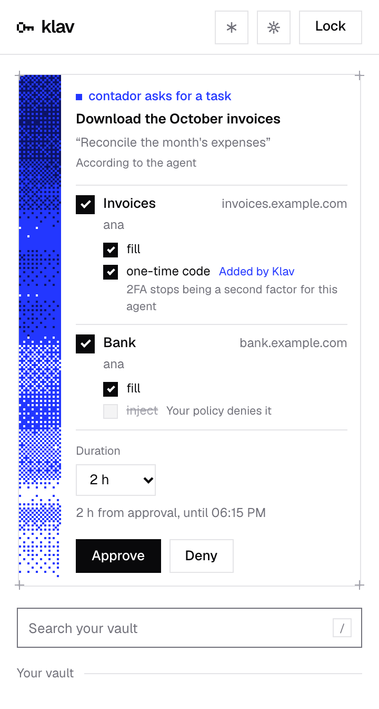

While the task is current, the *popup* shows it with what it covers and the
time left. The blue band empties from the top as time passes.
"End task" cuts it off at once, without asking for presence.

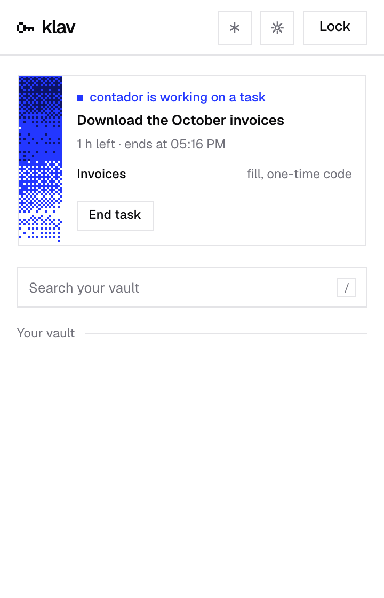

If the agent asks for something its current task doesn't cover, the approval says
"Outside the task “…”" and offers "Deny", "Approve once" and "Add to the
task". Adding signs a revision of the task with that item, permission and
site, without extending it, and approves the request. `reveal` and `delete` only
offer the first two, and `fill` only offers adding if the site matches
the item.

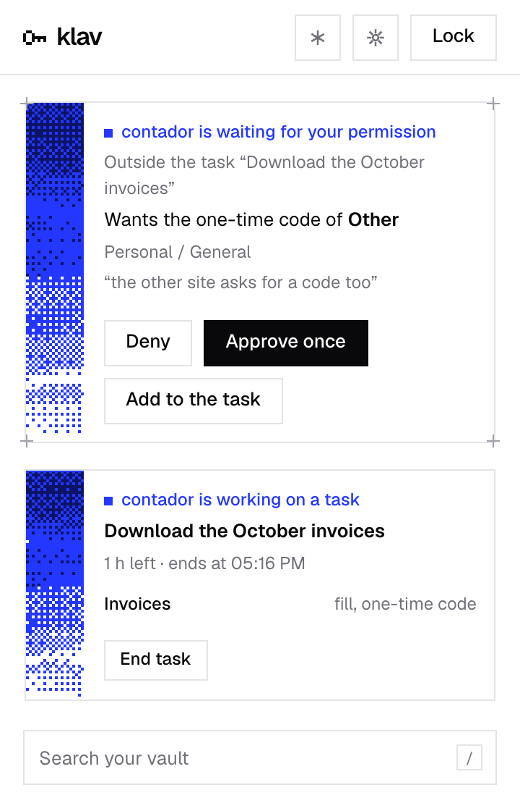

## 9. Permissions

Each permission in the manifest, and why:

| Permission | What for |
|---|---|
| `nativeMessaging` | Talking to `klav-native-host`: it is the only path to the vault |
| `alarms` | Clearing the clipboard 30 s after copying, even if the *service worker* has gone to sleep |
| `clipboardWrite` | Copying a username, a password or a code from the *popup* |
| `offscreen` (Chromium only) | A *service worker* has no clipboard: an *offscreen* document clears it |
| `favicon` (Chromium only) | Reading from the browser's cache the favicon of a site it has already shown (§7, "Site icons"), without asking the network for anything |
| `storage` | Keeping four values in `storage.local`: the "Only fill, don’t press" (`onlyFill`) and "Ask each site for its icon" (`askSites`) settings, the generator's preferred kind (`generatorDefaultKind`) and the time it couldn't clear the clipboard (`clipboardNotCleared`), to warn about it |

No `tabs`, `activeTab`, `<all_urls>`, `scripting`, `webRequest` or
`cookies`. Only those four values go in `storage`: nothing from the vault, no hosts, no
history (everything else it needs to remember lives in the *background*'s memory).
The browser gives a tab's address in every message from its
*content script* (`sender.url`).

The *content script* is declared for `http://*/*` and `https://*/*` in every
frame: it has to see forms to draw the glyph. It receives nothing
from the vault except the values the person chooses to fill. For
passkeys there are two more *content scripts* with the same addresses: the bridge
and a wrapper of `navigator.credentials` in the page's world (§13);
neither asks for a new permission. The pages of
the surfaces inside the page (`menu.html`, `card.html`, `find.html`,
`save.html`, `notice.html` and `passkey.html`) are the only resources reachable from
pages (`web_accessible_resources`), and in Chromium with `use_dynamic_url`,
so that a page can't recognize the extension by those URLs.

The content policy of the extension's pages is
`script-src 'self' 'wasm-unsafe-eval'; object-src 'none'; base-uri 'none'; form-action 'none'`:
no remote code and no `eval`; `wasm-unsafe-eval` only allows compiling the
bundled `klav_wasm_bg.wasm`.

## 10. Languages

The extension speaks English (the base language) and Spanish, according to the language of
the browser's interface; any other language falls back to English.

- The texts live in `apps/extension/_locales/{en,es}/messages.json` and are
  fetched with `chrome.i18n.getMessage` through `t()`
  (`src/shared/i18n.ts`), which has the type of the English catalog's
  keys: a key that doesn't exist doesn't compile. A test checks that the
  two catalogs have the same keys and the same substitutions (`$1`…).
- The manifest is translated too (`default_locale: "en"`, `__MSG_ext_name__`,
  `__MSG_ext_description__` and the shortcut's description).
- Numbers and plurals ("Another account", "3 other accounts") use `Intl`
  with the language of the catalog in use (the `locale` key), not the system's,
  so that a screen never mixes the two.
- What the extension **recognizes** on pages (buttons such as "Continue",
  "Next", "Sign in", field labels) isn't Klav's text:
  it stays in the code, in both languages at once (`detect.ts`, `steps.ts`).
- Messages that come as is from `klavd` (a `denied` from the server, for
  example) stay in English.
- The screenshots in this document show the interface in Spanish, except
  those of the site icons (§7), which come from the tests in English.

The end-to-end tests run in English, with the browser's language
pinned (`launch(stack, { lang })` in `e2e/harness.ts`), and `idioma.spec.ts`
goes through the *popup*, the menu and the save bar in Spanish. Chromium takes
`--lang` on Linux; on macOS it ignores it and reads `AppleLanguages`, so the
*harness* launches it with `-AppleLanguages (es)` from a *script* in the
run's temporary directory.

| *Popup* in Spanish | Menu in Spanish, dark |
|---|---|
| 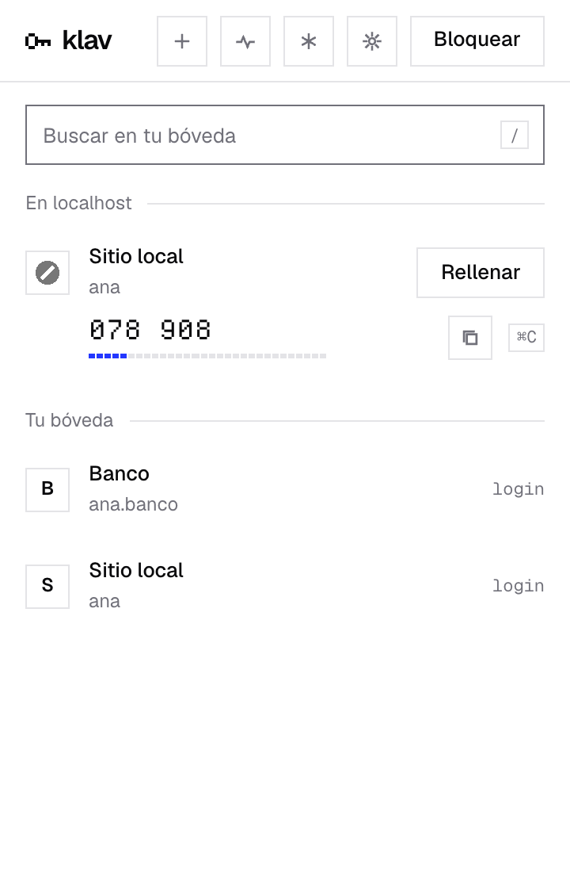 | 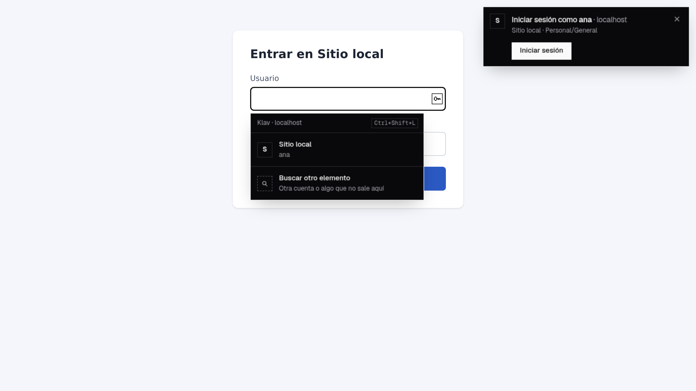 |

## 11. Building, packaging and loading

You need Rust with the `wasm32-unknown-unknown` target, `wasm-bindgen-cli`
at the version in `Cargo.lock` (0.2.130), Node 22 and pnpm:

```sh
rustup target add wasm32-unknown-unknown
cargo install wasm-bindgen-cli --version 0.2.130 --locked
pnpm install
pnpm build        # klav-wasm + dist/chromium, dist/firefox y sus .zip (respeta CARGO_TARGET_DIR)
pnpm lint && pnpm typecheck && pnpm test
pnpm --filter @klav/extension lint:firefox   # el validador de addons.mozilla.org
pnpm --filter @klav/extension e2e            # Chromium de punta a punta (compila antes los binarios de Rust)
```

`pnpm build` leaves in `apps/extension/dist/`:

| File | What for |
|---|---|
| `chromium/` | Load unpacked in Chrome, Chromium, Brave, Edge, Arc and Dia (120 or newer) |
| `firefox/` | Load as a temporary add-on in Firefox (140 or newer) |
| `klav-chromium.zip`, `klav-firefox.zip` | The same development builds, zipped. For the stores, `scripts/extension/package.sh` (below) |

<a id="cargar-sin-empaquetar"></a>

### Load unpacked

> The steps for people who use Klav are on the public page [`install.mdx`](../apps/docs/src/content/docs/get-started/install.mdx) (in `apps/docs/src/content/docs/get-started/`); a change to those steps goes there first.

- **Chromium, Chrome, Brave, Edge, Arc, Dia:** `chrome://extensions` →
  "Developer mode" → "Load unpacked" → `apps/extension/dist/chromium`.
  The ID will be `niiplppgdljgimbnmokojdkofdcjkgao`, and the *host* only lets it
  through with `klav extension install-host --dev`.
- **Firefox:** `about:debugging#/runtime/this-firefox` → "Load Temporary
  Add-on…" → `apps/extension/dist/firefox/manifest.json`. It is removed when
  Firefox closes.

Then, `klav extension install-host --dev` and restart the browser. The guide
[`probar-fase-5.md`](probar-fase-5.md) goes through everything by hand in Dia and Chrome.

### For the stores

`scripts/extension/package.sh` leaves in `target/extension/` the packages for
the stores (Chromium's without the development key, `key`), the source
code addons.mozilla.org asks for, and their *hashes*. Underneath it uses
`KLAV_STORE=1` and `KLAV_DIST` from `scripts/build.mjs`, so `dist/` stays
the development build. The Chrome Web Store assigned its own ID, which is
in `STORE_CHROMIUM_IDS` (§2); Firefox's doesn't change: `klav@klav.dev`.

The step-by-step for each store is in
[publicar-extension.md](publicar-extension.md). The store listing (descriptions,
the justification for each permission, data use and notes to reviewer), the
screenshots and the images live in `apps/extension/store/`, and the privacy
policy in [privacidad.md](privacidad.md).

### Tests

- **Unit** (`pnpm test`): form detection with *fixtures* from
  real sites, site matching, field names, the language
  catalogs, the tabs by kind (`filters.ts`) and the logo map (that its paths only use `M`, `L`, `C`, `Q`
  and `Z`, and the normalization of `scripts/site-icons.mjs`), what a task's card
  sends on approval and the "New item" view (the `create` of
  each kind, the errors on their field and that the values are cleared). Since layer 09, also the *content
  script* and the *background* with a fake `chrome`: visible fields,
  the person's submits, fills bound to the document, covered frames,
  operations per page and saving per tab and site.
- **Rust** (`cargo test --workspace`): the native *host* (message framing,
  allowed IDs, list of operations) and `klavd`'s event channel
  with a simulated extension.
- **End to end in Chromium** (`e2e`): `klav-server`, `klavd`, the
  *host* and Chromium with the extension in a throwaway profile. Unlocking,
  autofill, frames, saving, generating, codes, the *popup*, the
  clipboard, the tabs by kind and "Codes" (`tipos.spec.ts`), the
  page's codes above "Codes" (`site-codes.spec.ts`), creating items from the *popup*, agents through MCP, task requests (card,
  "Outside the task" and "End task"), the menu covered by a layer that
  lets the click through or with the host moved (`tapado.spec.ts`), the
  languages and the site icons
  (that no site receives an icon request if the setting is
  off), passkeys against a test RP (§13) and the presence gate
  (`presencia.spec.ts`: a `klavd` with Touch ID off, the master
  password in Klav's frame, and a second browser connection where
  neither, one or both report focus, also changing right before the
  fill). Each run uses its own temporary
  directory, deleted when it ends, also if it fails. Each
  `*.spec.ts` file brings up its own stack (server on a free port, `KLAV_HOME`,
  Chromium profile and the *host*'s manifest), so in CI four
  files run at once (`workers` in `playwright.config.ts`); the tests within one
  file still run in order. Locally they run one at a time, except with
  `--workers=4`: on a Mac without traces, with four, `save.spec.ts:38` and the
  T80 test of `passkeys.spec.ts` failed in half the runs.
  The passkey and save tests (`passkeys*.spec.ts` and `save.spec.ts`,
  project `serial`) run at the end and on their own: in CI, next to other files,
  the `passkeys.spec.ts` page froze once and
  `save.spec.ts:38` didn't see "Saved to Klav" on `main`. A filter for other
  files also runs them; `--no-deps` leaves them out.
- **Firefox:** `lint:firefox` validates the package with `addons-linter` in CI.
  There is no automatic end-to-end test: Playwright doesn't load
  extensions in Firefox. The manual guide covers what would need testing by
  hand.

## 12. Import

> The steps for people who use Klav are on the public page [`import.mdx`](../apps/docs/src/content/docs/get-started/import.mdx) (in `apps/docs/src/content/docs/get-started/`); a change to those steps goes there first.

The "Where are you coming from?" wizard ([ADR 0024](decisiones/0024-importadores.md))
is an extension page, `import.html`, in its own tab. It opens
from the *popup*'s settings (Import) and from the empty vault. Opening a
tab of the extension itself doesn't ask for the `tabs` permission.

| | | |
|---|---|---|
| 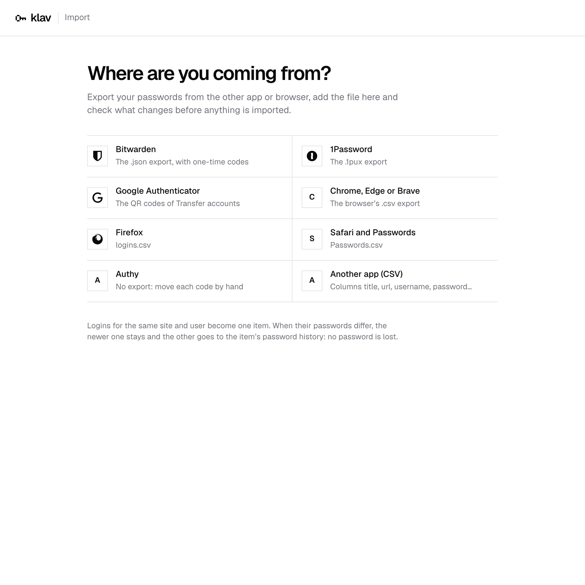 | 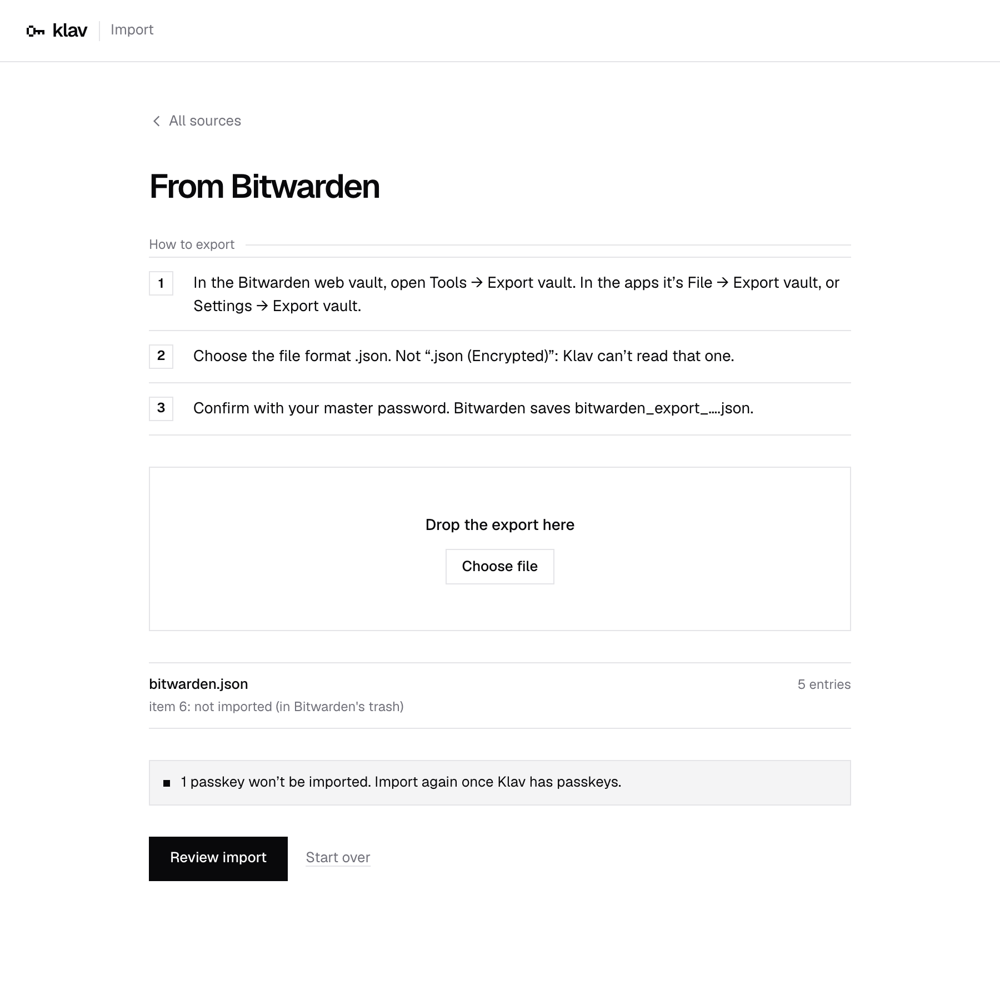 | 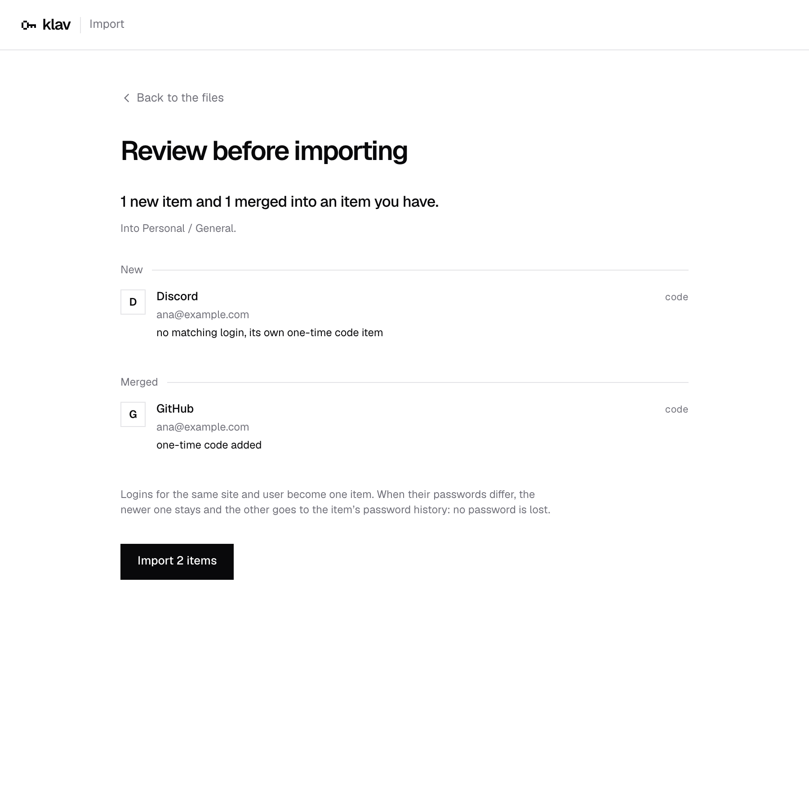 |
| 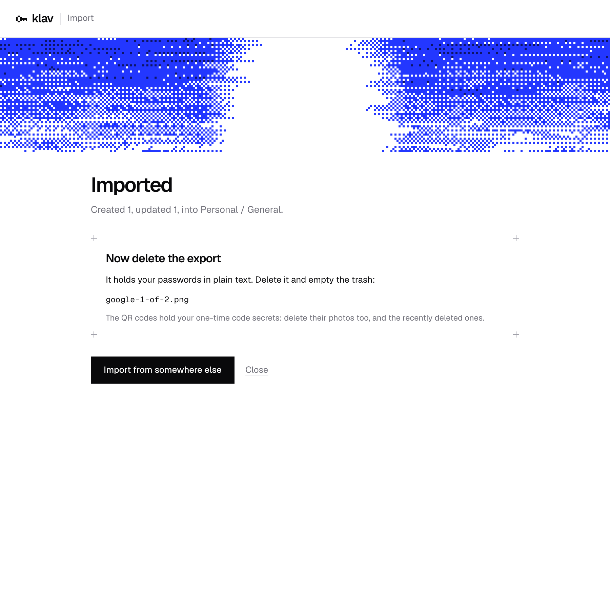 | 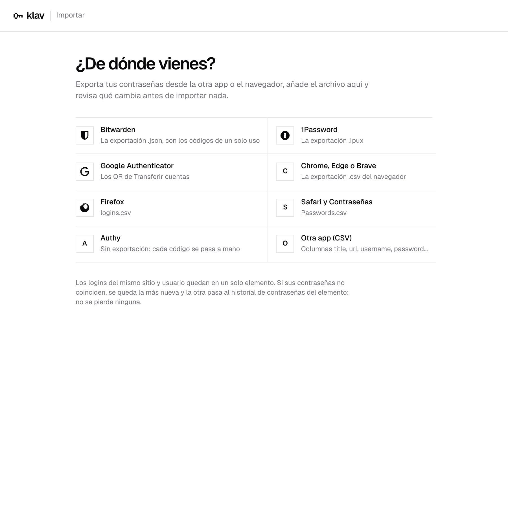 | 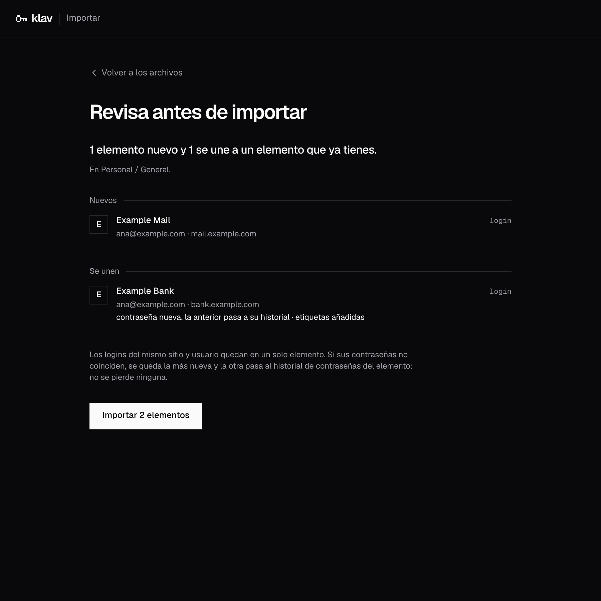 |

1. **The source:** Bitwarden, 1Password, Google Authenticator, Chrome, Edge or
   Brave, Firefox, Safari and Passwords, another app (CSV) or Authy. Each one
   shows the exact steps of its export. Authy has none: the page
   explains how to move each code by setting up Klav as the site's
   authenticator, and that the CSV Twilio sends under the GDPR isn't imported.
2. **The files:** dropped or chosen, one or several; from Google
   Authenticator, the photos of the QR codes or their pasted `otpauth-migration://` links.
   Each file says how many entries it has and what is skipped (the
   Bitwarden trash, a HOTP code), without values. If a Google export
   is missing QR codes, it says how many. If a file isn't
   from the chosen source, it is rejected with its name.
3. **The review:** new ones, the ones that merge into an item that already exists and
   the ones already there, with what changes in each ("new password, the old one
   goes to its history", "one-time code added"). Nothing is
   written until "Import" is pressed. With more than one project, the
   destination is chosen.
4. **Done:** how many were created and updated, and the reminder to delete the
   exported file, with its name, and to empty the trash; for Google,
   the photos of the QR codes too.

**How the files travel.** A native message can't exceed 1 MiB, so
the page sends each file to `klavd` in 512 KiB chunks (`import_add`,
in base64url), up to 256 MiB per file. A photo is first turned into a PNG in the
page (`createImageBitmap` and `OffscreenCanvas`, longest side 2400
pixels) and `klavd` reads the QR code with `rqrr`. The pending import lives in
`klavd`'s memory: 4 at a time at most, forgotten after 30 minutes without
use, when Klav locks and when the tab closes (`import_cancel`). The review
carries no values, only titles, usernames, sites and what changes.

The merge rules are the CLI's ([cli.md](cli.md), "Import"): the
same site and username end up in a single item, a Google
Authenticator TOTP merges into the login for the same site and account or stays as its
own item, and a replaced password goes to the `0x16` history.
Importing the same thing twice adds nothing.


## 13. Passkeys

> The steps for people who use Klav are on the public page [`browser-extension.mdx`](../apps/docs/src/content/docs/apps/browser-extension.mdx) (in `apps/docs/src/content/docs/apps/`); a change to those steps goes there first.

The extension signs in with and registers passkeys saved in Klav
([ADR 0020](decisiones/0020-passkeys.md)). The private key never leaves
`klavd`: the extension passes it the request and receives the assertion or the registration already
signed.

```
 page ── navigator.credentials.create/get
   │  webauthn-page.js (page's world, document_start): the wrapper
   │  window.postMessage, only within the same window
   ▼
 webauthn.js (isolated world): the bridge; cleans up the request
   │  runtime.sendMessage (the browser adds sender.url and the frameId)
   ▼
 background: does Klav take it? ── no ──▶ "browser": the original call
   │ yes
   ▼
 passkey.html (Klav's frame, top right): the person chooses
   │  passkey_candidates / passkey_get / passkey_create
   ▼
 klavd: checks the rpId against the origin, asks for presence and signs
```

**The wrapper.** `webauthn-page.js` runs in the page's world
(`world: "MAIN"`, Chromium 111 and Firefox 128 or later; the extension's
minimum is 120 and 140). It replaces `create` and `get` on
`CredentialsContainer.prototype`. It keeps nothing secret: it turns the
page's options into a flat request (base64url) and Klav's response
into WebAuthn objects (`PublicKeyCredential`,
`AuthenticatorAttestationResponse`, `AuthenticatorAssertionResponse`, with
`toJSON`). If the bridge doesn't confirm within 800 ms that it got the call (a
frame without it), the browser's original call is used. The page sees its
own request and its response, and that's fine: it is the RP. Klav's
decisions (which origin, which passkey, the consent) are made outside it.

**The bridge** (`webauthn.js`, isolated world, `document_start`, every
frame) only accepts messages from its own window (`event.source ===
window`). It validates the shape of the request again (`cleanCall`):
- the challenge, from 16 to 1024 bytes;
- the user ID, 64 bytes at most;
- 256 credentials at most;
- texts of 256 characters at most.

It drops any other field, for example an `origin`. It sends the
*background* the request and whether its frame is of the same origin as the top one.

**Who handles it.** The *background* sends to the browser's authenticator,
silently and as if Klav weren't there, everything Klav doesn't take:
- an address that isn't `http(s)`, or an opaque origin (a *sandbox* frame);
- a frame from an origin other than the top page's (T82);
- a malformed request;
- a registration without ES256 among its algorithms, or for a security key
  (`authenticatorAttachment: "cross-platform"`);
- `klavd` absent or without an account (P13);
- an rpId that `klavd` rejects for that origin;
- a `get` with no Klav passkeys that match, also with
  `allowCredentials` (T86);
- `mediation: "silent"`, which allows no interface.

Everything else waits for the person's decision in Klav's frame. There is a single
request per tab and it expires after 5 minutes. The origin always comes from
`sender.url`, never from the message (T80). If Klav is locked, the frame
asks to unlock first; if afterwards there is no passkey for the site, the
call goes to the browser.

**The frame** (`passkey.html`, one more surface inside the page, with
the two checks against *clickjacking* of §5; the bridge answers the page-side one,
since it is what draws the frame):
- **Sign in:** the site's passkeys in Klav (title, account and
  vault). One click signs.
- **Register:** "Save a passkey for *account* in Klav", in a new login
  or in one of the site's logins; the one for the same account comes first.
  If the account already has a passkey, it asks whether to replace it.
- **Presence:** `klavd` asks for Touch ID. Without Touch ID, or if it fails, the
  master password is typed in Klav's frame, never in the page.
  Inside the verification window (§7, Settings) it asks for neither of
  the two: the click is enough.
- **The sign-in card** ("Sign in as…") takes up the same corner
  and another *script* draws it. When the frame opens, the *background* closes it,
  without dismissing it for the site, and doesn't offer it again in that
  tab while the frame is open. Otherwise, the card could cover the
  frame, and the frame ignored clicks as covered (T62).
- **Always:** "Use another device", which hands the call back to the
  browser (its passkeys, a phone or a key).
- **Closing the frame:** the page gets `NotAllowedError`.

`InvalidStateError` (excluded credential) only arrives after the
person consents (T86).

**Conditional mediation** (`get` with `mediation: "conditional"`, ADR 0020
P9). It is the passkey in the username field's autofill:
- The request waits without a frame, for up to an hour or until the page
  aborts it or goes away.
- When a field with `autocomplete="… webauthn"` gets the focus in that same frame,
  the field's menu opens on its own. From the glyph it opens on any sign-in
  field.
- The site's passkeys in Klav come first ("Passkeys", with the title and
  "Passkey · account"). Below them come the logins and, at the bottom, "Use another
  device".
- Choosing one opens Klav's frame only for presence. The choice goes through
  the menu's two checks (§5), and the frame waits to count as
  seen before asking for Touch ID; if the page covers it, it says so and the passkey
  is chosen with a click. Closing it leaves the request waiting: the person
  can still type their password.
- "Use another device" passes the request to the browser, which shows its
  own passkey autofill.
- If Klav has no passkeys for the site, the request passes to the browser
  silently (T86). With Klav locked it can't be known: the menu asks to unlock
  and, if afterwards there are none, passes it to the browser.
- When leaving the page, the bridge cancels its requests; if the page
  comes back from the back/forward cache, they end in `NotAllowedError`.

**An agent uses one of the person's passkeys** (ADR 0020 §9; the protocol in
[`klavd.md`](klavd.md) §3). Only inside a task with `passkey`:
- `klavd` sends `passkey_arm` once it has checked the agent and the task. The
  *background* checks that the tab is still on that host (the address the
  browser gives) and keeps the use for that tab, for up to 60 s.
- If the page is already waiting for a passkey from that site (in the field's menu or
  with Klav's frame open), it gets it at that moment and the frame
  closes. If not, the site's next `get` request in that tab
  gets it without a frame: the *background* asks `klavd` for `agent_passkey_use`, which
  signs with UV.
- Only if the tab, the host, the rpId and the login match (and it is among
  the page's `allowCredentials`). It is used once, even if `klavd`
  rejects; a rejection leaves the request to the person, with their frame.
- The page shows the agents' blue notice: "Klav signed in with
  the passkey of “*title*” for “*agent*”" and the reason.

**ADR 0020 checks.**
1. Klav's AAGUID reaches the RP in Chromium too. The browser never sees
   the `attestationObject`, because `klavd` builds it and the wrapper
   delivers it as is, so it can't zero it out. The e2e checks it
   with the AAGUID the RP reads.
2. `match_origin_as_fallback` isn't declared in any browser. `about:blank`,
   `blob:` and `data:` frames don't get the wrapper and go to the
   browser.

**Tests.**
- Unit: reading the options, `cleanCall` and the objects the
  page receives.
- E2e (`e2e/passkeys.spec.ts`): a test RP (`e2e/rp.ts`) verifies on
  its own, with `node:crypto` and no new dependencies:
  - the `clientDataJSON` (type, challenge, origin);
  - the `authData` (rpId hash, flags, counter and AAGUID);
  - the COSE key;
  - the ES256 signature of each sign-in.

  In addition:
  - a virtual browser authenticator (CDP) receives what Klav doesn't
    take;
  - a page that writes another origin or another rpId gets nothing out of
    them (T80);
  - a wrong password doesn't sign, and closing the frame gives
    `NotAllowedError`;
  - conditional mediation: the menu opens on its own in the
    `webauthn` field, signs with the chosen passkey, closing the frame leaves the
    request waiting and "Use another device" passes it to the browser.
