# iOS app

Klav's iPhone app opens the vault with Face ID, lets you view, search and
edit items, fills passwords and codes in Safari and other apps, and is the
place where the person approves what their agents ask for. All the cryptography
is `klav-core`'s, compiled for iOS with `klav-ffi`. The decisions
are in [ADR 0018](decisiones/0018-app-ios.md).

## 1. Architecture

> The steps for people who use Klav are on the public page [`iphone.mdx`](../apps/docs/src/content/docs/apps/iphone.mdx) (in `apps/docs/src/content/docs/apps/`); a change to those steps goes there first.

```
 Klav.app (SwiftUI)                    KlavCredentials.appex
 ─ inicio de sesión, bóveda, edición    ─ Credential Provider Extension
 ─ Face ID, bloqueo automático          ─ solo Face ID, sin red, solo lectura
 ─ aprobaciones y avisos (APNs)         ─ rellena contraseñas y códigos
            │                                       │
            └──────────── Shared/ (Swift) ──────────┘
                 CoreService, Keystore, tema, textos
                             │
                     klav_ffi.swift (uniffi)
                             │
             KlavFFI.xcframework (Rust: klav-ffi → klav-client → klav-core)
                             │
          <contenedor del App Group>/klav   (NSFileProtectionComplete)
```

- **`klav-ffi`** exposes one `KlavCore` object per directory, with synchronous
  methods that Swift calls off the main thread (`CoreService.run`).
  Errors arrive as `KlavError` and the app tells them in the interface's
  language (`KlavError.userMessage`). Swift implements the Face ID keystore with
  the `PlatformKeystore` protocol. The only `unsafe` on the Rust side is in
  `klav-ffi`.
- **The app and the extension share the same `KLAV_HOME`**: the App
  Group container (`group.dev.klav.ios` by default) with `complete` protection. The
  extension only reads what the app saved in its last sync.
- **No third-party dependencies in Swift.** The fonts are the same as
  the extension's (Geist, Geist Mono and Departure Mono, OFL): the `woff2` files in
  `apps/extension/static/fonts` are converted to `ttf` in `Shared/Fonts` with
  `scripts/ios/fonts.sh`.
- **Interface:** the same as the extension's
  ([diseno-visual](diseno-visual/README.md)). The light and dark colors
  live in `Shared/Theme.swift`. The dither of
  `apps/extension/src/shared/dither.ts` is ported to `Shared/Dither.swift`
  with the same numbers (the tests check it), and the pixel key to
  `Shared/Glyph.swift`. `scripts/ios/app-icon.sh` generates the icon (light, dark and tinted)
  with that same code. What iOS decided on its own
  is in diseno-visual §7.
- **`Shared/` is also the Mac app's** ([ADR 0027](decisiones/0027-app-de-mac.md) §2):
  the theme, the fonts, the dither, the pixel key, the site icons,
  the texts and the clipboard compile for macOS 15, with `#if` where
  they differ (`UIColor` versus `NSColor`, `UIPasteboard` versus
  `NSPasteboard`, the App Group container versus
  `~/Library/Application Support/klav`). `Keystore.swift` and
  `CoreService.swift` are iOS only. `Shared/App/` holds what
  the two apps share and the AutoFill extension doesn't: the engine's protocol
  `VaultEngine` (what the screens ask of `KlavCore` on iOS and of
  `DaemonEngine`, a `klavd` client, on the Mac), the cards for agent
  requests (approvals, registrations, tasks and the "Compare
  words" one), generic over the `RequestsModel` protocol that
  `AppModel` and the Mac's `MacModel` conform to, their pieces (`RequestWords`,
  `AgentCard`, `CheckBox`, `Chip`, `Flow`, `FieldBlock`, `Tag`,
  `FilterMenu`), the tasks' logic (`TaskEdits`, `TaskWords`), the
  vault health's words (`HealthWords`) and those of the agents' activity and
  pause (`ActivityWords`, `ActivityPeriod`, `PauseWords`,
  `PauseLength`, `Pauses`; §10), and what the item editor does
  (`ItemDraft`: the fields of each kind, `titleTaken` and what goes to
  `create_item` and `edit_item`), the generator (`GeneratorWords`) and the
  "Fix my reused passwords" card with its progress
  (`FixReused`: `OfferCard`, `FixProgressCard` and the
  `FixOffering` protocol, which each app conforms to in its own way: Face ID on the iPhone,
  Touch ID in `klavd` on the Mac).

| Vault | Item page | Item page, dark |
|---|---|---|
| 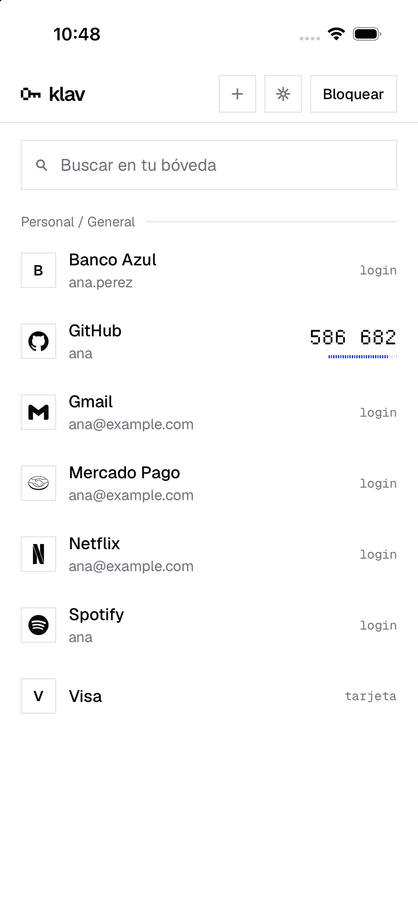 | 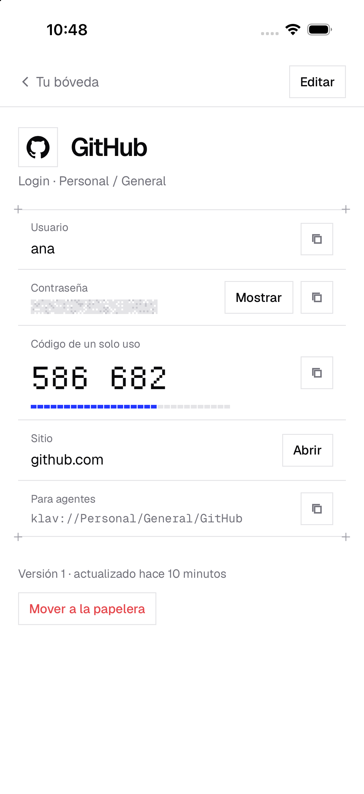 | 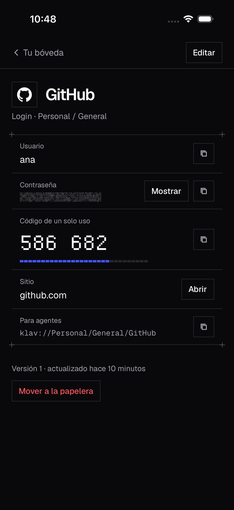 |

### Tabs by kind and "Codes"

Under the vault's search there is a row of tabs, the same as the *popup*'s
([extension.md](extension.md) §7): "All", "Logins", "Codes", "Cards",
"Notes", "SSH keys", "API keys", "Addresses" and "Files". Each one
carries its kind's icon in front, the same as the *popup*'s and the Mac's sidebar's
([diseno-visual](diseno-visual/README.md) §7), and its count in gray after it. The
icon grows with the text (`@ScaledMetric`).

- **Only the ones that have something show.** If the vault is of a single kind and has
  no codes, the row isn't drawn. The chosen one is in ink with the 2 pt
  line that says "chosen" in the rest of the app, and if they don't fit they
  scroll sideways and fade at the edge.
- **The counts follow the search.** They come from the same list that draws
  the vault (`items`), so a search counts them again. A
  tab that the search leaves empty stays while it is chosen and says
  so.
- **"Codes"** is the view in the style of Google Authenticator: only the
  items with a one-time code, whatever their kind, by title.
  Each row carries the title and the username at the top and the large code in
  Departure Mono with its time blocks. **A tap anywhere on the
  row copies the code**, with the success haptic
  (`sensoryFeedback(.success)`). The copy box turns into ✓ for a moment,
  and the notice at the bottom counts down the clipboard's 30 s.
- **Which items have a code** is said by `klav-core` with
  `items(query: ItemQuery(codes: true))`, once when the vault opens and again
  every time it changes. Each code is still asked for only while its row
  is on screen.
- **A code on its own** (kind `totp`) has no tab of its own: that is what
  "Codes" is for. The logic lives in `Klav/VaultFilter.swift` and
  `VaultFilterTests` tests it.

| Tabs | "Codes" | "Codes", dark | In Spanish |
|---|---|---|---|
| 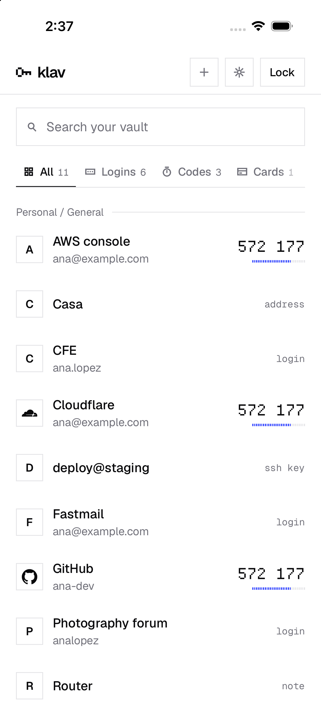 | 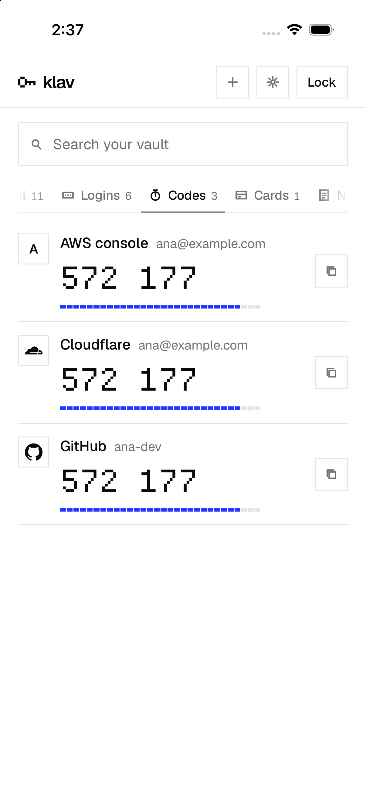 | 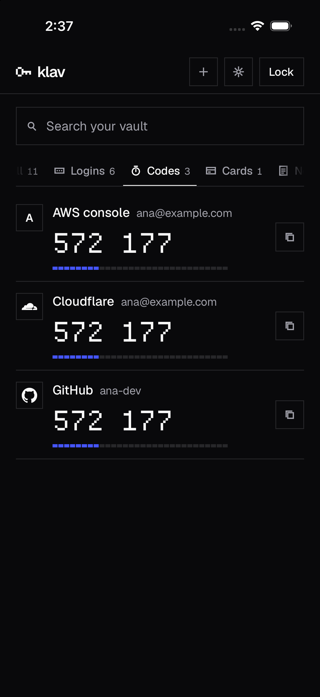 | 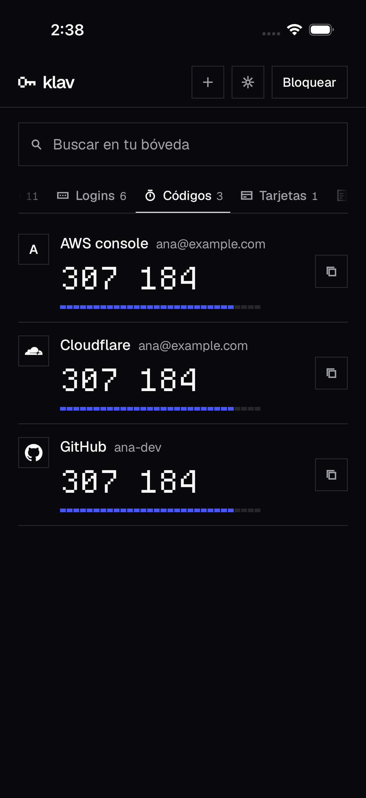 |

### Large text

The interface follows the iPhone's text size, the accessibility sizes included
(AX1 to AX5). In an item page's rows (`DetailRow` in
`ItemView.swift`) the name and the value go on one side and "Show", copy and
"Open" on the other; with accessibility text the buttons move down under the
value, so the name has the whole width and is never cut mid-word.
The same happens in previous passwords, the generator
history and the editor's fields. Section titles
(`SectionLabel`) wrap to another line instead of being cut off. The test
`testItemRowsStackWithAccessibilityText` checks it from "large" to AX5.

| AX1 | AX5 | AX5, in Spanish and dark |
|---|---|---|
| 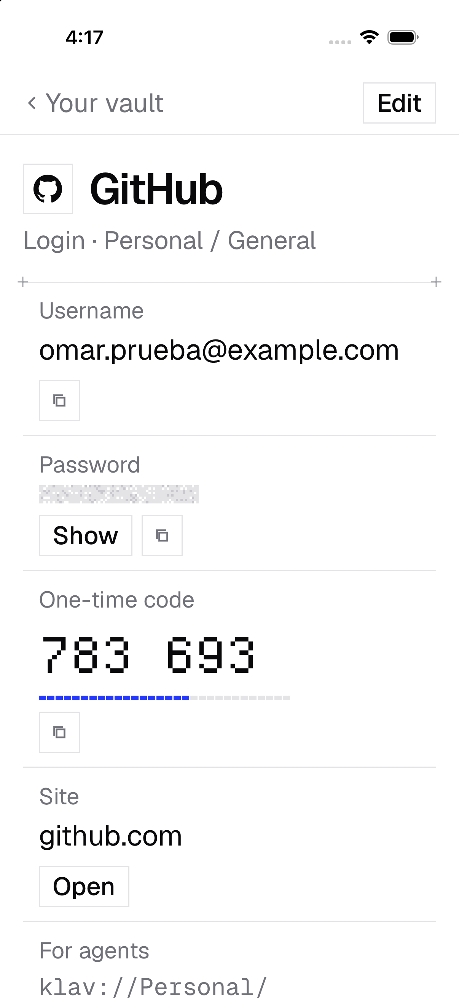 | 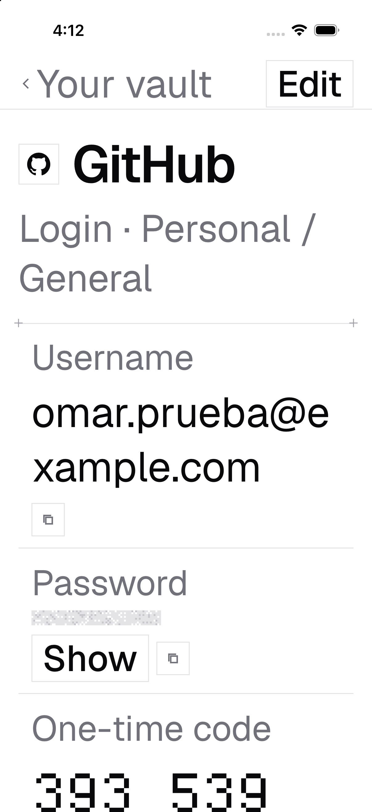 | 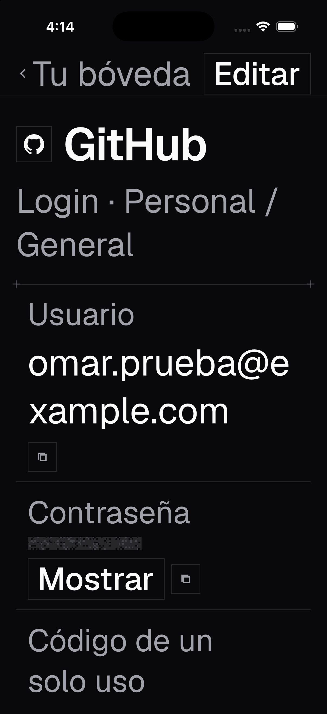 |
| 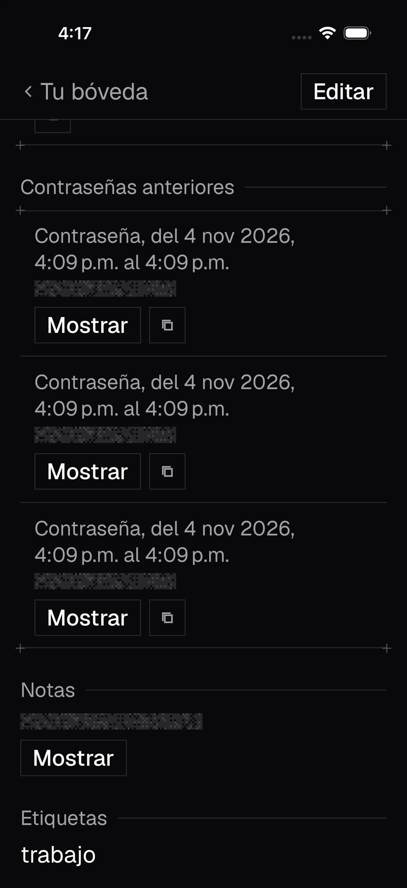 | 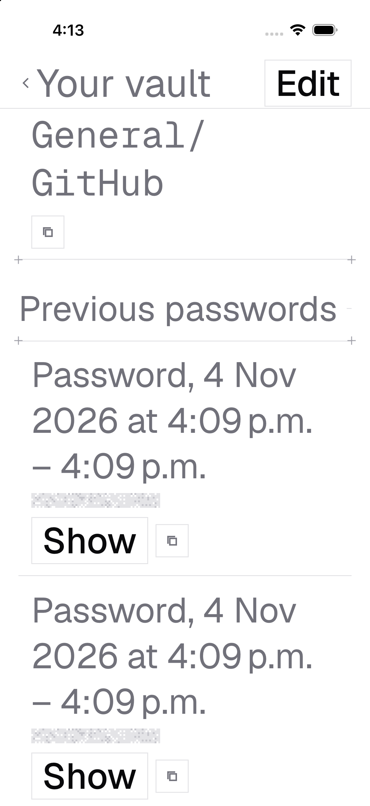 | 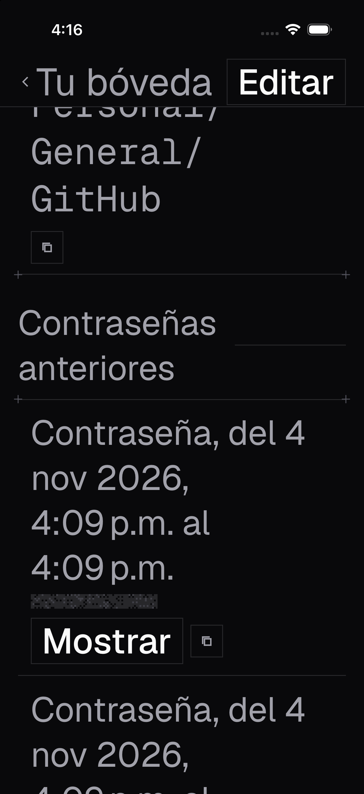 |
| 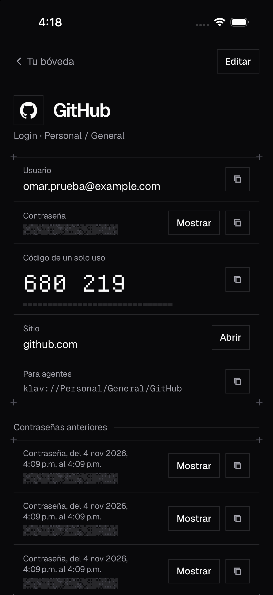 | 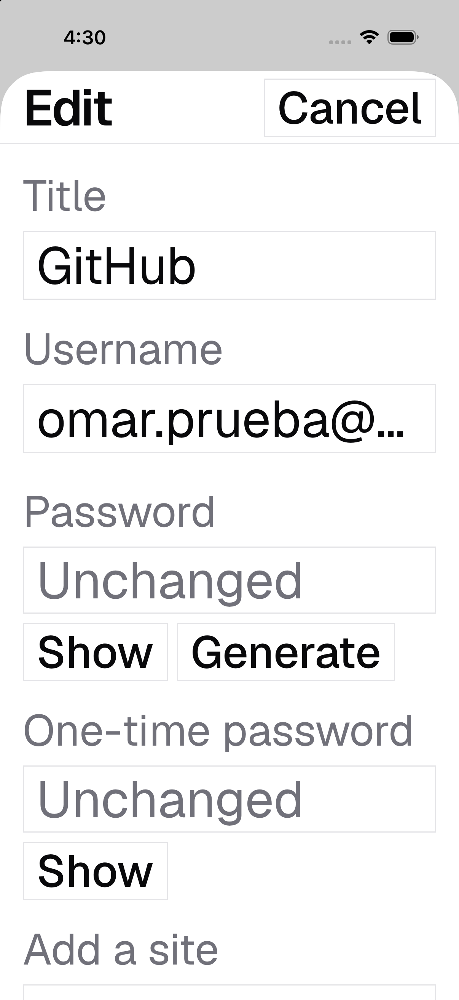 | |

### Languages

The app and the AutoFill extension speak English (the base language) and
Spanish, according to the iPhone's language; any other language falls back to English.

- The texts live in a String Catalog, `Shared/Localizable.xcstrings`,
  which goes into both *targets* because `Shared` belongs to both. The keys
  are the English text; the catalog keeps the Spanish. The `Info.plist`
  permissions (the Face ID text) go in `Klav/InfoPlist.xcstrings` and
  `Credentials/InfoPlist.xcstrings`. `project.yml` sets
  `developmentLanguage: en` and `LOCALIZATION_PREFERS_STRING_CATALOGS`, and
  XcodeGen takes `es` from the catalogs (`knownRegions`).
- In views, a literal is a key: `Text("Unlock")`, and also
  `Title`, `SectionLabel`, `FieldLabel` and `placeholder` from
  `Shared/Theme.swift`, which imitate `Text` (a `String`, such as an
  item's title, is shown as is). The compiler doesn't extract the literals
  of those custom views, so those keys are in the catalog by hand
  (`extractionState: manual`). Whatever goes through a `String` (errors,
  `Kind.label`, the field names) uses `String(localized:)`.
- To see what's left to translate:
  `xcodebuild -exportLocalizations -project Klav.xcodeproj -scheme Klav -localizationPath <dir> -exportLanguage es -sdk iphonesimulator`
  and look in the `.xliff` for units without a `<target>`.
- The tests run in English (the scheme passes `-AppleLanguages (en)`) and
  read the Spanish from the `es.lproj` bundle. To see the app in Spanish in the
  simulator without changing the system, launch it with
  `-AppleLanguages (es)`.

| In English | AutoFill, in English |
|---|---|
| 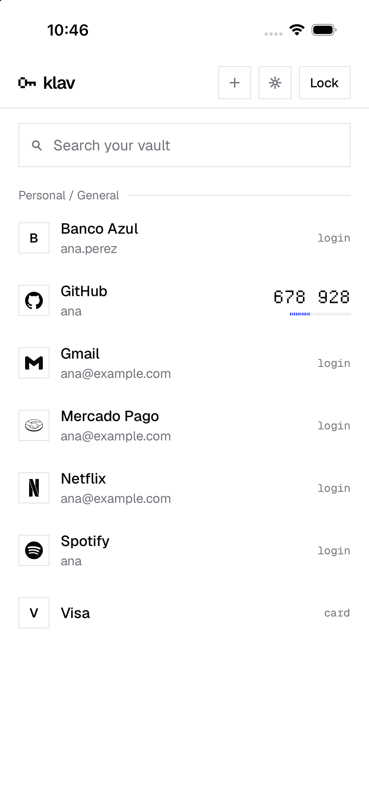 | 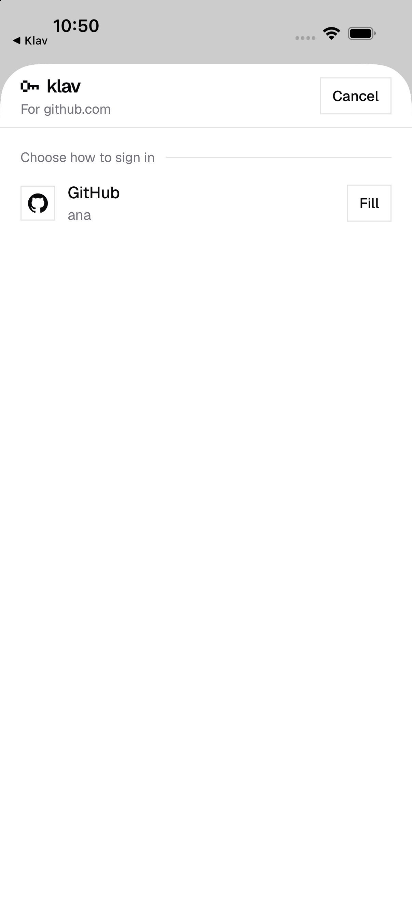 |

### Site icons

Each row of the vault, the header of the item page and the AutoFill list
carry the logo of the item's site (that of its first URL) if Klav
ships it, and otherwise the initial, like the extension
([extension.md](extension.md) §7). The map is the same file,
`assets/site-icons/site-icons.json` (Simple Icons, whose project license is CC0 1.0;
Klav ships only logos with CC0 1.0 or no license data, see
`THIRD-PARTY-NOTICES.md`; logos of about 300 sites, trademarks of their owners), which goes in as a resource in both *targets*.
`Shared/SiteIcons.swift` reads it once, looks up the domain or the closest
of its parents and draws the path, which only uses `M`, `L`, `C`, `Q` and `Z`, in
the theme's ink. A test checks that every path can be read.

iOS doesn't have the extension's other two layers: there is no favicon
cache to read, and it doesn't ask the site for the icon. The AutoFill
extension doesn't use the network by design, and the app would have to keep the
icons of every site; it stays with the initial.

### Generator and previous passwords

The generator is `klav-core`'s (ADR 0022 §1), exposed by `klav-ffi`
as `generate(input:host:)`; the app doesn't reimplement rules or word
lists.

- **Where it is:** "Generate" next to each password in an item's editor
  (with the rules of the site of its first URL) and **Settings ›
  Passwords › Password generator** (without a site).
- **The sheet** has the four kinds (smart, random, memorable and
  PIN), the options of each, the strength bar, copy, another and, in
  the editor, "Use this password". "Use as default for suggestions" saves
  the kind in `UserDefaults` (`generatorDefaultKind`), only on that iPhone.
  The characters are colored as in the extension (G10).
- **History:** copying and "Use this password" first save the
  password with `record_generated` (`0x43`, in the same
  `generator-outbox.bin` as the desktop, see
  [especificacion-cripto.md](especificacion-cripto.md) §14.7) and upload it
  as soon as possible; each sync uploads whatever is left. If it couldn't be
  saved, "Use this password" doesn't fill and says so; copying copies anyway and
  warns. "Generator history" lists what was generated without values and only decrypts
  one when copying it; "Delete history" deletes it all. In the copy of a
  deleted account, Settings › Passwords only shows "Generator history",
  read-only: it can be seen and copied, with no generating or deleting (question 2 of the
  review of ADR 0037, §11).
- **Signing out** counts what would be lost: the passkeys and the
  generated passwords that weren't uploaded, after trying to upload them.
  The dialog says how many of each (the generated ones can be copied from
  the history) and `sign_out` receives those numbers
  (`AcceptedLoss::Unsent`); if there are more on the way out, it refuses (T138). A queue
  that can't be read, or Klav locked with a queue, counts as "couldn't
  check".
- **Previous passwords:** the page of an item with a `0x16` record
  shows "Previous passwords", with the field and from when to when each one
  was used (with the time if it was a single day). The value is decrypted only when
  "Show" or copy is pressed, and is hidden again with the rest of the item page.
- **Accessibility text:** the four kinds go one per row, and copy,
  another, "Show" and the − / + steppers move down under their value.
- **VoiceOver** also reads the position of each previous password and of each
  history entry ("2 of 3"): two changed in the same minute
  show the same text, but don't sound the same.
- **AutoFill doesn't generate.** The AutoFill extension neither writes nor
  syncs (§3), so it couldn't save in the history what it
  generated. To sign up on a site, generate in the app and copy.

| Generator, with the site's rules | Generator history | Previous passwords |
|---|---|---|
| 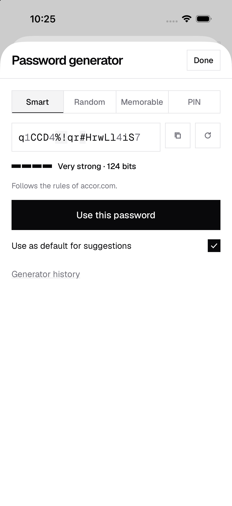 | 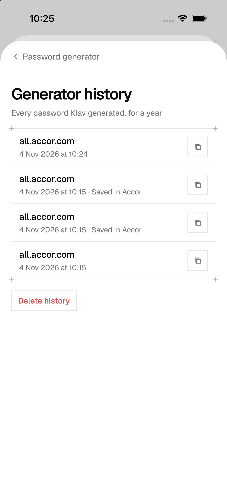 | 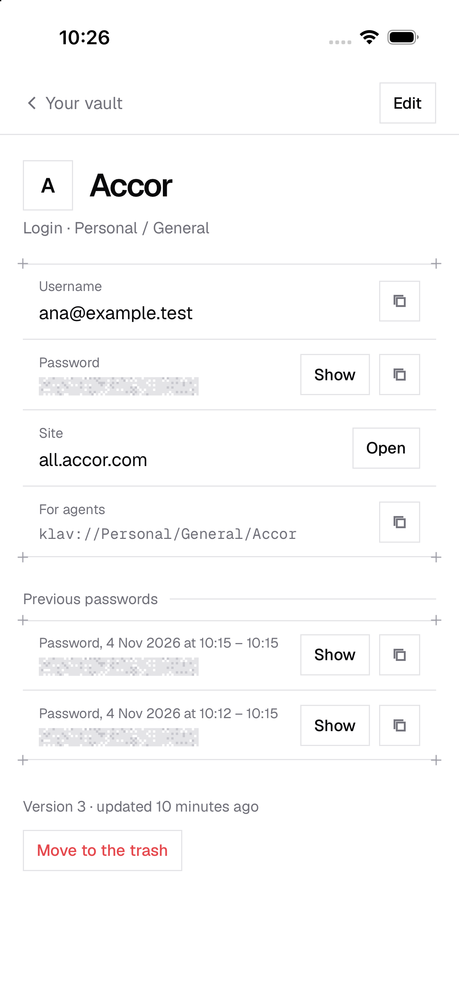 |

## 2. Unlocking

> The steps for people who use Klav are on the public page [`iphone.mdx`](../apps/docs/src/content/docs/apps/iphone.mdx) (in `apps/docs/src/content/docs/apps/`); a change to those steps goes there first.

- **Master password:** when signing in, every 14 days and after
  restarting the iPhone.
- **Face ID:** a P-256 key in the Secure Enclave
  (`biometryCurrentSet`) wraps the local key. If the enrolled faces
  change, the key stops working and Klav asks for the password. A
  transient keychain failure doesn't delete the setup: Klav says it failed and you can
  retry or use the password. A password time in the future
  also asks for the password.
- **Turning off Face ID** in Settings asks for the iPhone's owner: Face ID or, if it
  fails, the iPhone's passcode (`deviceOwnerAuthentication`, through
  the keystore's `confirm_owner`), never the master password alone. If the
  person cancels, the switch goes back and nothing changes. Without this,
  whoever has the unlocked iPhone could turn off Face ID and delete the account
  with the password alone (§11). Only an iPhone without a passcode lets the setup be
  forgotten without asking: there is no Face ID there either.
- **Simulator:** it has no Secure Enclave. Only in `DEBUG` builds for
  the simulator is a software key used behind the same simulated
  Face ID. On a device or in *release* that code doesn't exist.
- **Automatic lock:** on leaving the app, or after 1, 5 or 15 minutes or 1
  hour in the background (1 minute by default). The time away is measured with
  `ContinuousClock`, which doesn't change with the Settings time and keeps counting
  while the iPhone sleeps (`systemUptime` stops). On lock, the app
  forgets the requests, the tasks and what the person changed on their
  cards; the notification that was opened shows after unlocking.
- **Privacy cover:** in the app switcher you see the dithered lock,
  never the vault. The cover is a window of its own above
  alerts (`UIWindow` at level `.alert + 1`), so it also covers the
  sheets (editor, generator, settings, import) and the dialogs, which iOS puts
  above the root view. It comes up without animation as soon as the scene stops
  being active (except during Klav's own Face ID). When going to the
  background, the item page and the editor hide again the secrets the
  person had shown.
- **Logs:** the `dev.klav.ios` log only carries states in public (lock,
  scene, how many suggestions); error messages go with `.private`.

| Locked | Dark | Sign-in |
|---|---|---|
| 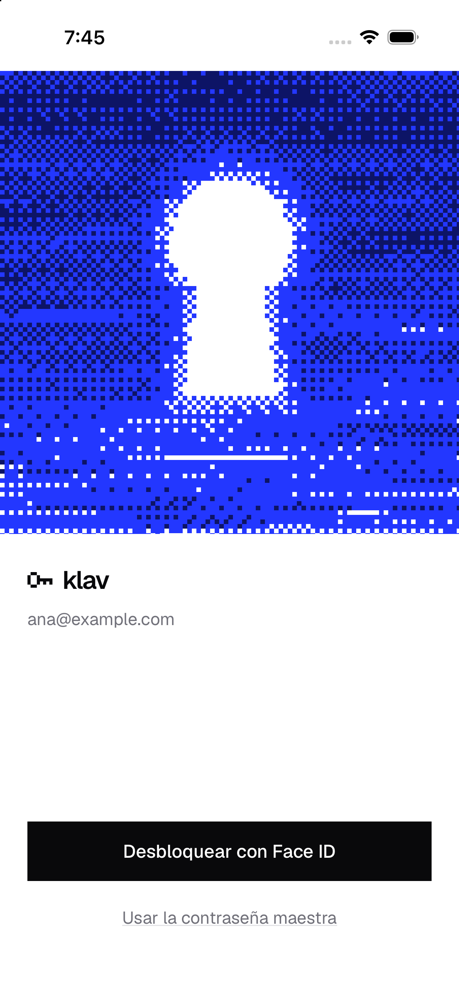 | 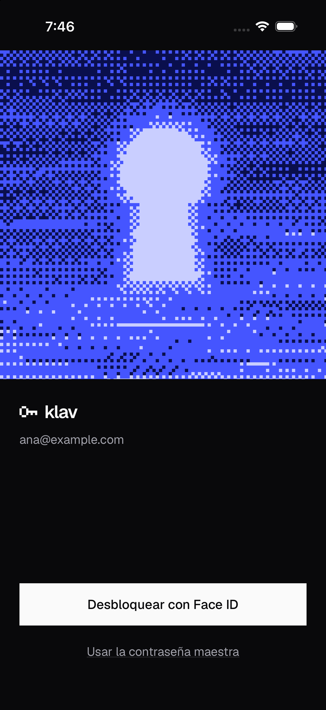 | 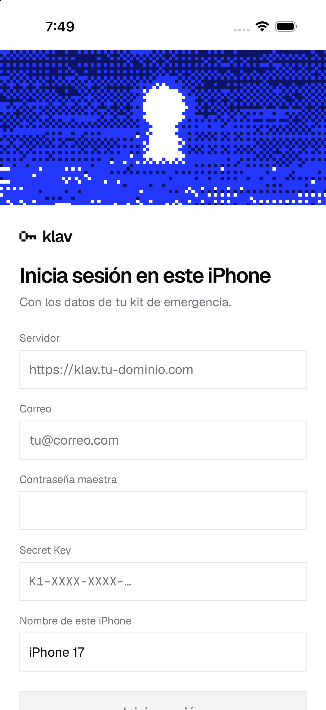 |

### Sign-in and server (ADR 0028)

> The steps for people who use Klav are on the public page [`add-a-device.mdx`](../apps/docs/src/content/docs/get-started/add-a-device.mdx) (in `apps/docs/src/content/docs/get-started/`); a change to those steps goes there first.

- **The form starts with the email.** The server is klav.dev
  (`https://api.klav.dev`, `default_server()` from `KlavFFI`), and it isn't
  asked for.
- **"Use my own server"**, under the fields, unfolds the
  "Server" field. If the last server used (`preferences.lastServer`) wasn't
  klav.dev, the field comes already open and with it.
- Whatever is typed goes through `server_from_input`: `https://` is added if missing,
  and `klav.dev`, `api.klav.dev` or the old Railway URL mean the
  default server.
- The footer says "Your account lives on klav.dev", or on the typed host.
- iOS doesn't create accounts, so the closed-registration notice
  (`registration_open`) doesn't apply here: the CLI gives it.
- **Settings › Account** shows the server as "klav.dev" or its host, and two
  buttons:
  - **"Print the emergency kit"** asks for the master password (the kit
    shows the Secret Key) and shows the kit with today's server, with
    "Print". The text is forgotten when the sheet closes.
  - **"Use another server"** asks for the URL and the password. It does a full OPAQUE
    sign-in there and only switches if it is the same account, with the
    same identity and the same device (`set_server`). It also helps if
    a domain goes down.
- **Automatic move:** before each sync, `KlavFFI` moves the
  account from the old Railway URL to `api.klav.dev` if the new host
  answers with the same account and the same identity (ADR 0028 §4).
- **Tests:** the scheme and `scripts/ios/test.sh` set
  `KLAV_NO_DEFAULT_SERVER=1`, so no test has a default
  server. A `KlavTests` test checks it.

## 3. AutoFill

> The steps for people who use Klav are on the public page [`iphone.mdx`](../apps/docs/src/content/docs/apps/iphone.mdx) (in `apps/docs/src/content/docs/apps/`); a change to those steps goes there first.

It is turned on in **the iPhone's Settings › General › AutoFill & Passwords ›
Klav** (in Spanish, *Ajustes › General › Autorrelleno y contraseñas*). That is what
iOS calls it in Spanish; "autollenado" is Klav's Spanish word for its feature.

### AutoFill welcome

Someone signing in for the first time doesn't know they have to turn on Klav in Settings.
After signing in, as long as iOS says Klav isn't turned on, the app
puts a screen over the vault that shows how (`Klav/AutofillWelcome.swift`).

- **The state** comes from `ASCredentialIdentityStore.shared.state().isEnabled`
  (`AppModel.refreshAutofill`). It is read on unlock and every time the app
  returns to the foreground (`scenePhase` active), after deciding whether it
  locks. If the vault locked on coming back from Settings (the automatic
  lock is 1 minute), it is read on unlock.
- **The path**, with the names the person sees: Settings › General ›
  AutoFill & Passwords › Klav. The last row carries Klav's square
  checkbox, empty.
- **"Open AutoFill & Passwords"** calls
  `ASSettingsHelper.openCredentialProviderAppSettings()` (iOS 17 or
  newer; the app requires iOS 18), which opens that Settings page. If it fails, the
  screen gives the path in text. No private Settings URLs are used.
- **When it is turned on**, the checkbox fills, the title changes to "Klav fills
  in now", VoiceOver announces it and the screen closes on its own after 1.8 s.
  The keyboard suggestions are published at that moment: `IdentityStore`
  publishes nothing while Klav is turned off.
- **"Not now"** closes it, and it doesn't come back on its own until the next
  sign-in (`autofillWelcomeDismissed` in the App
  Group preferences; signing out deletes it). It doesn't come back once turned on either.
- **In Klav's Settings › AutoFill** a row says whether Klav is turned on
  in iOS Settings and, while it isn't, offers "Turn on", which opens the
  screen again.
- **If it is turned on with the screen closed** (from Settings, without going through
  it), on returning the notice "Klav can fill in Safari and other apps now." shows.
- **An agent's notification** opened with the screen on top removes it until
  the next launch, so the request isn't left underneath.

| Off | On | Off, in Spanish and dark | On, in Spanish and dark |
|---|---|---|---|
| 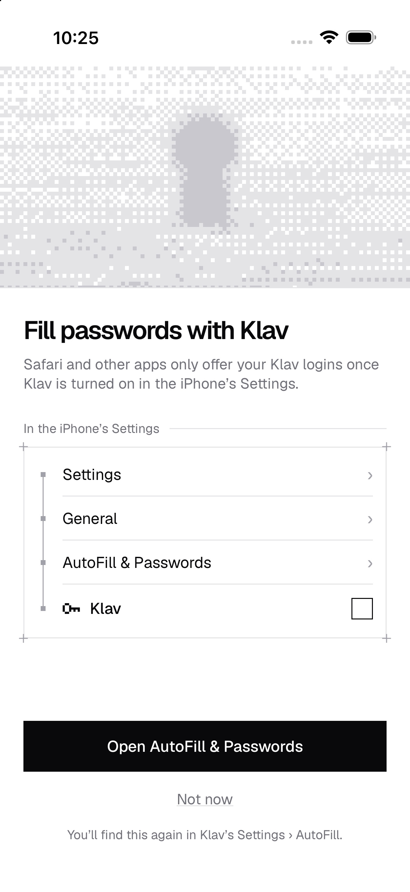 | 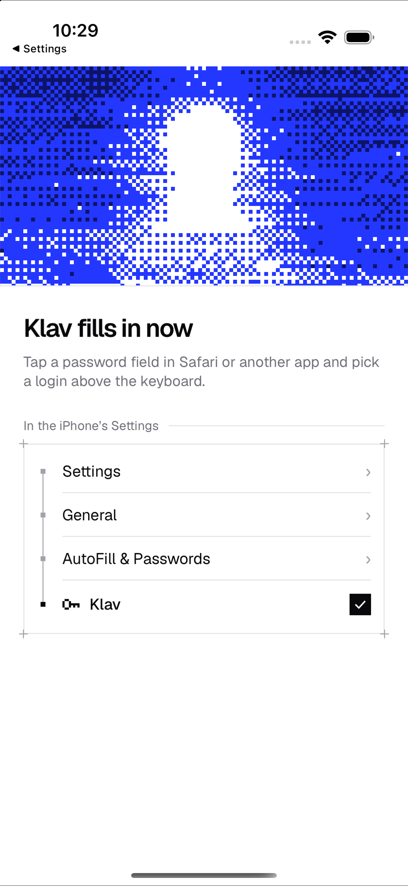 | 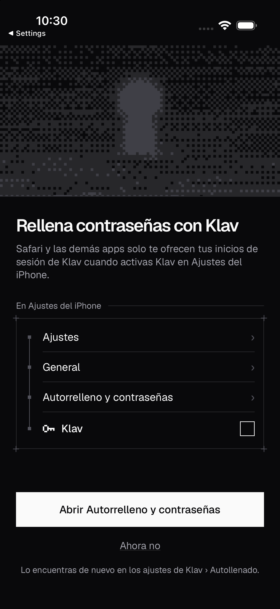 | 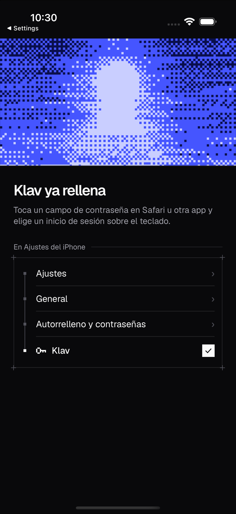 |

| The row in Klav's Settings | Turned on without the welcome |
|---|---|
| 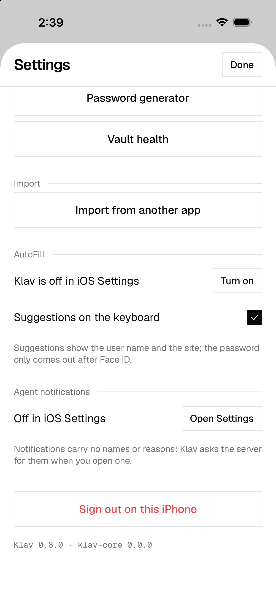 | 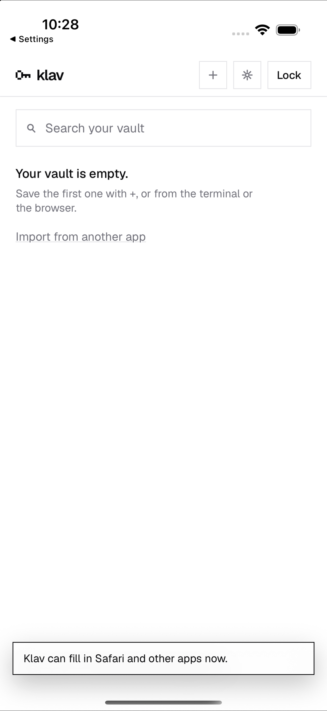 |

### Suggestions, filling and memory

- **Suggestions on the keyboard (QuickType):** the app publishes in
  `ASCredentialIdentityStore` one suggestion per site of each
  login: the username (or the title), the site and the ID. If the item has
  a one-time code, it publishes another for the code. **It never publishes
  secrets.** They are updated after each sync, deleted on
  signing out, and can be turned off in the app's Settings.
- **On choosing a suggestion or opening the list**, the extension asks for Face ID,
  opens the vault with the key the app wrapped, and fills. It never derives the
  key from the password: Argon2id uses 256 MiB, much more than iOS
  lets an extension use. It doesn't sync either. On finishing, on canceling, when
  the sheet closes or if the app being filled goes to the background, it locks
  again; a Face ID that ends with the sheet already closed also locks.
- **Several sites in one request:** each login in the list fills for the
  site it matched, not for the first one iOS sent.
- **If Face ID isn't turned on**, or if it is time to ask for the password (restart or
  14 days), the extension says "Open Klav first" and explains why.
- **The site** is checked by `klav-core`, with the same rule as the browser
  extension (exact host or subdomain). If the item isn't for that site,
  it doesn't fill. Sites an agent added and the person didn't confirm don't
  count ([ADR 0030](decisiones/0030-ronda-de-seguridad-2026-11.md) §7).

### Order and "Saved for a subdomain" (ADR 0025)

QuickType offers a login across the whole registrable domain, because Klav
registers each site with `ASCredentialServiceIdentifier(type: .domain)`. So,
on `1password.com` the keyboard offered the login for `my.1password.com` and the
list then said "No login is for 1password.com". Now the
list offers it too:

- **The order** comes from `klav-core` (`suggestions` in `klav-ffi`): first the
  exact host, then the subdomains and, within each group, by title.
  On `my.1password.com`, the login for `my.1password.com` comes before the one for
  `1password.com`.
- **"Saved for a subdomain"**: the logins for a subdomain of the page
  (`parent_suggestions`) come afterwards, separately, with "Saved for
  my.1password.com" under the username. If there is no other, above it says "No
  login is saved for 1password.com itself". They are filled
  only when tapped: `password_credential` and `one_time_code` receive
  `chosen: true` only from that row, and without it `klav-core` rejects them as
  today (`SiteMismatch`). Siblings (`mail.` versus `accounts.`) and
  single-label domains never match, and the PSL isn't used.
- **Without interaction, nothing changes.** `provideCredentialWithoutUserInteraction`
  always answers `userInteractionRequired`, because the vault only opens
  with Face ID, so a parent's login is never filled on its own. When a
  QuickType suggestion is tapped, iOS gives the extension the site Klav
  registered it with, not the page. That domain match is done by iOS, as
  before (residual risk 29 in the threat model).
- **"Add this site".** The extension doesn't sync or write to the
  vault. After filling a login from that group, it leaves an offer in the
  App Group preferences: the item's ID and title, the page's host
  and the saved one, without secrets (`Shared/SiteOffer.swift`). On unlocking the
  app, or on returning to it, "Add 1password.com to Zeta?" shows. "Add
  this site" is a normal edit (`edit_item` with `add_urls`), and from
  then on it matches exactly. "Not now" deletes it. It is discarded without asking if the
  item no longer exists, if it already matches that site or if a week has passed.

**Measured memory** in the simulator (iPhone 17, iOS 26.5), with
`phys_footprint`, which the extension writes to the `dev.klav.ios` log, category
`autofill`. Measured again with the new interface (Geist fonts and the
dithered lock):

| Moment | Debug (MiB) | Release (MiB) |
|---|---|---|
| On opening the sheet | 23.3–28.4 | 26.7 |
| After Face ID (vault open) and with the list | 28.6–29.5 | — |
| On filling a password | 31.6 | — |
| On filling a code | 29.5 | — |

In the simulator, Release can't open the vault: the software key
behind Face ID only exists in `DEBUG` builds (there is no Secure
Enclave). That is why there is only a Release figure for opening the sheet.

| Waiting for Face ID | "Choose how to sign in" | "Open Klav first" |
|---|---|---|
| 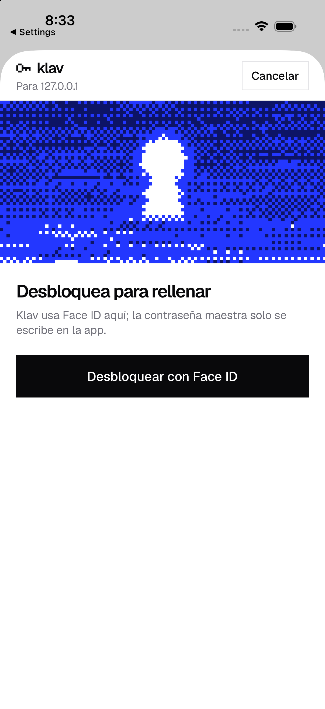 | 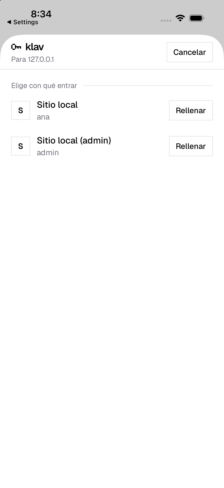 | 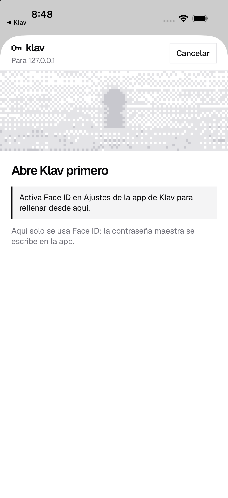 |

Apple doesn't publish the memory limit for these extensions. The measurement
has to be repeated on an iPhone with a *release* build (see
[probar-fase-6.md](probar-fase-6.md) §6).

### Passkeys (ADR 0020 §11)

The extension declares `ProvidesPasskeys`, so iOS offers it for signing
in with a passkey and for creating one. Everything happens without the network and always with Face
ID, which is the passkey's user verification (UP and UV flags).

- **Signing in:**
  - With a Klav passkey chosen in the iOS sheet or in QuickType, the
    extension asks for Face ID and signs the `clientDataHash` that iOS built.
  - With "Klav" chosen in the sheet, the list carries first the passkeys of the
    exact rpId (never of a parent domain or a subdomain) and, if the page
    gives `allowCredentials`, only those. Below go the site's logins.
  - The `passkey.used` event waits in the outbox until the app
    syncs.
  - If the passkey is no longer there (it was deleted on another device), iOS receives
    `credentialIdentityNotFound`.
- **Creating:**
  - ES256 only. If the page doesn't accept it, iOS receives an error and the person
    can use another manager.
  - Before Face ID, the sheet warns "Klav keeps it on this iPhone. Open Klav
    to sync this passkey to your other devices." (T87). Afterwards
    it closes on its own.
  - The passkey goes to the outbox (`outbox.bin`, sealed `0x43`) and can
    be used right away on this iPhone. On opening the app, `sync` uploads the
    queue and the app publishes the iOS identities again.
  - If `excludeCredentials` names a Klav passkey, iOS receives
    `matchedExcludedCredential`.
  - If the account already has a passkey for that site, the sheet asks
    "Replace the passkey?", with "Replace" or "Keep it". Replacing
    puts it in that same login. If not, the passkey goes to a new login.
- **Suggestions:** the passkeys' identities (site, account and
  credential ID, never the key) follow the "Suggestions on the keyboard" setting.
  If it is off, iOS receives none, neither from the app nor from the extension.

### Set up codes in Klav (ADR 0035)

Klav shows up in **the iPhone's Settings › General › AutoFill & Passwords ›
Set Up Codes In** (in Spanish, *Configurar códigos en*) because it registers the
`otpauth` scheme in `Klav/Info.plist`; Apple asks for nothing else
([ADR 0035](decisiones/0035-configurar-codigos-en-ios.md)). With Klav chosen, the
iPhone's camera, Safari (long-pressing a QR code) and
`otpauth://totp/…` links from any app open Klav.

- **The link is read by `klav-core`** as soon as it arrives (`onOpenURL` →
  `AppModel.openLink`): Swift only keeps the opaque `CodeLink` object and its
  description without the secret (issuer and account cleaned and trimmed, digits,
  period and algorithm). `image=` is discarded and nothing is asked of the network. An
  `otpauth://hotp/…` or a broken link gives a notice that doesn't repeat the link.
- **The "Save code" sheet** (`Klav/CodeSetup.swift`) shows on top of
  whatever is open, with a UIKit presenter so as not to close the
  editor or Settings. If an alert is open, it waits for it to close, however
  long that takes. If SwiftUI removes the sheet to show one of its alerts (such as
  "Add this site?"), it comes back on its own when the alert closes, from the start.
  It shows what the link says, marked "From the link";
  the logins that match the issuer (first those that also have the
  account, with `code_targets`), a search for any other login and
  "Save in a new login" (title and username from the link, empty site,
  project Personal / General).
- **Nothing is saved without confirming.** The confirmation names the login, its
  username and its site. Without a code: "Save the code". With this same
  code in the field AutoFill uses (same secret, algorithm,
  digits and period): it writes nothing, and "Show the code" only
  shows it. With another code: "Replace", in red, with the warning that
  replacing it removes the code Klav has for this login; it only changes
  that field. If the issuer doesn't name
  the title or a confirmed site of the login, it warns
  (`site::issuer_names_site`, the importer's rule). If the login has
  unconfirmed sites from an agent, it says that saving confirms them, like the
  editor.
- **`save_code` checks and writes in a single call to the core**: if the
  login gained a code while the sheet was open, it returns "needs to
  replace" without writing and the sheet asks again; a `Conflict`
  syncs and reads again.
- **On saving**, the sheet shows the live code (`LiveCode`), to
  type it into the site that asks for one to finish turning on 2FA. The
  link is forgotten.
- **With the vault locked or without a session**, the link waits **only in
  memory** and the lock screen says "Unlock Klav to save the
  code for *X*". The sheet shows on unlock. Locking with the sheet open
  closes it; the link keeps waiting. It is forgotten on saving, on canceling,
  when another arrives (the last one wins) and on signing out. The log only says what
  kind of link arrived.
- **Settings › AutoFill › "Set up codes in Klav"** opens that
  iOS screen with `ASSettingsHelper.openVerificationCodeAppSettings()`.
  iOS doesn't say which app was chosen, so the row can't be marked as
  done.
- **Tests:** `crates/klav-ffi/tests/codigos.rs` (against the real server:
  the order of the logins, saving, the same code, "Replace" without touching anything
  else, the code only in a second field, a new login with and without a site,
  trash and other kinds left out, a `Conflict` from another device, an agent's
  sites confirmed on saving, locked) and
  `KlavTests/CodeSetupTests.swift` (links, reading without the secret, the wait
  in memory, that the `CodeLink` is released, search, a repeated title and
  Spanish, with every key of the catalog).

| Klav in "Set Up Codes In" | The issuer's logins | "Replace" |
|---|---|---|
| 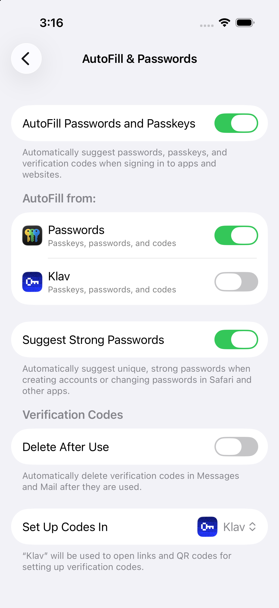 | 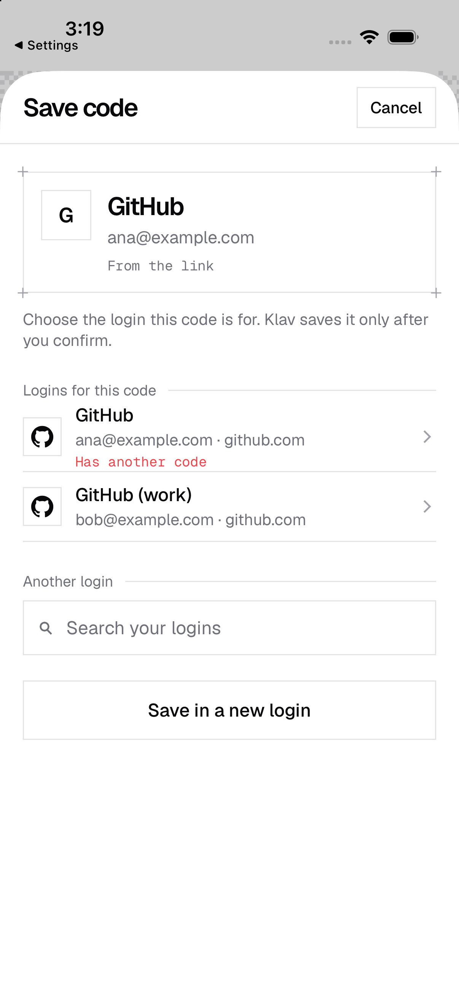 | 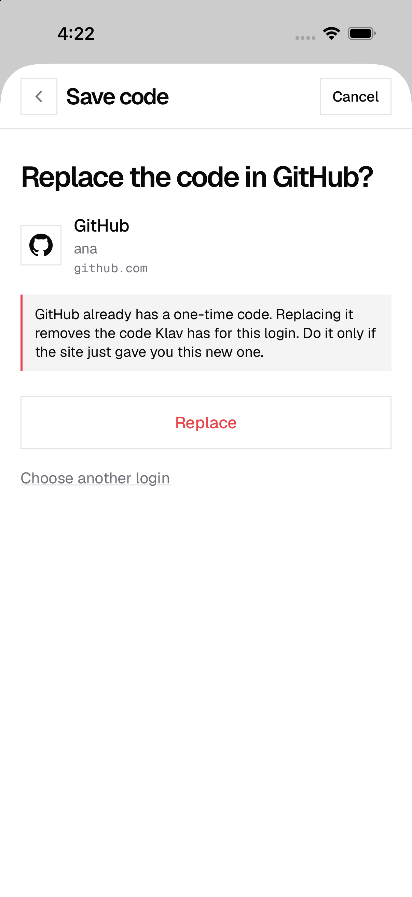 |

| Issuer warning | Saved | With the vault locked |
|---|---|---|
| 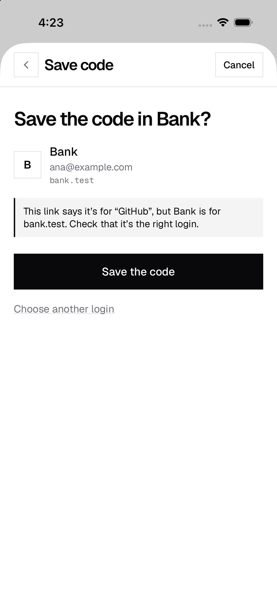 | 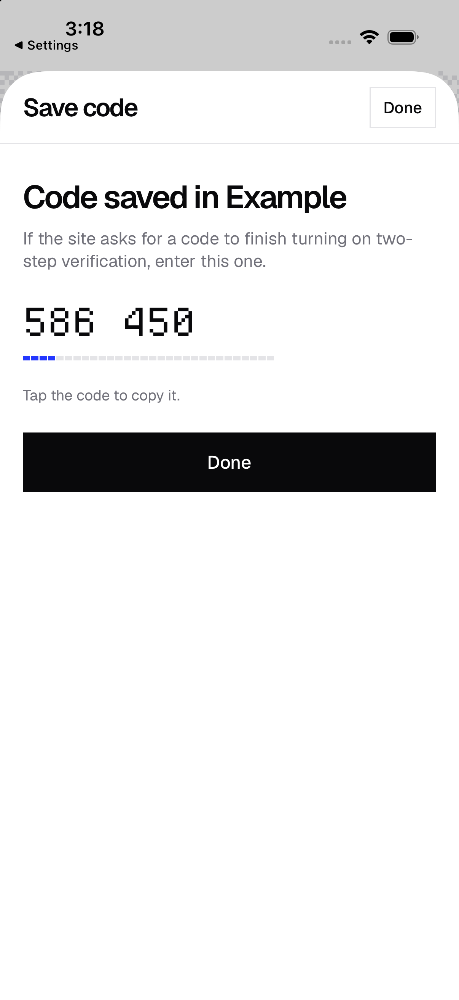 | 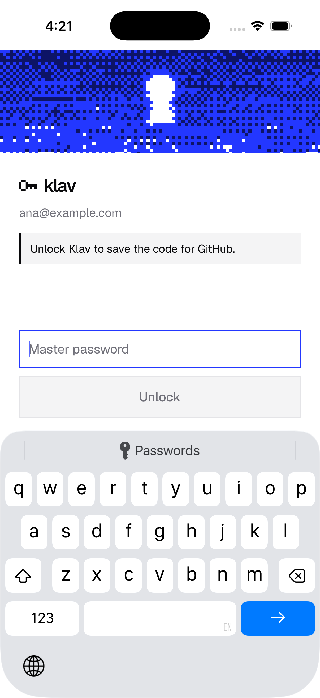 |

## 4. Approvals and notifications

> The steps for people who use Klav are on the public page [`iphone.mdx`](../apps/docs/src/content/docs/apps/iphone.mdx) (in `apps/docs/src/content/docs/apps/`); a change to those steps goes there first.

- **Agent requests** (`ask` in their policy): they show above the
  vault with what they ask for, where, the reason and how long until they expire.
  The options are "Approve once", "Approve 15 min" and "Deny". Approving
  asks for Face ID, or the iPhone's passcode if there is no Face ID. Denying asks for
  nothing.
- **Tasks** ([ADR 0021](decisiones/0021-solicitudes-de-tarea.md)): an agent asks for several
  items and permissions for a job, and the person approves them with a single
  card, "*agent* asks for a task". It carries the task's name and the reason
  ("According to the agent"), and one row per item with title, username and sites.
  The item's checkbox checks or unchecks all its permissions (with a dash
  if only some are), and each permission has its own. What Klav added (the
  one-time code of a login with TOTP) says "Added by Klav"; what
  the policy denies shows crossed out and without a checkbox. It warns if the site doesn't
  match the item, if the item is missing, and what giving `totp`,
  `passkey` or `rotate` implies. The duration can only be shortened: the requested one and the
  steps of 15 min, 30 min, 1 h, 2 h, 4 h and 8 h below it, with the end
  time. Approving asks for Face ID, the same as a single request; Denying asks for
  nothing. If nothing is left checked, the card asks "Check at least one
  permission, or deny the task" without getting to Face ID. What the person
  unchecks survives the refresh every 8 s.
- **Current task:** "*agent* is working on a task", with what it covers and
  "X left · ends at HH:MM". The dither band empties from the top
  according to the time spent, measured from when the agent asked for it (like the
  extension). "End task" doesn't ask for Face ID: removing permissions doesn't
  need it.
- **Outside the task:** if an agent with a current task asks for something the
  task doesn't cover, its request says "Outside the task “…”" and offers
  "Deny", "Approve once" and, if the server allows it, "Add to the
  task" (with Face ID), which adds it to the task until it ends without
  extending it. Those requests don't offer "Approve 15 min".
- Tasks use `tasks()`, `decide_task`, `add_to_task` and `end_task` from
  `klav-ffi`; the app checks Face ID before approving or adding.
- **Who is asking:** the agent's name was chosen by the agent. Below it, each
  request and each task shows the start of its ID ("Agent 0192f3a4…",
  like `klav approval`) and, if it is an agent the account approved, its six
  pairing words: the signed grant binds those words to its
  key. The name takes up two lines at most. The server's error
  messages arrive on one line, without control or formatting
  (*bidi*) characters and cut to 300 characters (`klav-ffi`).
- **Sites added by an agent** ([ADR 0030](decisiones/0030-ronda-de-seguridad-2026-11.md) §7):
  the item page shows separately the sites an agent added to a login and the
  person didn't confirm ("Sites added by *agent*", with the full URL),
  with "Confirm" and "Remove". Like `klav item sites` and the extension's *popup*,
  they act on all of them: confirming is an edit by the person with no
  changes, so the new version is theirs and all its sites count;
  removing is that same edit without them (`ItemEdit.remove_urls`). Saving
  any change in the editor also confirms them, and the editor warns about it.
  The icon on the item page and in the list comes only from the confirmed sites.
- **Agents that want to join:** their card leads to "Compare words".
  The "New agent" sheet shows the six numbered words, in a 2 × 3
  grid, to compare them with the agent's terminal. The person chooses the
  projects they share, with none checked in advance, not even when the
  account has only one ([ADR 0033](decisiones/0033-agentes-desde-la-app-de-mac.md)
  P4, as on the Mac), and the expiry (1 day, 7 days, 30 days or "No end",
  which is what comes checked). It uses the default policy, like
  `klav agent approve` without options. To fine-tune permissions, the
  terminal is used.
- **Notifications (APNs):** after the first unlock the app asks for permission and registers
  its *token* on the server (`PUT /v1/devices/current/push`). The environment
  (`sandbox` or `production`) comes from the build: `KLAV_APS_ENVIRONMENT`
  is `development` in Debug and `production` in Release. On signing out, the
  app removes the *token*.
- **What a notification carries:** only the type (`approval`, `agent` or `task`) and an
  ID. The text comes from the catalog, in English or in Spanish
  (`PUSH_APPROVAL_TITLE`/`BODY`, `PUSH_AGENT_TITLE`/`BODY`,
  `PUSH_TASK_TITLE`/`BODY` in `Shared/Localizable.xcstrings`). On opening it, the
  app asks the server for the details and goes to the card, after
  unlocking if needed. A task's notification expires with the deadline for
  deciding it (10 min).
- **Without APNs** (a server without `[push.apns]`, or notifications turned off) requests
  show up anyway: the app asks for them again every 8 s while it is in the foreground.

| Request | Opened from a notification | New agent |
|---|---|---|
| 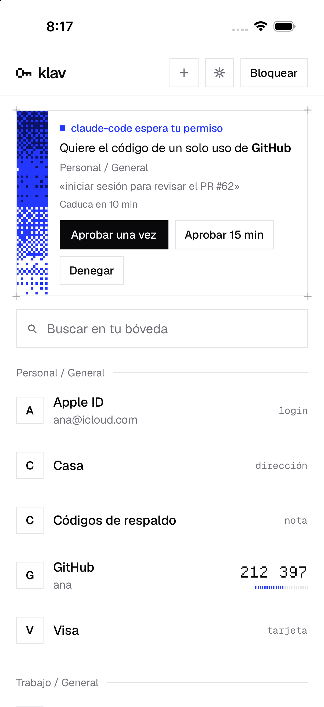 |  | 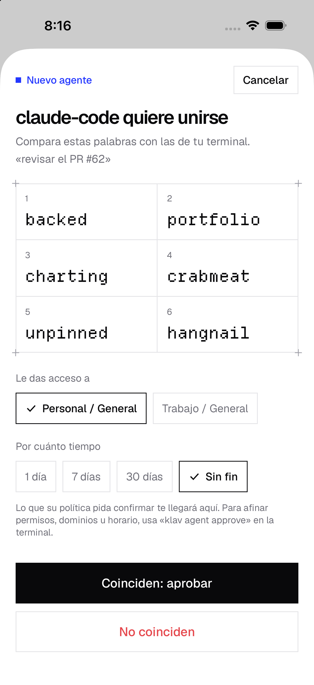 |

| A task | Opened from a notification | Dark |
|---|---|---|
| 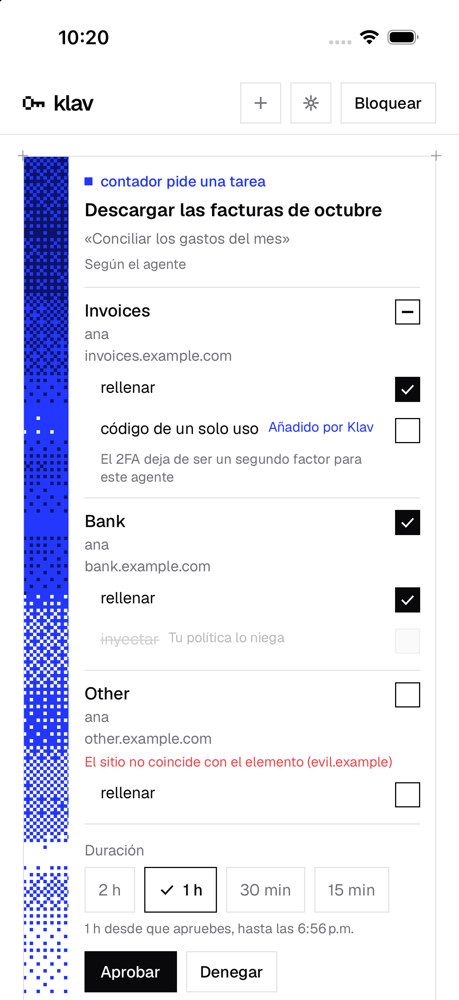 | 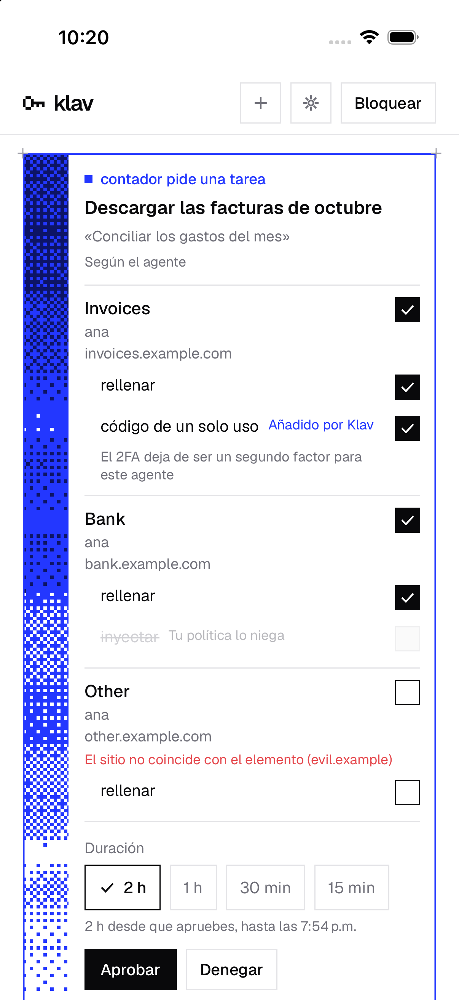 | 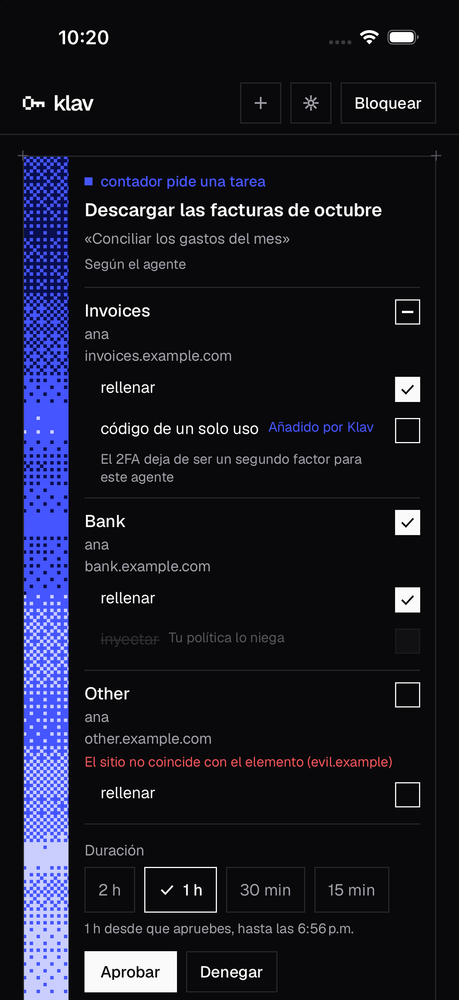 |

| Large text | In English | Current task, in English | Outside the task, in English |
|---|---|---|---|
| 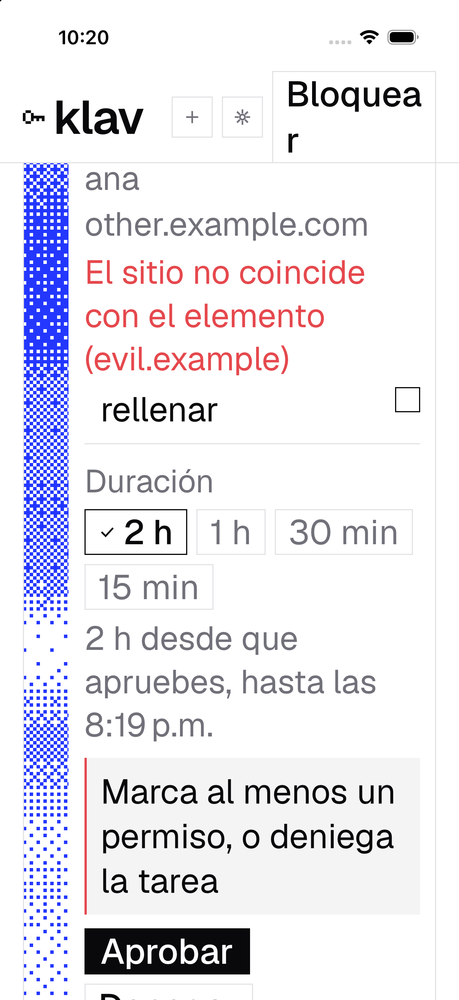 | 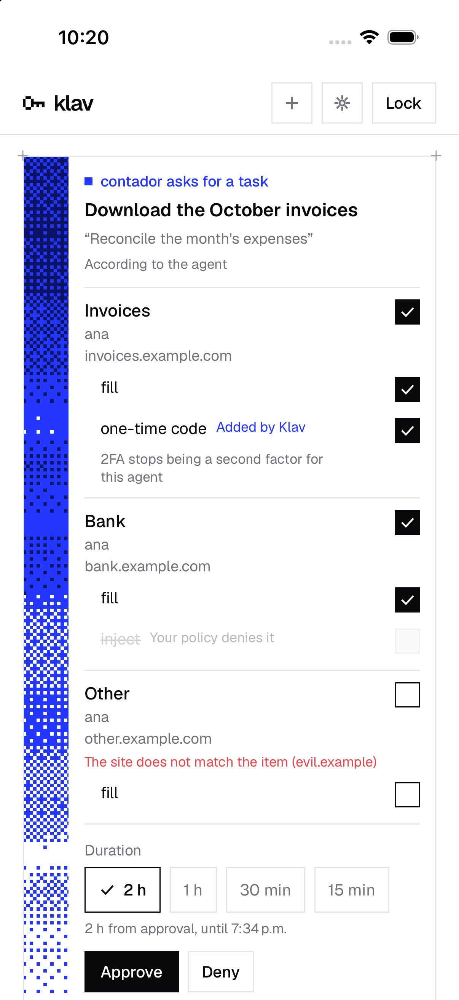 | 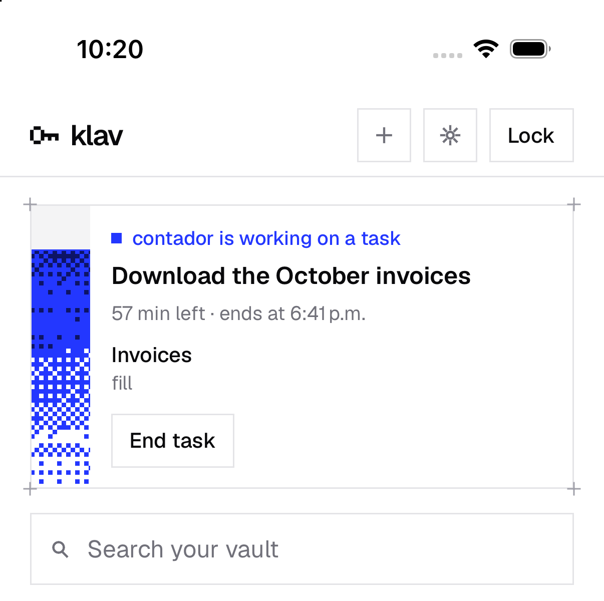 | 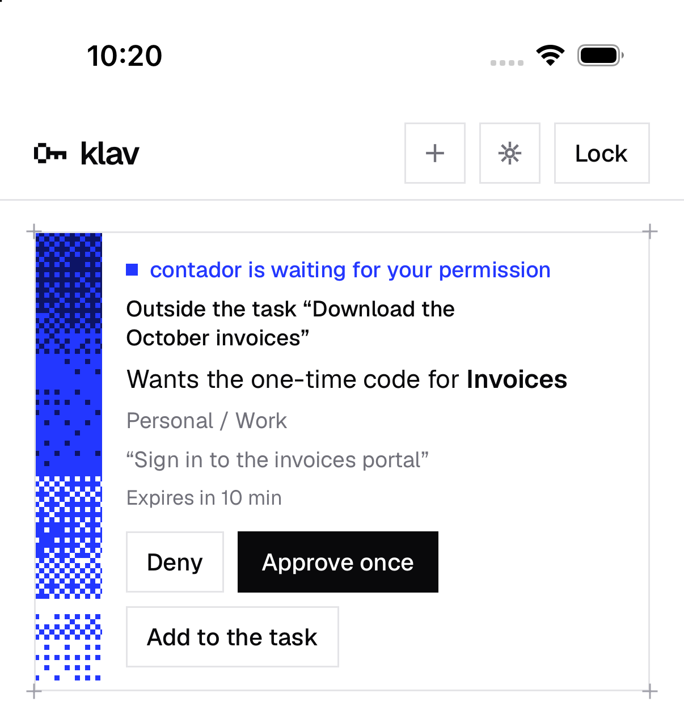 |

The server is configured as [self-hosting.md](self-hosting.md) §2.4 says.

## 5. Building and testing

Requirements:

- macOS with Xcode 26 or newer (tested with Xcode 27.0);
- [XcodeGen](https://github.com/yonaskolb/XcodeGen) (`brew install xcodegen`);
- Rust with the `aarch64-apple-ios`, `aarch64-apple-ios-sim` and
  `aarch64-apple-darwin` targets (the scripts install them with `rustup` if missing).

```sh
scripts/ios/test.sh            # XCFramework, proyecto, compilar y pruebas en el simulador
scripts/ios/test.sh build      # solo compilar
KLAV_IOS_SKIP_FFI=1 scripts/ios/test.sh   # reusar target/ios/KlavFFI.xcframework
scripts/ios/build-xcframework.sh [--release]
```

- **The XCFramework carries three slices:** the iPhone, the simulator and the Mac
  (`aarch64-apple-darwin`, macOS 15, [ADR 0027](decisiones/0027-app-de-mac.md) §3).
  The Mac's is built with `klav-ffi`'s `daemon` feature
  (`DaemonEngine`, the Mac app's `klavd` client) and has its own
  *bindings* in `target/macos/bindings/`; the iOS ones are generated without that
  feature and don't change. `KLAV_IOS_TARGETS` chooses slices (for example,
  only the simulator).
- **Everything generated goes outside the repository:**
  - `target/ios/KlavFFI.xcframework`, `target/ios/bindings/` and
    `target/macos/bindings/`;
  - the `.xcodeproj`, which is generated from `apps/ios/project.yml` and is in
    `.gitignore`;
  - DerivedData in `target/xcode/ios-derived` and the Swift package cache in
    `target/xcode/spm-cache` (the real path of `target/`, which may be a link to another disk),
    changed with `KLAV_IOS_DERIVED` and `KLAV_SPM_CACHE` or in the local build config below.
- **The simulator** is chosen with `KLAV_IOS_SIMULATOR` (name or UDID; by
  default "iPhone 17").
- **CI runs on Linux:** it builds and tests `klav-ffi` and generates the Swift
  *bindings*. The iOS build and the simulator tests
  are a local gate before each iOS PR.
- **Opening in Xcode:** `cd apps/ios && xcodegen generate && open Klav.xcodeproj`.

**The local build config.** What belongs to one machine or one Apple account stays out of the
repository, in one file per user: `~/.config/klav-dev/config.env` (under `$XDG_CONFIG_HOME` if
set, or the path in `KLAV_DEV_CONFIG`). It is outside every checkout on purpose: a release is
built from a clean checkout, and an untracked file would make it dirty. The scripts read it
through `scripts/dev/local-config.sh` and never run it: one `NAME=value` per line, taken as
written (no quotes, `$HOME` or `~`), and a name they don't know is an error. A variable set in
the environment, and not empty, wins over the file. [`scripts/dev/config.env.example`](../scripts/dev/config.env.example)
has every name:

- `KLAV_IOS_DERIVED` (`scripts/ios/test.sh`, `archive.sh`), `KLAV_MAC_DERIVED`
  (`scripts/macos/test.sh`), `KLAV_MAC_RELEASE_DERIVED` (`scripts/macos/build-app.sh`) and
  `KLAV_SPM_CACHE`: where Xcode builds. Without them, in `target/xcode/`.
- `KLAV_NOTARY_KEY` (the App Store Connect key's path, never its contents), `KLAV_NOTARY_KEY_ID`
  and `KLAV_NOTARY_ISSUER`: only for `scripts/macos/build-app.sh release`, which stops before
  building, naming what is missing, without them. They have no default.

`KLAV_DEV_CONFIG_PRINT=1` before any of those scripts prints what it would use and exits.

To test notifications in the simulator, without APNs:

```sh
xcrun simctl push <UDID> dev.klav.ios aviso.apns
```

with the same *payload* the server sends
(`{"aps":{"alert":{"title-loc-key":"PUSH_APPROVAL_TITLE","loc-key":"PUSH_APPROVAL_BODY"}},"klav":{"type":"approval","id":"<ID>"}}`).
The simulator also gets a real *token* from the APNs *sandbox*, and the app
registers it on the server.

## 6. Signing and uploading to TestFlight

The account isn't fixed in the repository:

- **`apps/ios/Config/Local.xcconfig`** (not committed; copy
  `Local.xcconfig.example`) defines `DEVELOPMENT_TEAM` (Omar's is
  `SZ3F58F8LX`) and `KLAV_BUNDLE_PREFIX`.
- **With the default prefix**, the identifiers are:

  | What | Identifier |
  |---|---|
  | App | `dev.klav.ios` |
  | Extension | `dev.klav.ios.credentials` |
  | App Group | `group.dev.klav.ios` |
  | APNs *topic* | `dev.klav.ios` |

- **Capabilities** each *target* asks for:
  - the app: App Groups, AutoFill Credential Provider, Push Notifications and
    Data Protection (`complete`);
  - the extension: App Groups, AutoFill Credential Provider and Data
    Protection.

```sh
scripts/ios/archive.sh check    # Release para dispositivo, sin firmar (no necesita cuenta)
scripts/ios/archive.sh export   # archivo firmado + .ipa en target/ios/export
scripts/ios/archive.sh upload   # archivo firmado y subido a App Store Connect
```

- **`export` and `upload`** sign automatically with the team in
  `Local.xcconfig`, which must be signed in in Xcode (Settings ›
  Accounts). Xcode creates the profiles (`-allowProvisioningUpdates`).
- **The export options** are in `apps/ios/Config/ExportOptions.plist`
  (`app-store-connect`).
- **Before each upload**, `CFBundleVersion` is bumped by hand in
  `Klav/Info.plist` and `Credentials/Info.plist`.
- **`archive.sh`** builds `klav-ffi` in *release* only for the device.
  Afterwards, `scripts/ios/test.sh` without `KLAV_IOS_SKIP_FFI` generates the
  XCFramework again with both slices.

The list of what Omar has to create in their Apple account is in
[probar-fase-6.md](probar-fase-6.md) §1.

## 7. Known limits

- **The extension sees the data from the app's last sync.** Opening
  the app syncs.
- **An iPhone without Face ID, or with the password pending, doesn't fill** until
  the app is opened.
- **Notifications only reach an app signed with the same APNs key the
  server uses.** The relay for self-hosted servers belongs to phase 8.
- **No trash list:** `klav-client` doesn't know how to restore yet, so
  the app only moves to the trash (with confirmation).
- **No cards in iOS AutoFill** for now: they are copied from the
  app.
- **A passkey created in the extension is only on this iPhone** until
  the app is opened (T87). Uninstalling Klav before that loses it.
- **No passkey registration without an interface**
  (`SupportsConditionalPasskeyRegistration`): creating a passkey always asks for
  Face ID.
- **The camera was only tested in the simulator**, which has none: the sheet says
  there is no camera. QR reading is tested with Core Image.
- **An `otpauth://` link waiting for unlock is lost if iOS closes
  the app**: it only lives in memory (ADR 0035 §4). It has to be opened again.
- **If another app registers `otpauth-migration`**, iOS chooses which one opens the Google
  Authenticator QR code, and there is no setting to change it.
- **Without the network, the app doesn't see an agent pause until it syncs:** it doesn't
  save pauses to disk, as `klavd` does (§10). The iPhone doesn't mediate
  anything for agents, so only what is shown changes.
- **What the agents app doesn't have yet** (§10): each agent's "what it saw"
  summary, tasks as collapsible groups in its timeline, the
  vault filter, exporting the audit log, and revoking or changing an agent's
  grant, which remain in the terminal.

## 8. Import

> The steps for people who use Klav are on the public page [`import.mdx`](../apps/docs/src/content/docs/get-started/import.mdx) (in `apps/docs/src/content/docs/get-started/`); a change to those steps goes there first.

The "Where are you coming from?" wizard ([ADR 0024](decisiones/0024-importadores.md))
opens from Settings › Import and from the empty vault. The steps and the
rules are the extension's ([extension.md](extension.md) §12): the
source with its instructions, the files, the review without values, the
import and the reminder to delete the export.

| | | |
|---|---|---|
| 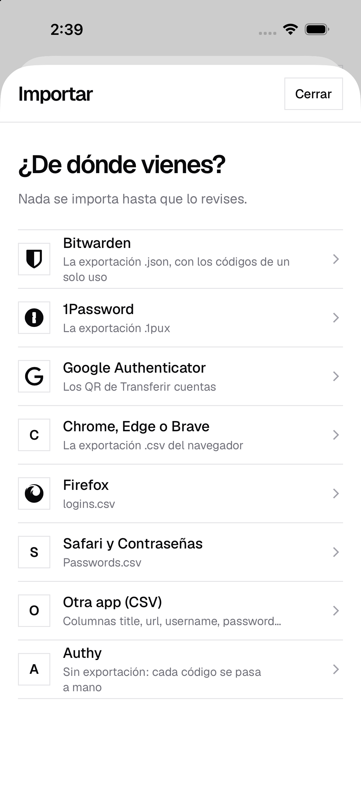 | 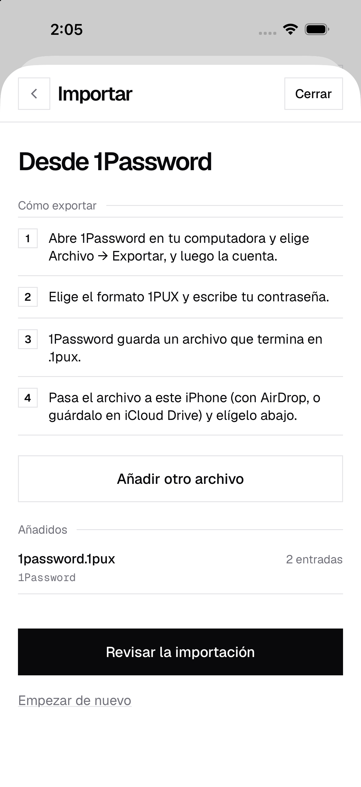 | 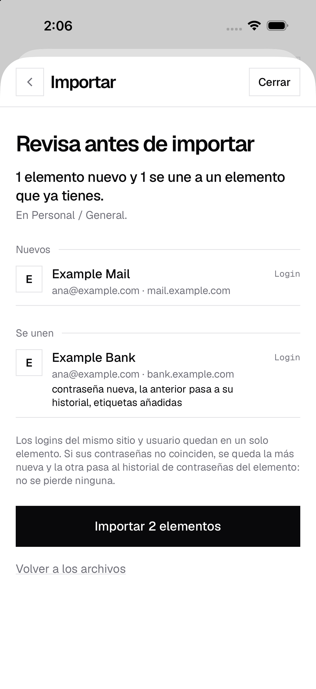 |
|  |  |  |

- **Files:** they are chosen in Files (`fileImporter`, with
  security-scoped access), one or several, up to 64 MiB each. Each source's
  steps end with moving the file to the iPhone (AirDrop or iCloud
  Drive), and the final reminder asks to delete it from there too and from Recently
  Deleted.
- **Google Authenticator**, in three ways:
  - **with the camera** (`QRScanner.swift`: `AVCaptureSession` with
    `AVCaptureMetadataOutput` for `.qr`), if the app is on another
    phone. The sheet adds each QR code it reads and says which are missing;
  - **from screenshots in Photos** (`PhotosPicker` and `CIDetector`), if it is on the
    same iPhone;
  - **by pasting** the `otpauth-migration://` links;
  - **with the iPhone's camera, outside Klav**: the app registers
    `otpauth-migration`, so each "Transfer accounts" QR code opens the
    Google Authenticator wizard with that batch already added, and the
    following ones are added to the same wizard (ADR 0035 §5). With the vault
    locked, they wait in memory until unlock.
  
  The image doesn't leave the iPhone and isn't saved: the app reads the QR code's text and
  passes it to `klav-ffi`, which doesn't read images. The camera permission
  (`NSCameraUsageDescription`, in English and Spanish) is asked for the first time
  the sheet opens. If it is denied, the sheet leads to Settings and offers the
  screenshots.
- **In `klav-ffi`:** `ImportSession` keeps the files read in memory
  (`add`, `state`), and `KlavCore::import_preview` and `import_apply` review and
  import with `klav-client`, like the CLI. The session is forgotten when the
  wizard closes. The tests against the real server are in
  `crates/klav-ffi/tests/import.rs`, and the app's in
  `KlavTests/ImportTests.swift`.


## 9. Vault health and assisted change

> The steps for people who use Klav are on the public page [`iphone.mdx`](../apps/docs/src/content/docs/apps/iphone.mdx) (in `apps/docs/src/content/docs/apps/`); a change to those steps goes there first.

The same as the extension's *popup* ([extension.md](extension.md)), with
its texts, in the app ([ADR 0022](decisiones/0022-generador-historial-y-cambio-asistido.md)
§4–§6). Everything is computed by `klav-client` on the iPhone. The report names
items, sites and reasons, never values.

- **Vault health** (Settings › Passwords › Vault health):
  - it shows the reused ones by group, the weak ones (`zxcvbn` strength or
    generator bits), the old ones and the breached ones. Each row opens its
    item;
  - "Look for breached passwords" turns on the Have I Been Pwned lookup.
    It is off by default and is an iPhone setting (`health.json` in the
    `KLAV_HOME`, not synced). Below it, what is sent is explained: the
    5-character prefix of the SHA-1, and the IP and the time the
    service sees. The lookup runs after releasing the vault, so a
    slow response doesn't block the app.
- **"Fix my reused passwords":**
  - opens the tasks' blue card. In it the agent is chosen (on
    changing it, the list is asked for again with its grant), logins are unchecked
    and the duration is chosen (2 h by default, up to 24 h). Logins
    without a website or outside the grant show as blocked, with the reason;
  - "Approve" first checks everything that can fail (`check_offer`).
    Then it asks for Face ID once and signs the offered task (`offer_task`),
    with `rotate` on each login and the one-time code "Added by
    Klav" where needed. The title and the reason are neutral, in the app's
    language: the agent receives the sites, never which ones share a
    password;
  - while the task runs, one card per task shows each site as
    changed, in progress, pending or failed (`task_progress`, from
    the `rotate.*` events). It is polled every 5 s only while the view
    is on screen.

  The change itself is made by the agent in the computer's browser, with
  `klavd` and the extension (destination `extension`). The iPhone offers the task and
  follows the progress, but doesn't fill change forms.
- **Pending change:**
  - if an assisted change left a new, unconfirmed password (`0x16` v2
    record), the item page shows "Pending change: did the new password
    work?" with [Use the new one] and [Keep the current one] (`resolve_pending`);
  - with "Keep the current one", the new one goes to "Previous passwords"
    marked "generated, not confirmed". With "Use the new one", the previous one
    stays in the history with its end date;
  - neither of the two asks for Face ID, as in the *popup*.
- **In `klav-ffi`:** the `health` module (`vault_health`, `health_settings`,
  `set_breach_check`, `password_history` with `pending`, `resolve_pending`,
  `reused_offer`, `check_offer`, `offer_task` and `task_progress`).
  `klav-ffi` turns on `klav-client`'s `health` feature, so the
  `zxcvbn` dictionaries (about 1 MB) go into the library. They also
  go into the AutoFill extension's binary, which never uses them:
  they take disk space, not memory.
- **Tests:**
  - `crates/klav-ffi/tests/cambio_asistido.rs`, against the real server.
    It goes through the health, the offer (what is blocked is rejected before Face ID),
    a site changed and confirmed by the computer, another pending and
    "Keep the current one";
  - `KlavTests/HealthTests.swift`: what is offered, how the progress is read, the
    texts in Spanish and VoiceOver.

| Vault health | Fix my reused ones | Pending change | In Spanish and dark |
|---|---|---|---|
|  |  |  |  |

## 10. Agents: the pause and the activity (ADR 0033 §9)

> The steps for people who use Klav are on the public page [`iphone.mdx`](../apps/docs/src/content/docs/apps/iphone.mdx) (in `apps/docs/src/content/docs/apps/`); a change to those steps goes there first.

The app shows and decides the agents' pause, which is account
state, and shows what they did, with the same `klav-client` functions
the Mac uses through `klavd`
([ADR 0033](decisiones/0033-agentes-desde-la-app-de-mac.md) §7, §8 and §9).
It doesn't connect clients or install the skill: Claude Code,
Codex and Cursor don't run on an iPhone.

- **Agents:** the robot button, next to "+" in the vault's bar,
  opens the "Agents" sheet:
  - at the top, "Pause agents", with the duration (15 min, 1 hour or "Until I
    resume") and what a pause doesn't stop (ADR 0033 §7.7);
  - below, "Activity" and the account's agents, in three groups: "Waiting
    for you", "With access" and "Denied or revoked". Each one carries its
    name, the start of its ID, its projects, its last use and its state.
    One with access has "Pause", with the same durations, or "Resume"
    if the pause is only its own; one that is waiting leads to "Compare words"
    (§4);
  - revoking an agent is done from its page (§12); changing its grant stays
    in the terminal (`klav agent approve`) until a later layer (P10).
- **Pausing asks for nothing** (ADR 0033 P2): `pause_agents` signs with the
  account's identity and sends it to the server at once. If the server doesn't
  answer, the app says why and nothing is left half-done: the iPhone has no
  `klavd`, so there is no "only on this device" pause.
- **Resuming asks for Face ID**, and only Face ID: the biometrics, not the iPhone's
  passcode. Without Face ID, with Face ID locked or if the person chooses "Use the
  master password", it asks for the master password, and a wrong one signs
  nothing (`resume_agents_with_password`). Canceling doesn't resume or ask for anything else. The
  approvals do accept the iPhone's passcode (§4); resuming gives back
  access to every agent at once, so it asks for the same as the Mac.
  The sheet and the card say what has to be done, with the same check
  as the button: "To resume, use Face ID" (or Touch ID) and, if the biometrics
  can't be used right now, "To resume, enter your master password".
- **The pause of all of them is never hidden:** while it lasts, a blue card
  above the vault says since when and until when, with "Resume" and
  "Agents". Pauses are read separately from the server, also without the network, so
  the card goes away when the pause ends.
- **Pauses that another device decided** arrive on sync, and only
  the ones the account signed count (`klav-client`). If what the server says
  about each agent (`dev_agents`) doesn't match those pauses, the app
  syncs once to catch up, not every 8 s; if that sync
  fails, it tries again on the next poll.
- **An agent's page:** the name, the start of the ID, its note "according to the
  agent", its projects, its state with "Pause" or "Resume", and below it its
  timeline by day: what it did and what the person decided about it
  (the 200 most recent events; the rest, with `klav log --agent`).
- **Activity:** the account's audit log, from the newest event to the oldest
  and by day.
  - At the top, the state of the chain: "Verified up to event #12", or
    how many are left to verify, with "Verify now" (`verify_audit`).
  - Filters: text (titles, agents, reasons and sites), agent, permission,
    result, period and "Only alerts". It shows the 300 most recent;
    the rest, in `klav log`.
  - Each line says who: the agent in cobalt, with the start of its ID, or
    the person in the second person ("You paused an agent"). Then, what it did,
    the item and where it lives, the reason in quotes, trimmed and marked
    "according to the agent" (T136), the time, the result, the alerts and "Not
    verified yet" after the last head this iPhone signed.
- **"Who used it",** on each item's page: the 5 most recent uses
  by agents, with the reason "according to the agent", how it happened ("Allowed by
  your policy", "Approved once", "Inside the task “…”", "Denied") and
  when, and "Open in the log", which opens Activity filtered by that
  item. It doesn't show in an account without agents if no agent used the
  item. If the audit log doesn't add up (`security`, ADR 0033 §8.4), it says so
  instead of the list. Without the network, it says it needs the server, as
  information, and never "No agent has used it".
- **Who wrote each event** comes from `by_agent` (`LogEntryInfo`), never
  from the name: an agent can be called `you`, and the pause of an agent that
  the person decided carries the agent's ID but is the person's.
- **In `klav-ffi`:** `KlavCore` gains `dev_agents`, `agents_paused`,
  `pause_agents`, `resume_agents`, `resume_agents_with_password`,
  `audit_log`, `item_activity`, `audit_status` and `verify_audit`. The
  pause and activity records come from the `daemon` feature:
  `KlavCore` and `DaemonEngine` share them with the same names.
- **Tests:**
  - `crates/klav-ffi/tests/pause_activity.rs`, against the real server:
    "Who used it" with the reason and how it happened, pausing an agent without asking for
    anything and the server rejecting it, the audit log with `by_agent`, a
    wrong password that doesn't resume, a use the policy denies and
    that is the only thing the "Denied" filter leaves, the pause of all of them
    learned on sync after unlocking, and "Verify now", with the
    code (`unpinned`) of the first verification;
  - `KlavTests/AgentActivityTests.swift`: which pause stops each agent,
    a pause that already ended, when to sync and that a failed sync
    is retried, what Face ID leaves to the master password and what
    the card says it will ask for, the filters with the period, the audit log's
    phrases and their Spanish, with the plurals and the times without an article.

| Agents | All paused | Resuming with the master password |
|---|---|---|
|  |  |  |

| Activity | Who used it | A paused agent, dark | Agents, dark |
|---|---|---|---|
|  |  |  |  |

## 11. Deleting the account

> The steps for people who use Klav are on the public page [`iphone.mdx`](../apps/docs/src/content/docs/apps/iphone.mdx) (in `apps/docs/src/content/docs/apps/`); a change to those steps goes there first.

Apple requires an app that creates accounts to let them be deleted from the app
(guideline 5.1.1(v)). The texts and the rules are those of
[ADR 0037](decisiones/0037-borrar-la-cuenta.md) §7, in English and in Spanish.

- **Where:** Settings › Account, below "Sign out on this iPhone" and
  inside the same section, the red "Delete my account" button. Before anything else, the app asks the server whether it can
  (`account_deletion` in `/v1/health`). If it can't, it says "This server can’t
  delete accounts from the app. Ask whoever runs it." and
  asks for neither Face ID nor the password.
- **Two steps in one sheet, "Delete your account?":**
  - what is deleted and what isn't (§7.2), with the date 7 days out, that the agents
    stop now and that Klav doesn't export the vault yet; "Continue" in red;
  - the master password (§7.3). On tapping "Delete my account", Face ID comes
    first, if Klav uses it on this iPhone ("Confirm it’s you to delete
    your account"), and then the password is checked: against this iPhone,
    so that a typo doesn't spend an attempt on the server, and with OPAQUE on the
    server. A mistyped password says "The master password isn’t
    correct." and asks for nothing.
- **Face ID** uses the unlock's Secure Enclave key
  (`biometryCurrentSet`), without the iPhone's passcode and without the 14-day
  rule. If Klav uses Face ID on the iPhone, `klav-ffi` doesn't let it be skipped: without the
  key it answers that there are no biometrics. Turning off Face ID in Settings isn't a
  shortcut: it asks for Face ID or the iPhone's passcode (§2).
  - **Face ID unavailable** (locked after several attempts, or the sensor doesn't
    respond): the sheet says so and gives the way out: unlock the iPhone with its
    passcode and try again, delete the account from another device, or
    turn off Face ID for Klav in Settings, which asks for the passcode.
  - **New faces:** if the enrolled faces changed, Klav forgets Face
    ID, as on unlock, and the sheet asks to type the password again;
    from then on the password is enough. Whoever knows the iPhone's passcode
    can enroll their face: that is risk 57 of the
    [threat model](modelo-de-amenazas.md), and what protects against it is the 7
    days and the notifications.
  - **Server errors**, in the interface's language: a deletion already
    requested (`409`) says "The deletion of your account is already scheduled…" and
    syncs so the band with the date shows up; the limit of 3
    requests every 7 days (`429`) says "Klav limits how often the deletion can be
    asked for…"; if the server accepted but the iPhone couldn't
    save it, it says the date and that it will show after the next sync.
- **The wait (7 days):** Settings › Account says "Your account will be deleted on
  *day*", from which device and on what day it was requested, with "Cancel the
  deletion". Above the vault, a band with the date and the same button.
  Canceling gives the agents back, so it asks for the same as resuming them
  (amendment A2 of ADR 0037, ADR 0033 §7.3): Face ID and, without Face ID or if the
  person chooses "Use the master password", the password; never the iPhone's
  passcode. Afterwards, a short notice says "The deletion was canceled. Your
  agents work again.", or "The deletion was already canceled." if another
  device got there first. Once the date has passed without the server confirming it
  (without the network), the band says "Your account was to be deleted on *day*" and that Klav
  confirms it when it connects, never "will be deleted" on a day that has already passed.
  Meanwhile Klav keeps working, except for the agents: the server
  rejects them with `account_deleting`.
- **Notifications:** the server sends `type: "account"`, without an ID, with the
  `PUSH_ACCOUNT_DELETION_*`, `PUSH_ACCOUNT_CANCELED_*` and
  `PUSH_ACCOUNT_DELETED_*` keys. The text comes from the catalog, in English or in
  Spanish. When it arrives with the app in the foreground, or when it is opened, the app syncs and
  shows the date or the cancellation.
- **After the deletion:** a `401` after the date the iPhone
  knew is "Klav deleted your account" (§7.6). There is no separate screen: the
  vault stays open read-only under a fixed band, "Klav
  deleted your account. Read-only: you can search and copy, but not edit or
  sync." (decision D-C of the review). Searching, viewing and copying
  work, and so does the generator history, to copy whatever
  is there; editing, moving to the trash, creating, syncing, requests,
  agents, generating passwords, vault health, importing and
  changing server disappear, and a codes or import link
  says the copy no longer saves anything new. `klav-ffi` also rejects
  each write without touching the network, so nothing is left waiting in a
  queue. Signing in with a passkey still works from the copy, but doesn't
  leave `passkey.used` in the queue, because there is no longer an audit log to receive it.
  Above the vault, what was deleted, that the emergency kit has to be
  destroyed, and "Delete this iPhone’s copy", a separate button. Nothing
  deletes the copy on its own (T165), and knowing it stays in `deletion.bin`,
  so after restarting without the network the iPhone stays read-only. An
  iPhone that never learned the date sees an expired session.
- **Deleting this iPhone's copy:** first it counts what never reached
  the account (`sign_out_check`, which no longer tries to upload anything). If there is
  nothing, it asks to confirm: "Klav can’t export your vault yet: what you don’t
  copy elsewhere first is lost.", and deletes the session, Klav's
  files and `faceid.json`. If there are generated passwords or *passkeys* not uploaded
  (question 3 of the review), it refuses and says so on the card: "*N*
  generated passwords never reached your account: they’re only on this
  iPhone. Copy them somewhere else before you delete this copy." (the
  *passkeys*, which can't be copied, "are lost with this copy").
  It offers "Generator history", which marks them as "Not synced yet",
  and separately "Delete anyway", with its own confirmation, like `klav
  logout --discard-unsent`. If Klav can't count them (locked with a
  queue, or a queue that can't be read), it counts as if there were some. If something reached
  the queue with the confirmation open, `sign_out` refuses and the card
  shows it.
- **In `klav-ffi`:** `deletion_supported`, `account_deletion` (with
  `deleted`), `request_account_deletion(password, keystore, reason)`,
  `cancel_account_deletion` (the app asks for Face ID first),
  `cancel_account_deletion_with_password` and
  `forget_biometrics(keystore, reason)`, which calls the keystore's
  `confirm_owner`. The errors: `AccountDeleted` (with the date), `AccountDeleting`,
  `DeletionUnsupported`, `DeletionAlreadyScheduled` (`409`),
  `DeletionRateLimited` (`429`) and `DeletionNotRecorded` (the server
  accepted and the iPhone couldn't save it). A locked vault can also
  request it: the Mac app uses it that way.
- **Tests:**
  - `crates/klav-ffi/tests/borrar_cuenta.rs`, against the real server with the
    cleanup every second: Face ID canceled, without a key or with new faces doesn't
    ask for anything; a wrong password doesn't either; requesting (7 days, "this
    device"), the `409` of a second request, canceling with the password
    (a wrong one doesn't cancel), requesting with the vault locked and, after the deletion,
    "Klav deleted your account" with the copy readable. Restarted without a server,
    it still knows: it doesn't sync, edit, save to the generator or
    register *passkeys*; it signs in with a *passkey* without leaving `passkey.used` in the
    queue; the password generated offline before the date is counted, seen
    and copied in the history, and "Delete the copy" refuses (unlocked,
    locked and with a number that falls short) until "Delete
    anyway", which deletes it with everything else. Two more: turning off Face ID asks for the owner (canceling changes nothing;
    without a passcode the setup is forgotten only if there are no biometrics either), and with Face ID
    unavailable nothing is asked for, plus the `429` after three requests;
  - `KlavTests/DeleteAccountTests.swift`: the notifications, the texts in Spanish
    (with the arguments in their order), the date without the year, the new errors
    in both languages, the past date, that only an iPhone without a passcode
    counts as "unavailable" when turning off Face ID (a Face ID lockout is
    refused), and what "Delete the copy" counts as a loss and what it accepts on
    confirming it, with its texts in Spanish.
- **By hand:** Face ID with a real face and the APNs notifications (Omar, in
  TestFlight, with a throwaway account; see the [roadmap](roadmap.md)).

| Settings › Account | What is deleted (§7.2) | The password (§7.3) | The wait, in Settings (§7.4) |
|---|---|---|---|
|  |  |  |  |

| The wait, in the vault | Canceled | After the deletion: read-only (§7.6) |
|---|---|---|
|  |  |  |

## 12. Revoking an agent (ADR 0033, amendment of 2026-11-10, P10)

> The steps for people who use Klav are on the public page [`iphone.mdx`](../apps/docs/src/content/docs/apps/iphone.mdx) (in `apps/docs/src/content/docs/apps/`); a change to those steps goes there first.

On the iPhone an agent can be revoked and "what it saw" can be seen; changing its permissions
comes later (P10). The logic is `klav-client`'s, the same one
`klavd` uses on the Mac: the app only shows it.

- **"Revoke…"** shows on the page of an agent with access, also when
  paused: a pause ends and a revocation doesn't. It opens a sheet with:
  - "What it saw": the projects whose keys it had, the items it used according to
    the audit log (with "got a secret" or "no secret") and how many attempts
    Klav denied it. If this iPhone can't read its grant, it says so: it may
    have had some key. If it can't read "what it saw", it says so and revoking
    works the same.
  - "Also change its projects’ keys", checked (P7), with what it
    costs: the same words as the Mac (`KeyChangeWords`, shared).
    Without projects it doesn't show.
  - What revoking does and what it doesn't, and "Revoke" in red, without Face ID
    (ADR 0014 §7.1).
- **First the revocation, then the keys:** `revoke_agent_first`
  revokes, changes the keys of the items that were shared with it one by
  one, and records in `revocations.bin` what is left before answering. The sheet
  closes on "Revoked" and the agent's page follows the key change:
  `revocation_step` changes at most one project per call, with the
  new grants of the other agents, and records it before answering. The
  vault never waits for a whole key change.
- **The iPhone has no `klavd`:** the steps are taken by the app while Klav is
  unlocked. If iOS suspends or closes it, or Klav locks, the
  sealed record keeps what was done; the first read after the next
  unlock picks up what is left, one agent after another (P11). A revocation
  whose projects this iPhone doesn't know waits for the person (T189). While it
  runs, the agent's page asks to leave Klav open and says that, if it closes, it continues
  where it left off.
- **Two steps in a row without progress stop it** (`moved` in
  `RevocationStepInfo`, like `klavd`): the page says it will try
  again on the next unlock, and the app's log keeps only
  the agent's ID.
- **The page says what is left,** from most urgent to least: projects it
  doesn't know, keys to change ("3 of 5"), items without a new key, other
  agents without their new grant, the audit log not read and what was left out of
  reach, with their reasons. With "Finish" when something can move forward without the
  person, and with the last step's error if it stopped.
  - "Done: every key changed" only shows when this iPhone carried
    a key change of projects through to the end with nothing out of
    reach. It never says "every key within its reach": what is missing from the
    record is only counted.
  - A revocation without a key change never talks about projects: only about
    the items shared one by one (`without_key_change`). If an
    item out of reach comes back, its key changes on the next
    unlock or with "Finish"; a purged one doesn't come back.
- **A key change that another device finishes** (a Mac's `klavd`)
  doesn't show here: it is in that device's record. On the iPhone the
  agent only says "Revoked".
- **In `klav-ffi`:** `KlavCore` gains `agent_exposure`, `revoke_agent_first`,
  `revocation_step` and `agent_revocations`. Each one takes the account only
  for the length of its call.
- **Tests:**
  - `crates/klav-ffi/tests/revocar.rs`, against the real server: revoking
    first and changing the keys one project per call, a step cut short
    without the network that leaves the rest in the record, the closed app that picks it up
    on unlock and a step with nothing to do that doesn't move forward; and revoking without
    a key change, which doesn't change the key of any project;
  - `KlavTests/RevokeTests.swift`: what the page says and when it never says
    "every key", when "Finish" and the resumption show, why it
    stopped, and the Spanish.

## 13. Active sandboxes (ADR 0036 E2.1, E2.3)

The app has no "Active sandboxes" screen yet; `KlavCore` already has the list and the revocation.

- **The screen must use `sandbox_list_flagged(all_proxies)` once it can show `security`.** When an agent wrote the account's preferences, it gives the rows of every proxy, no proxy, and `security` (`SandboxSecurityInfo::PreferencesByAgent { agent_id, message }`; one this build does not know arrives as `Unknown { message }`). The app shows it as a security problem, apart from `warnings`, and offers to choose the proxy again (`klav proxy use`, with presence, which replaces those preferences whole, using nothing in them).
- **`sandbox_list` keeps failing with `Security`** in that case, for an app that cannot show the flag: it never gets a clean list.
