# Testing phase 5 (extension) in Dia and Chrome

This guide goes through the browser extension by hand:

- building it and loading it in Dia and in Chrome, and installing the native *host*;
- unlocking with Touch ID and filling logins, cards and addresses;
- the "Sign in as …" card and Klav's search;
- checking that a look-alike site receives nothing;
- the one-time code after the login;
- sign-ins in several steps (email, password, code);
- saving and generating passwords;
- the *popup*: viewing, copying, filling and its settings;
- letting an agent fill the tab with your approval.

At the end everything is deleted.

- **Time:** about 50 minutes (the first build takes several).
- **Isolated:** Klav's state lives in `~/klav-prueba-f5`, and Chrome uses
  a separate profile. Dia uses its normal profile: step 18 removes what this
  guide adds to it.
- The steps marked **[Touch ID]** ask for your finger. If you cancel, Klav
  asks for the master password.
- Terminals: **T1** for the server, **T2** for the test site and
  **T3** for everything else.

## 0. Requirements

- A Mac with Touch ID and macOS 14 or newer, with Xcode's Command Line
  Tools (`xcode-select --install`).
- Rust with `rustup`, the WASM target and `wasm-bindgen-cli` at the version in
  `Cargo.lock`:

  ```sh
  rustup target add wasm32-unknown-unknown
  cargo install wasm-bindgen-cli --version 0.2.130 --locked
  ```

- Node 22 and pnpm (`corepack enable`).
- Dia and Google Chrome (120 or newer).

## 1. Preparing the test environment

In **T3**, from the root of the repository:

```sh
cd ~/dev/klav
mkdir -p ~/klav-prueba-f5/bin
cat > ~/klav-prueba-f5/env.sh <<EOF
export KLAV_REPO="$PWD"
export KLAV_HOME="\$HOME/klav-prueba-f5/persona"
export KLAV_SERVER="http://127.0.0.1:8080"
export PATH="\$HOME/klav-prueba-f5/bin:\$PATH"
EOF
source ~/klav-prueba-f5/env.sh
```

In **each new terminal**, run `source ~/klav-prueba-f5/env.sh` before
anything else. `KLAV_SERVER` points the CLI at the local server; without it, it would use
`https://api.klav.dev` ([`cli.md`](cli.md) §3).

## 2. Building

```sh
cargo build --release -p klav-cli -p klav-daemon -p klav-server
cp target/release/{klav,klavd,klav-native-host,klav-server} ~/klav-prueba-f5/bin/
pnpm install
pnpm build
```

- The first block leaves `klav`, `klavd`, `klav-native-host` and
  `klav-server` in `~/klav-prueba-f5/bin`.
  - **Why a copy:** the browser runs the native *host*, and macOS doesn't
    let a browser open a binary on an external disk without asking for
    permission. If your `target/` is a link to another disk, the *host* would
    be left waiting.
  - With the copy, this test also doesn't change if you rebuild halfway through.
- `pnpm build` leaves the extension in `apps/extension/dist/chromium` (and
  `dist/firefox`, plus the `.zip` files).

## 3. Bringing up the server

In **T1**:

```sh
source ~/klav-prueba-f5/env.sh
mkdir -p ~/klav-prueba-f5/servidor
KLAV_DATABASE_URL="sqlite://$HOME/klav-prueba-f5/servidor/klav.db" \
KLAV_DATA_DIR="$HOME/klav-prueba-f5/servidor/data" \
KLAV_LOG_FORMAT=pretty \
  klav-server
```

Check in **T3** that `curl -s http://127.0.0.1:8080/v1/health` answers
`ok`.

## 4. Account and Touch ID

```sh
klav signup --email tu@correo.com --emergency-kit ~/klav-prueba-f5/kit.txt
klav unlock      # la primera vez pide la contraseña y da de alta Touch ID
klav lock
klav unlock      # [Touch ID]
```

## 5. Test site and items

In **T2**:

```sh
source ~/klav-prueba-f5/env.sh
node "$KLAV_REPO/examples/sitio-extension/server.mjs"
```

It serves <http://localhost:8766> with these pages:

- `/entrar`: a login;
- `/entrar-2fa`: a login that asks for a code afterwards;
- `/registro`: creating an account;
- `/pago`: a card;
- `/envio`: an address;
- `/marco`: the login inside an `iframe`;
- `/pasos`, `/pasos-navega`, `/pasos-marco`, `/pasos-marco-ajeno`,
  `/pasos-2fa`, `/pasos-captcha` and `/pasos-sin-clave`: sign-ins in several
  steps (step 12). `/pasos-marco` asks for the password in a frame from
  `idmsa.localhost`, another subdomain on the same machine.

It accepts anything, saves nothing and only says which fields it received and their
length.

In **T3**, the items:

```sh
klav item add login --title "Sitio de prueba" --username ana --url http://localhost:8766 -g password -s totp
#   totp: pega JBSWY3DPEHPK3PXP (una semilla de prueba)
klav item add card --title Visa -f "cardholder=Ana Pérez" -f expiry=2030-12 -s number -s cvv
#   number: 4111111111111111   cvv: 123
klav item add identity --title Casa -f first_name=Ana -f "last_name=Pérez" \
  -f "address=Av. Reforma 1" -f "city=Ciudad de México" -f postal_code=06600 \
  -f "country=México" -f "phone=+52 55 1234 5678"
klav item ls
```

## 6. Loading the extension and installing the *host*

### 6a. Chrome, with a separate profile

```sh
klav extension install-host --browser chrome --user-data-dir ~/klav-prueba-f5/chrome --dev
open -na "Google Chrome" --args --user-data-dir="$HOME/klav-prueba-f5/chrome" --no-first-run
```

- `install-host` writes `dev.klav.host.json` **inside that profile**:
  your everyday Chrome doesn't notice.
- In that new Chrome window:
  1. Open `chrome://extensions` and turn on "Developer mode".
  2. Press "Load unpacked" and choose `~/dev/klav/apps/extension/dist/chromium`.
- **Expected:** the "Klav" extension with the ID
  `niiplppgdljgimbnmokojdkofdcjkgao`. Pin it to the toolbar (puzzle
  icon → pin).

### 6b. Dia

```sh
klav extension install-host --browser dia --dev
```

- It writes `~/Library/Application Support/Dia/User Data/NativeMessagingHosts/dev.klav.host.json`
  and points to `~/klav-prueba-f5`. If you already use Klav in Dia, this test
  replaces it until step 18.
- Quit Dia completely (⌘Q) and open it again: the browser reads the
  *hosts* at startup.
- Open `chrome://extensions`, turn on developer mode and load
  `dist/chromium` the same as in Chrome.

Do steps 7 to 15 in one of the two browsers and repeat whichever ones you
like in the other. **What changes between them** is only where the
*host* is (6a or 6b) and the name that appears in the notice for agents (step 16).

## 7. Unlocking from the *popup*

Lock first: `klav lock` in **T3**. Press the Klav icon (the key in a black square) in the toolbar.

- **Expected:** a lock of blue light in pixels, "Klav is
  locked", your email and the "Unlock with Touch ID" button.
- **[Touch ID]** Press it: the light floods the box and the vault appears with
  your three items. With "Reduce motion" turned on in macOS, the change
  is immediate.
- "Use the master password" unlocks without Touch ID. A wrong
  password says "The master password isn’t correct.".
- `klav status` in **T3** says `unlocked`: it is the same `klavd`.
- "Lock" goes back to the lock screen. Unlock again to continue.

## 8. Filling a login

1. Open <http://localhost:8766/entrar>.
   - **Expected:** nothing is filled on its own. At the top right the
     "Sign in as **ana** · localhost" card appears with "Sign in"
     and an ✕.
   - Wait a few seconds: the card still doesn't fill anything.
2. Press "Sign in" on the card. **Expected:** the
   username and password are typed and the card disappears.
3. Reload the page and type a letter in "Correo o usuario": the card
   goes away and doesn't come back in that tab. Delete what you typed.
4. Click "Correo o usuario": at the end of the field, Klav's key appears
   in a white square with a black border. Press it: the menu opens,
   "Klav · localhost", with "Sitio de prueba · ana" and, below, "Find another
   item".
5. Choose the login. **Expected:** the username and password are typed, and the
   menu closes.
6. Press "Entrar": the page says it received `username` and `password` with their
   length.
7. Go back to `/entrar`, click the field and press **⌘⇧L**: the menu
   opens without the mouse. The arrows and Enter choose.
8. **Look-alike site:** open <http://127.0.0.1:8766/entrar>, the same
   server at another address.
   - **Expected:** the menu says "No Klav login is for **127.0.0.1**"
     and offers nothing. The sign-in card doesn't show either.
9. **Frame:** on <http://localhost:8766/marco>, the login inside the
   box is filled too (same origin).

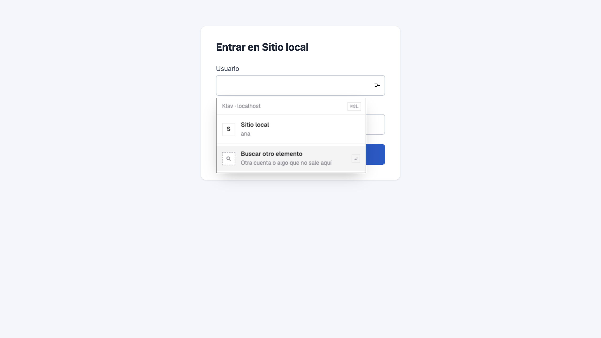

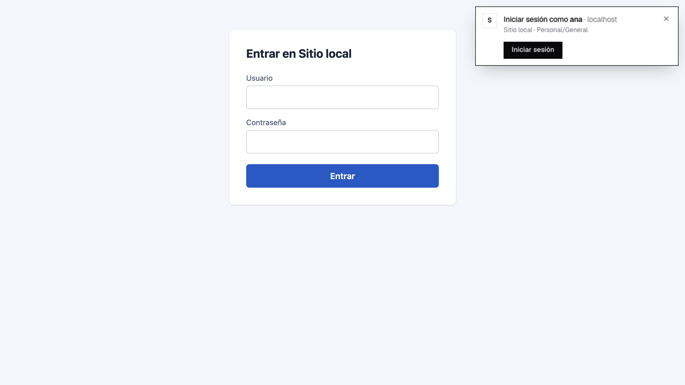

## 9. Klav's search

1. On <http://localhost:8766/entrar>, click outside the fields and press
   **⌘⇧L**. **Expected:** in the center of the page, over a dark veil,
   "Search for a login…" with "On localhost: Sitio de prueba" first.
2. Choose "Sitio de prueba": the form is filled and the search
   closes.
3. On <http://127.0.0.1:8766/entrar>, open the field's menu and press
   "Find another item". Type `prueba`: "Sitio de prueba" shows under
   "Other logins", with `localhost` on the right.
4. Choose it. **Expected:** nothing is filled yet. "Fill
   Sitio de prueba on 127.0.0.1?" shows, with "The login is for localhost" and "You’re about to
   type on 127.0.0.1", and "They don’t match".
5. "Back" returns to the list without filling. Repeat and press "Fill on
   127.0.0.1": now it does fill. That is how the confirmation works for a
   site that doesn't match; on a real site, think twice.
6. Esc or a click on the veil closes the search.

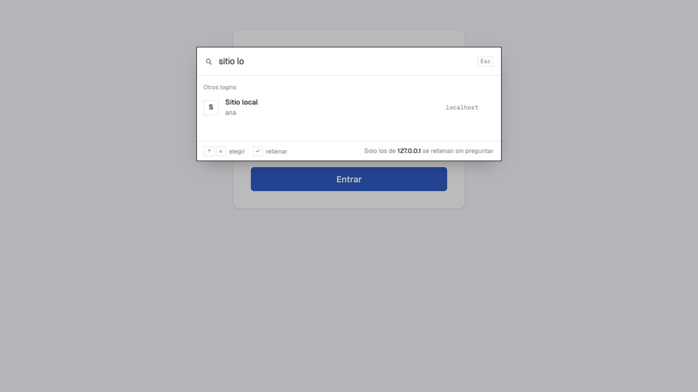

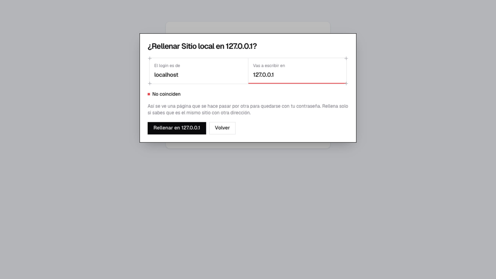

## 10. Card and address

1. <http://localhost:8766/pago>: click "Número de tarjeta" and the key.
   - **Expected:** "Cards: Visa", with `•••• 1111` below.
   - Choosing it fills the cardholder, the number, the expiry (`12/30`)
     and the security code.
2. <http://localhost:8766/envio>: click "Nombre" and the key. **Expected:**
   "Addresses: Casa". Choosing it fills everything, including "México" in the
   country list.

## 11. One-time code after the login

1. Open <http://localhost:8766/entrar-2fa> and fill "Sitio de prueba" from
   the menu.
2. Press "Entrar": the next page asks for the code and has the focus on its
   field.
   - **Expected:** Klav's menu opens on its own, with "One-time
     code: Sitio de prueba" first.
   - **It doesn't type anything until you choose it.**
3. Choose it: a 6-digit code is typed. Compare it with
   `klav totp "Sitio de prueba"`.

Here the person submitted the form, so Klav waits for the click. When it is
Klav that follows the steps (step 12), the code goes in on its own.

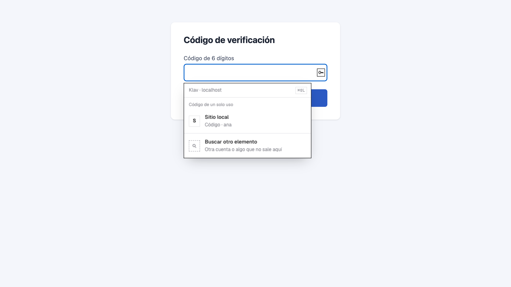

## 12. Sign-ins in several steps

As at Apple, Google or Microsoft: first the email and "Continue", then the
password. After the login is chosen, Klav follows the steps and presses the
buttons.

1. <http://localhost:8766/pasos>: choose "Sitio de prueba" in the menu of
   "Correo". **Expected:** the email is typed, Klav presses "Continuar", the
   password appears, Klav types it and presses "Iniciar sesión". The page
   says it received `username` and `password`.
2. <http://localhost:8766/pasos-navega>: the same, but the password is on
   another page of the same site.
3. <http://localhost:8766/pasos-marco>: the password appears in a box
   from `idmsa.localhost`, another subdomain. **Expected:** it is filled too and
   the box says what it received.
4. <http://localhost:8766/pasos-marco-ajeno>: the box is from `127.0.0.1`,
   another site. **Expected:** Klav doesn't type the password there. After about
   10 s, the menu opens on "Correo" with "The password is asked for in a frame
   of another site…".
5. <http://localhost:8766/pasos-2fa>: after the password, the page asks for the
   code in six boxes. **Expected:** Klav types one digit in each
   box and presses "Verificar".
6. <http://localhost:8766/pasos-captcha>: there is a "No soy un
   robot" checkbox. **Expected:** Klav types the email, presses nothing and the menu
   says "The page wants to check you’re a person…".
7. <http://localhost:8766/pasos-sin-clave>: the password never appears.
   **Expected:** after 10 s the menu says "Klav filled the username, but the
   password never showed up…". Klav doesn't retry.
8. **Only fill, don't press:** in the *popup*, the gear next to
   "Lock" opens "Settings". Turn on "Only fill, don’t press" and repeat
   point 1: Klav types the email but presses nothing. Press "Continuar" yourself:
   Klav types the password, and you press "Iniciar sesión" yourself too.
9. With the setting on, choose the login on `/pasos` and type a letter in
   "Correo" before pressing "Continuar": Klav stops following the steps and the
   password stays empty. Turn the setting off when you're done.

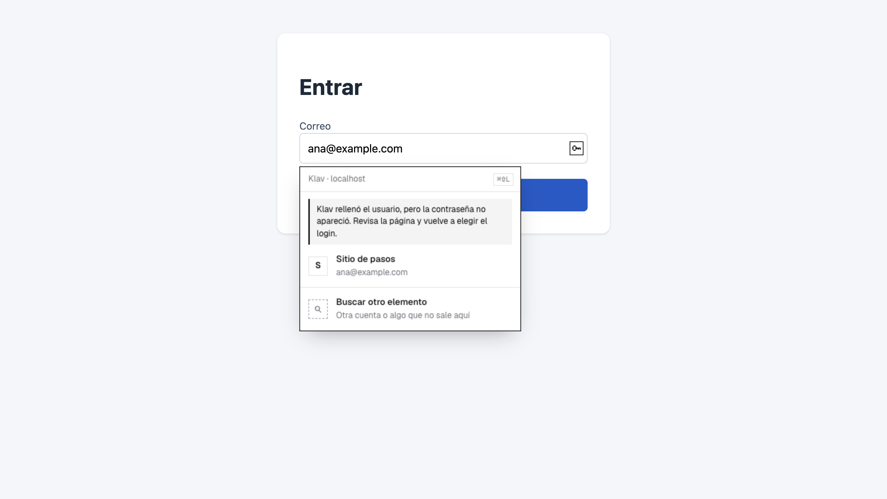

## 13. Saving and updating a login

1. On `/entrar`, type `nuevo` and `una-clave-de-prueba` by hand and press
   "Entrar".
   - **Expected:** at the top right "Save this login to
     Klav?" appears with "nuevo · localhost" and the title `localhost`.
2. Set the title to `Sitio de prueba` and press "Save". **Expected:** "There’s
   already a login with that title…": titles are unique within each project.
3. Change the title to `Sitio de prueba (nuevo)` and save. **Expected:**
   "Saved to Klav: Sitio de prueba (nuevo)", and `klav item ls` lists it.
4. Go back to `/entrar`, type `nuevo` with **another** password and submit.
   **Expected:** "Update the password of Sitio de prueba (nuevo)?". Press
   "Update".
5. Repeat with the same password: this time Klav offers nothing, because it already
   has it.

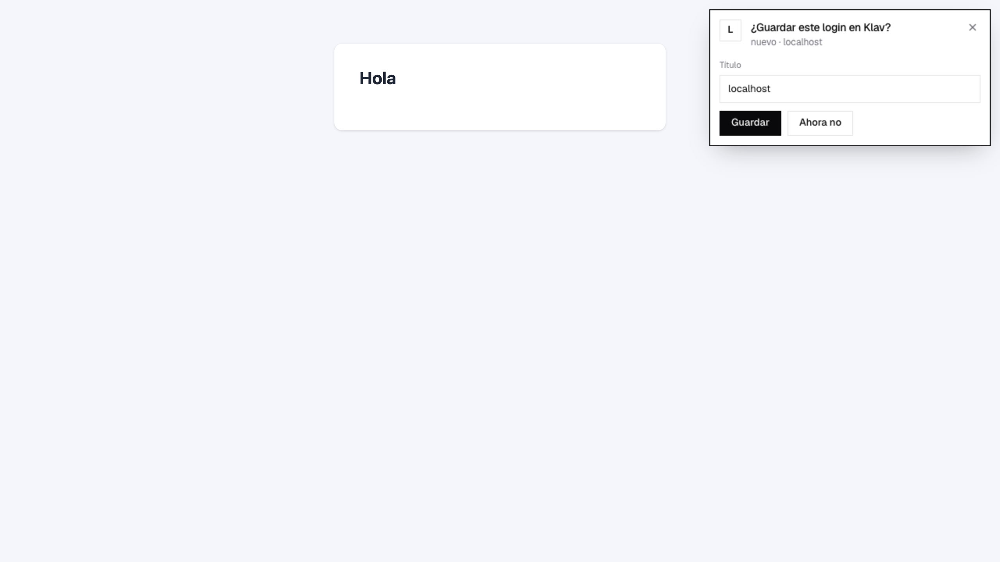

## 14. Generating a password

1. <http://localhost:8766/registro>: type an email and click
   "Contraseña" and Klav's key.
   - **Expected:** at the top of the menu, "New password" with a
     20-character password, "Another" and "Use this password".
2. "Another" changes the suggestion. "Use this password" types it into
   "Contraseña" and "Repite la contraseña".
3. Press "Crear cuenta": the bar offers to save it. Save it with the title
   `Registro`, and check that it matches
   `klav item get klav://Personal/General/Registro/password --reveal`.

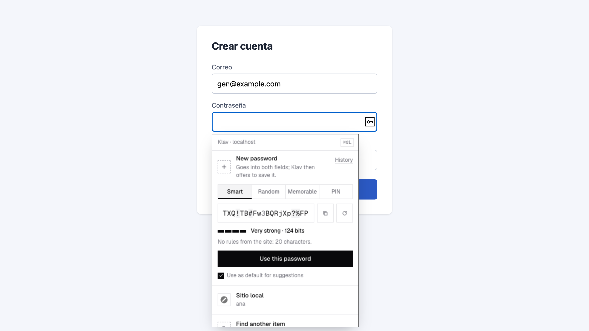

## 15. The *popup*: viewing, copying, filling and settings

With <http://localhost:8766/entrar> open, press the Klav icon in the
toolbar.

1. **On localhost:** "Sitio de prueba" appears with "Fill" and, below it, its
   one-time code in pixel type with a blue bar of blocks that
   loses one per second.
   - Press **⌘C** (with no text selected): "Copied…" appears and the code
     is on the clipboard.
   - "Fill" closes the *popup* and leaves the page filled.
2. **Searching and viewing:** search for `Sitio` (or press `/` to go to the search) and
   open "Sitio de prueba".
   - **Expected:** the username in view, the password covered by gray
     noise (not dots), the large code with its bar, the site and the
     reference for agents.
3. "Show" dissolves the noise on the password and "Hide" covers it
   again.
4. "Copy" on the password: "Copied. Klav will clear it from the
   clipboard in 30 s." appears.
   - Paste anywhere: it's there.
   - Close the *popup*, wait 30 s and paste again: the clipboard is
     empty.
5. "Copy" on the code copies the 6 digits.
6. Esc or "‹ Your vault" goes back to the list.
7. **Settings:** the gear opens "Only fill, don’t press" (step 12) and the
   list of shortcuts. Esc goes back.
8. Switch the Mac to dark mode: the *popup* and what Klav draws on
   pages change with it.

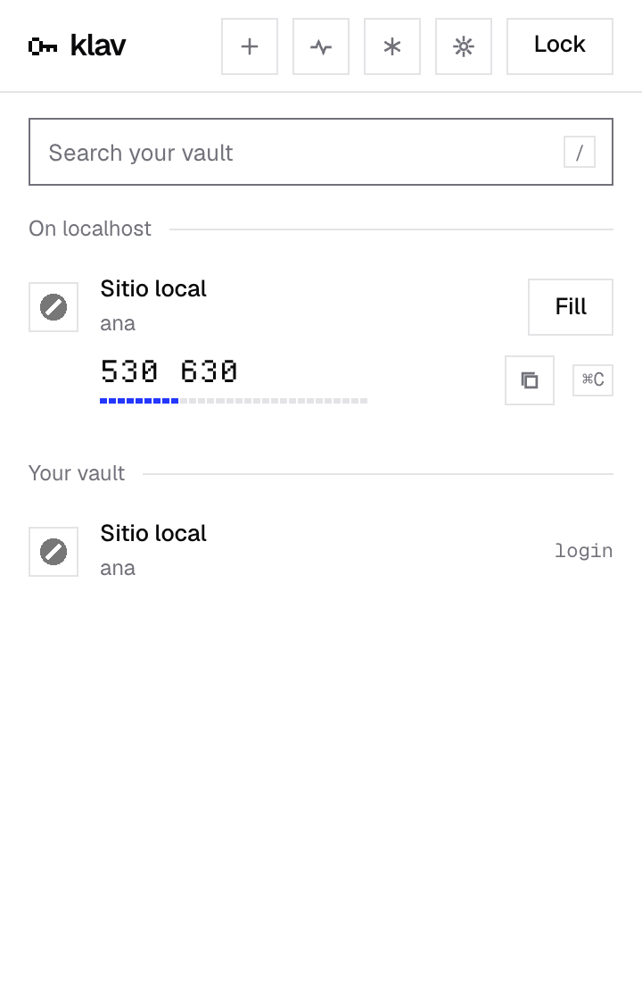

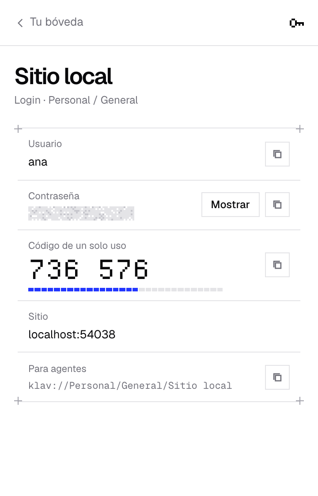

## 16. An agent fills the tab

Register an agent and approve it with `fill` in ask mode:

```sh
klav agent register --name prueba --key-store file
klav agent approve prueba --project Personal/General --ask fill
#   compara las 6 palabras y responde "y"   [Touch ID]
```

`--key-store file` keeps the agent's key in `$KLAV_HOME` instead of in
the keychain.

1. Leave <http://localhost:8766/entrar> as the active tab of the browser
   you are testing, and in **T3**:

   ```sh
   klav agent fill "klav://Personal/General/Sitio de prueba" --extension --agent prueba \
     --reason "probar la extensión" --wait 2m
   ```

2. **Expected:** the terminal waits for your permission.
   - Open the *popup*: at the top, with a blue pixel band, "prueba is waiting
     for your permission" and "Wants to fill **Sitio de prueba** on localhost", with the
     reason.
   - **[Touch ID]** "Approve".
3. **Expected:**
   - the tab is left filled and, at the bottom, full width, "Klav filled
     this page for prueba" appears in blue, with the reason;
   - the terminal only prints the names of the fields, **never the
     password**;
   - `klav log` shows the `fill` with the reason.
4. **Look-alike site:** switch the tab to <http://127.0.0.1:8766/entrar> and
   repeat the command. **Expected:** it refuses before asking for permission, because
   the host isn't the item's. The tab doesn't change.
5. **Optional, with Claude Code:** connect `klav mcp` as in
   [`probar-hito-a.md`](probar-hito-a.md) §10 (with `KLAV_AGENT=prueba`) and
   ask "sign in on the tab I have open". The skill uses
   `fill_login` with `target: "extension"`.

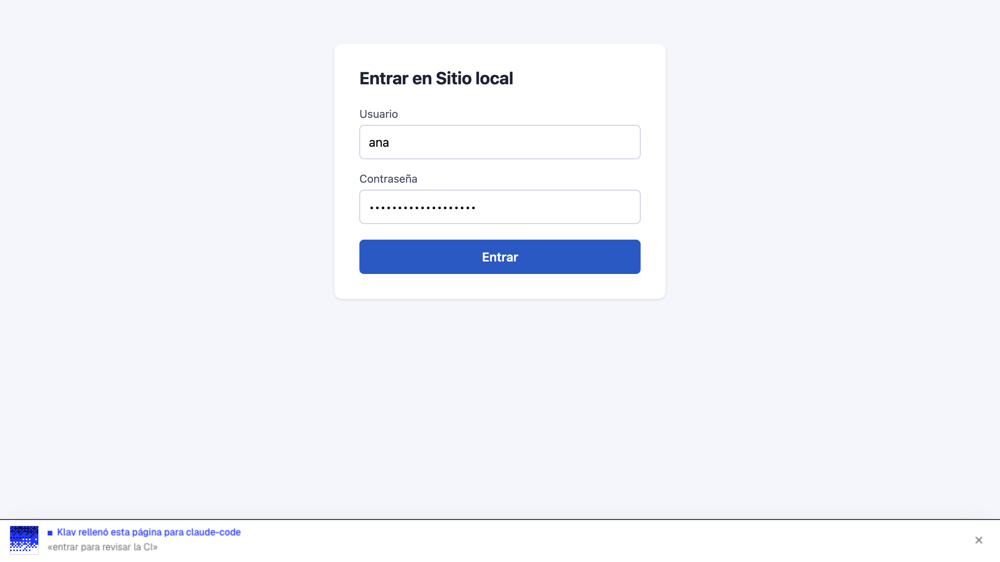

## 17. Locking

- `klav lock` in **T3**. On the page, the menu asks to unlock again; the
  *popup* too.
- Locking the Mac's screen (⌃⌘Q) locks `klavd`; on returning, the
  next use asks for Touch ID.

## 18. Cleaning up

```sh
klav extension uninstall-host --browser dia
klav lock --stop
```

- In Dia, remove the extension from `chrome://extensions` ("Remove").
- If you already used Klav in Dia, run `klav extension install-host` again
  with your usual `KLAV_HOME`.
- Close the Chrome window of the test profile.
- Stop the server (**T1**) and the site (**T2**) with Ctrl-C.
- Delete everything:

  ```sh
  rm -rf ~/klav-prueba-f5
  ```

## Common problems

| Symptom | What to look at |
|---|---|
| The *popup* says "This browser can’t talk to Klav" | `install-host` is missing for that browser, or you didn't fully restart it (⌘Q) |
| The *popup* stays blank or "Klav took too long" | The *host* doesn't start. If the binaries are on an external disk, copy them as in step 2. Look at `~/klav-prueba-f5/persona/klavd.log` |
| The key doesn't appear in a field | The page opened before the extension loaded: reload it |
| The menu or the card say "The page is covering part of this box" | Something on the page covers it (Chromium detects it). Use the *popup* or ⌘⇧L |
| A sign-in in several steps doesn't continue | Klav stops at a captcha, if the password takes more than 10 s or if you typed by hand. The menu says which it was; choose the login again |
| The sign-in card doesn't show | It only shows with Klav unlocked, on a page with a matching login, and doesn't come back in that tab if you closed it or typed |
| Touch ID doesn't appear | `klav status`: Touch ID is enrolled on the first `unlock` with the password |
| The agent says there is no browser | The extension isn't hooked up: open the *popup* once, or restart the browser |
